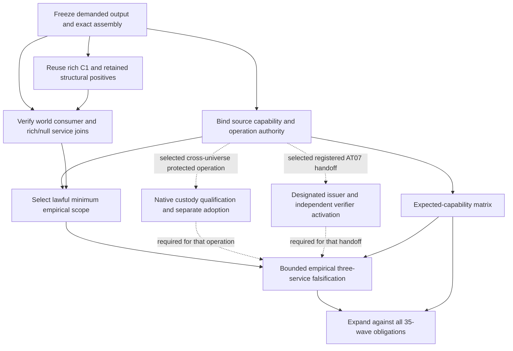

# P2 verified refinements — proposed path pending P3

V1–V8 are complete at documentary/static grain; the inherited P1 dependency model below is historical/provisional where these refinements apply. P3 must choose the final prescription after a human model switch. No future commission is dispatched.

| Verified P2 result | Implication for future commissioning |
|---|---|
| V1: selected N9→N10W assembly and demanded response receipt remain unbound; real I4 release assembly exists | D1 first pins exact demand/assembly. Do not infer a missing implementation or commission a new container from bounded search absence. |
| V2/V5: rich C1 and HQ168/HQ214 local joins are adopted; scalar wrapper remains restricted; selected service/replay bridge unbound | Reuse accepted machinery. D2 tests the exact rich/null consumer bridge only after D1 names it; preserve AT17 and selective owner-driven invalidation. |
| V3: C1-03A conserves null/refusal states, but inspected provider does not serve null products | Freeze demanded state semantics and authentic provenance. ZERO_SUPPORT is not VALID_EMPTY; lawful typed non-invocation is not blanket world-service completion. |
| V4/V7: EVS1990/2008 are physical candidates only; competent pair products/authority missing; most of 280 source/function expectations unknown | D3 binds exact support, operation and authority before selecting the minimum empirical set. Retained SRC02 GT2 contributes local context only. |
| V6: AT07 is unissued and scoped to source-free AT07_BIDIRECTIONAL_100; this Mac lacks independent verifier control | D5 is conditional topology/designation work. No universal issuer gate or second-account independence inferred. |
| V8: exact R3 leak and unimplemented T1/TCB remain, with no independent runtime qualification | D4 distinguishes narrow exact-R3 memory evidence from future integrated production security qualification. Native security is mandatory wherever selected protected operations consume it. |

All five envelopes under final/proposed_commissions are proposals, including exact review/stop boundaries and A–G qualitative priorities. Local accepted proof, selected-service integration, source occupancy and full PRE-V3 completion remain distinct. P2 does not establish a complete competent empirical minimum, a shortest measured schedule, a universal three-anchor law or 35-wave readiness.

## Preserved P1 dependency hypothesis

# Critical path — P1 hypothesis for falsification

**Baseline:** HQ249, control `a3d44f554e4e4fa01223679035599019ae2de527`, packet `feff06d43428efa767ce6823f693ca5361767332`. **Status:** P1 prescription hypothesis, not HQ adoption, dispatch or P3 final verdict. P0 historical seed remains in Git at `fe7493ca61c058cbccb30c02425ed1032f986c4f`.

The highest-value next step is to establish an exact demanded world/service response and prove its missing joins using accepted producers. Continuing infrastructure repair alone is insufficient: N10E R1 has an explicit scalar boundary, the inspected composition omits F8 invocation on non-SUPPORTED facts, and source eligibility/context admission does not itself define world-conditioned probability use. These findings do not authorize bypass of security or issuer requirements.

## 1. Evidence dependency DAG

D can be locally verified on competent inputs while C/required infrastructure remains unresolved. F waits for **all prerequisites actually consumed by its chosen operations**, including source execution permission. Arrows do not imply those operations are already authorized or implemented. Independent work streams are recommendations for later commissioning, not launched workers.

## 2. Ranked work units and exact exit conditions

| Order / unit | Why it matters now | Required input → exit witness | Dependency classification |
|---|---|---|---|
| 1. Exact service/assembly proof | Avoid fixing a historical implementation or a prerequisite for a consumer never selected | Pin accepted owner revisions, route, use, output and selected runtime assembly; locate current consumer/adoption receipts | Universal to this evidence claim, not a new global architecture phase |
| 2a. Rich/null service continuity | Existing analytical capability exceeds scalar wrapper; empirical negatives must survive | Reuse rich C1 positives; demonstrate cumulative conditioners, minority/joint/lineage conservation, real typed null consumer path and replay | Local competent-input proof can proceed without new native/issuer deployment; operational scope still needs its own authority |
| 2b. World operation/serving | An admitted source list or GT2 context is not a world-conditioned response | Exact context/eligibility/conditioning/transformation roles; source-indexed structural contributions; use/currentness/replay at actual consumer | Can specify and locally test consumer on competent products; no universal container required |
| 2c. Source-capability selection | Prevent missing products from being laundered as source N/A | Source-document/retained-product expected-capability rows, exact comparability/universe identities and necessary permissions | Parallel documentary work; no raw source execution here |
| 3. Required operational edges | Make the selected empirical proof lawful rather than nominal | Close only the native/issuer/authority/assembly gaps the selected operations actually consume | Conditional but mandatory when selected; no assumed bypass |
| 4. Minimum empirical demonstration | First credible practical social functionality | Governed source/retained evidence feeds all three demanded service families with consumed outputs and falsifiable contrasts | Waits on selected competent inputs, current consumer and exact scope authority |
| 5. Full 35-wave estate acceptance | Test generality and disclose every outstanding obligation | Expand declared F1–F8 source/function cells; classify failures independently and route narrow fixes | A bounded canary does not close this program |

No duration estimates support a mathematically shortest elapsed-time schedule. This is the smallest supported dependency hypothesis and a ranking by likely reduction of major uncertainty. P2/P3 may retract it.

| Proposed lane | A: dependency criticality | B: productive gain | C: confidence | D: intelligence | E: independent qualification | F: concurrency | G: falsification power |
|---|---|---|---|---|---|---|---|
| Rich/null service continuity | Required for demanded rich/null output; exact alternative route to check | Actual information reaches consumer | High route restrictions; gap scope provisional | Sol verification/implementation; Astra only unresolved semantics | Exact positive, null, hostile and replay witness after changes | Parallel with world/source work | High: exposes flattening or refusal-only completion |
| World operation/serving | Required for world-conditioned service | Coherent usable response with governed meaning | Medium: current full witness not established | Sol exact owner tracing; Astra consequential meaning/authority fork | Independent consumer/use/currentness review | Local proof need not await all estate inputs | High: distinguishes context decoration from actual operation |
| Source capability/input binding | Required before empirical truth claim | Competent inputs and correctly classified expected products | High requirement; selected support unknown | Sol document/evidence mapping | Independent source-grounded N/A and authority check | Parallel with consumer development | High: can disprove chosen minimum or claimed completion |
| Protected native path | Mandatory when selected operation consumes boundary | Trustworthy temporal authority decision | High conditional edge, empirical necessity unresolved | Capable native engineer plus independent reviewer; Astra only TCB fork | High: exact integrated candidate, positive and hostile runtime/security burden | Separate from source-local capabilities | High for trust claim; cannot prove whole service alone |
| AT07 operational issuer | Mandatory for exact registered handoff | Genuine registration at bounded fixture scope | High scoped requirement, global role unproved | Human/competent trust owner; Sol exact contract verification | Independent verifier/topology and HQ activation | Conditional lane; no global serial prerequisite established | High for custody, limited for rich/estate functionality |

## 3. Infrastructure edges that must be preserved

**Native F7-RR-04G:** selected cross-universe temporal candidate → exact P07 adjudication/custody → required secure implementation and independent exact-candidate qualification → separate HQ integration/adoption. R3 remains partial, owner construction leak open, T1 unbuilt. Repairing the leak is not trusted ingress; a top-level pinned helper does not close transitive mutable globals. An eventual exact native qualification must cover the actual integrated P07→F7 path, both genuine positives and in-scope forgeries. This audit neither performs that review nor specifies every repair as prerequisite to unrelated source-local analytical proof.

**AT07 registered issuer:** exact consumer need → supported distinct verifier-control topology/competent designation → owner/root proposal → distinct HQ root approval → owner install → independent verifier ACK → distinct epoch activation, with further model/use adoption where required. Current source-free warrant covers AT07_BIDIRECTIONAL_100 only; it cannot authorize all empirical service scopes. No direct-registration shortcut, credential issuance or local security change follows from this audit.

**Real source gate:** competent retained evidence may be reused only at its existing authority/use grain. New raw source execution requires its distinct current warrant and exact source/measurement/routing/denominator/comparability closure. An expected capability is not a predetermined empirical value or permission.

## 4. Three cases that determine the empirical critical path

| P2 result | Consequence |
|---|---|
| Lawful retained inputs and an already-adopted route cover the minimum service demands without the held native/AT07 edges | Prioritize rich/null/world integration and run only under the existing exact permissions. Retain separate unresolved full-estate/security obligations. |
| Actual selected temporal wave identities invoke the protected P07 path, or selected handoff necessarily consumes the AT07 issuer | That edge belongs on the empirical critical path. Continue local consumer and source-capability work concurrently; empirical completion waits for competent adoption. |
| No competent retained set/current authority covers the demands, irrespective of infrastructure | The first empirical blocker is exact source/operation authority or missing input occupancy. Name and commission that narrow prerequisite later; do not claim a synthetic prototype is the empirical minimum. |

A same-universe branch in candidate code is not proof case 1 applies to real waves. A successful AT07 installation is not proof case 2 solves real-source service breadth. P2 must distinguish these cases before P3 selects a final route.

## 5. Minimum credible functional program vs full estate

1. **Local proof:** competent fixtures establish stage ability, including minority/joint/recursive/empty/noncomparable and selective replay behavior. No empirical-world completion claim.
2. **Minimum empirical functional proof (proposed):** choose a bounded, justified source set that covers all three demanded service families and the corresponding F1–F8 obligations. Reuse GT2 only for its adopted local context. Supply other structural, source-indexed, temporal and progressive-service inputs only with actual support and authority. A useful smaller single-source demonstration may be an intermediate milestone, but does not close the multi-source/temporal demand.
3. **Full acceptance:** discharge all relevant 35-wave source/wave/claim/function cells. Do not turn source-local successes into blanket gate closure; do not demand unsupported positive empirical effects. Faithfully produced null/weak/no-change results may satisfy a cell; machinery refusal alone cannot.

Expected-capability row design: source/wave and physical identity; function/claim/use; evidence of intrinsic support; owner and exact input contract; expected **product class**, not result value; authority/readiness; producer; positive/null artifact; consumer; replay/currentness; local/integrated/estate status; source-intrinsic N/A rationale where applicable; blocker owner and falsifier. P2 must populate from exact existing source documents, leaving unknowns explicit. P1 invents no source-level expectations.

## 6. Stop/defer hypotheses with reopening triggers

| Stop or defer | Evidence for nonessentiality at present scope | Reopen only when |
|---|---|---|
| Automatic next native/issuer repair wave before service proof | HQ249 expressly stops recursion; H1/H2/H7 show independent unresolved joins | Exact selected output consumes that prerequisite and intended productivity gain is named |
| Rebuilding generic C1 predictor/fork/joint machinery | H4 nontrivial accepted/tested-source paths already reach a consumer | Exact narrow conservation/runtime test fails |
| Treating every empirical co-travel as needing special semantic relation/J2I work | HQ125 and H4 empirical-grade positive without that authority | Selected interpretation/product-family contract actually requires it |
| Reopening GT2-specific V555 or rerunning accepted local GT2 context by default | HQ227/HQ235 scoped N/A/acceptance; no changed relevant evidence shown | Changed claim/source/owner or exact contrary evidence |
| Universal world container, universal pooling law, universal three-anchor/time-grain choice | HQ203 rejects these as automatic requirements | Concrete demanded operation exceeds adopted forms or exact law requires the property |
| New broad architecture atlas or blanket estate reread on Astra | Banked lineage plus bounded changes already identify narrow questions | A specific high-consequence contradiction cannot be resolved by exact owner evidence |
| Counting green refusal totals as empirical completeness | HQ216 requires intended products and independent N/A/null classification | Never as a substitute; only relevant exact cell evidence changes status |

These are prioritization proposals, not retirement of mandatory controls or functionality. P3 must arbitrate against P2 disconfirmation.
