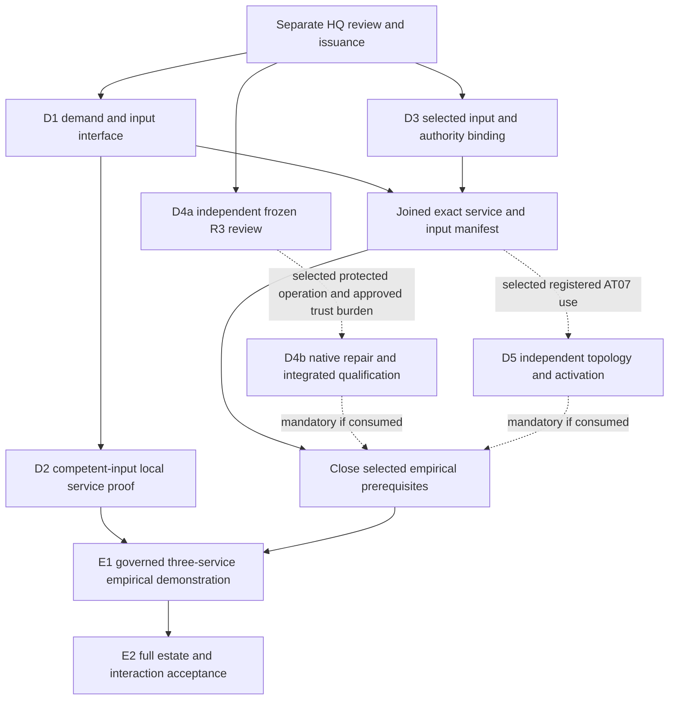

# Final dependency path and parallel work

P3 prescription for separate HQ review. No work issued. Exact evidence and counterevidence: [A1–A9](../phases/P3_ARBITRATION.md). This orders necessary evidence and owner work; no measured effort or shortest-duration theorem is asserted.

## Stage 1 — freeze the output and interface, resolve inputs concurrently

D1 first fixes the three service demands and their operation/input interfaces: progressive positioned possibility, rich predictor/fork/joint use and coherent distinct-source/temporal world use. Specify which world fields are context, source eligibility, empirical conditioners or authorized transformations. Name actual producer/consumer revisions, release route and promised current/as-of behavior. A required but absent contract gets one exact owner decision and smallest implementation/proof terrain.

D3 concurrently binds only the source/claim/use obligations needed for this candidate minimum. Start with retained GT2 at its existing grain and the documented EVS pair candidates; do not assume physical candidates are competent. Use exact evidence to name products, scope/measurement/time/risk/design/weights, current releases and positive comparison/use authority, or output exact warranted production/authority prerequisites. Preserve the whole 35/280 ledger without requiring every cell to be solved first.

These lanes join at a versioned execution-preparation manifest. Their shared dependency is an agreed input interface, not each other's completed report. Two different writers must not independently redefine it. HQ/integrating owner freezes one joined version; downstream qualifications bind that version.

In parallel, D4a independently reviews frozen R3 at its narrow quarantine grain. This is recommended now under HQ249's allowance and does not wait for D3. It cannot adopt native security or repair code. TCB dependency/threat inventory can be finalized alongside it; production-native changes wait for an explicitly accepted burden and exact candidate.

## Stage 2 — prove the selected local productive edge

D2 consumes D1's selected contract and competent lawful fixtures or already-accepted products. Prefer the accepted rich C1 path. First show whether that selected edge already meets the contract; issue/perform only the authorized narrow repair if it fails or is absent. A current accepted successful route requires a receipt, not an invented replacement implementation.

Preserve cumulative conditioner identities, minority/full joint information, ancestry, native negative states and the chosen release/currentness/replay promises. Separate independent review attacks productive behavior and loss. Local proof may finish while real source or operational prerequisites are held (HQ216 §4A); it never promotes estate occupancy.

## Stage 3 — close only prerequisites the empirical operations consume

| Prerequisite | Trigger | Required closure before dependent use | Work that remains orthogonal |
|---|---|---|---|
| Exact source/product authority | Intended real product or use is missing/unwarranted | Named source/measurement/model/temporal owners, exact products/current releases and separate source warrant if new execution is required | D1 contract work, competent-fixture D2 proof, frozen R3 review |
| Protected P07 native path | Selected operation requires cross-universe protected positive adjudication | D4b repaired memory/GC/OOM, accepted TCB/ingress contract, API parity, actual integrated hostile/positive court, independent FINAL candidate review and distinct HQ adoption | Unrelated source-local products and D1/D3 documentary work |
| Registered AT07 handoff | Selected handoff consumes the adopted AT07 warrant | D5 competent owner/topology, root proposal → distinct approval → install → independent ACK → distinct activation; exact subsequent model/use authority | Unrelated local C1/service proof and native review |
| World/temporal meaning | Selected operation or interpretation exceeds adopted authority/forms | Exact competent owner decision and positive consumer/rule evidence at selected scope | Other already-competent product lanes |

Different operational universe keys cannot be relabeled to evade P07. Missing authority cannot be converted into NONCOMPARABLE. An alternative route removes a dependency only through its own adopted contract and evidence. The fixture-specific issuer cannot authorize rich real-survey uses.

## Stage 4 — minimum real-source demonstration, then estate expansion

E1 executes only after the joined manifest has all actual dependencies, permissions, adopted candidates, independent expected-result/oracle identities and exact consumer receipts specified. It must populate all three demanded service families with governed respondent-backed products, preserve rich information and produce a competent comparable-wave result reaching structural/world use. Weak/no-change is a valid result where faithful; refusal-only execution is not the demonstration.

E2 expands against all relevant 35-wave source/claim/use cells and pair/composition edges, with source-grounded applicability and complete classification. E1 is a bounded functional milestone, not project-wide PRE-V3 completion. The P2 matrix's UNKNOWNs remain open until grounded; no count of sources, passes or refusals converts them into success.

D4a need not become a serial gate to unrelated E1 branches. D4b can be prepared before final D3 selection if separately commissioned for independent value, but its production need is neither presumed global nor retired. A source-free demonstration can remain useful if empirical occupancy is blocked; label that achieved scope exactly.

## Collision and model discipline

- D1/D3 work in distinct documentary return directories over one explicitly versioned interface; one integrating owner resolves conflicts.
- D2 is one writer for its named C1/service owner subset. If a selected source prerequisite also modifies those owners, serialize changes or freeze a common successor before independent qualification.
- Native baseline review is read-only on frozen R3. Native repair/T1 construction are separate exact branches/commissions with one coordinated owner; never merge stale C blobs concurrently. Review final changed code anew.
- Topology/authority approval is a human/competent-owner responsibility; another model or account is not independence evidence.
- Use Sol High or equivalent for bounded mapping, implementation and documentary verification; capable native/runtime specialists and a different reviewer for native work. Reserve Astra for exact consequential semantic/TCB disagreements unresolved by competent owner evidence. No automatic model changes or worker dispatch follows from this plan.
