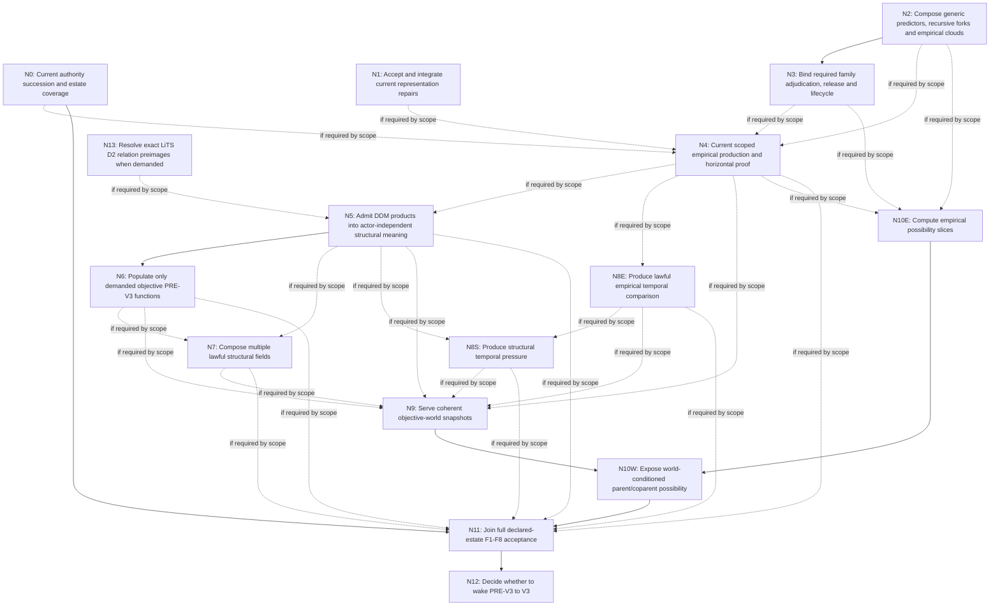

# Dependency DAG

[Start](README.md) · [Program](PROGRAM.md) · [Machine-readable nodes](data/nodes.json)

Solid edges are unconditional node prerequisites. Dotted edges are conditional on the exact selected scope/input. Read the node dossier before interpreting a dotted edge as a blocker. No edge grants execution permission.

| Node | Owner | Required nodes | Conditional edges | Court |
|---|---|---|---|---|
| [N0](nodes/N0.md) — Current authority succession and estate coverage | Source-semantic, measurement, routing and comparison owners | Exact inputs/authority |  | [C2](commissions/C2.md) |
| [N1](nodes/N1.md) — Accept and integrate current representation repairs | Physical decoder, codec and governed-facade owners | Exact inputs/authority |  | [C3](commissions/C3.md) |
| [N2](nodes/N2.md) — Compose generic predictors, recursive forks and empirical clouds | EE04/06/07/08 analytical producers and exact query/discovery owners | Exact inputs/authority |  | [C1](commissions/C1.md) |
| [N3](nodes/N3.md) — Bind required family adjudication, release and lifecycle | M1 substantive-rule owners, M2, B5 and I4 | [N2](nodes/N2.md) |  | [C1](commissions/C1.md) |
| [N4](nodes/N4.md) — Current scoped empirical production and horizontal proof | Route-B production and competent empirical owners | Exact inputs/authority | [N0](nodes/N0.md): Current authority for this scope is not already competently bound.; [N1](nodes/N1.md): Selected source/path requires one of the physical repairs.; [N2](nodes/N2.md): Claim includes composed analytical functionality.; [N3](nodes/N3.md): Selected product family requires learned adjudication/release. | [C4](commissions/C4.md) |
| [N5](nodes/N5.md) — Admit DDM products into actor-independent structural meaning | Field Forge and exact structural-rule owners | Exact inputs/authority | [N4](nodes/N4.md): Needed empirical product has not already been supplied by competent retained evidence.; [N13](nodes/N13.md): Selected LiTS relation use requires D2 preimages/instantiation. | [C5](commissions/C5.md) |
| [N6](nodes/N6.md) — Populate only demanded objective PRE-V3 functions | Position, context, opportunity, mediation, topology and consequence producers | [N5](nodes/N5.md) |  | [C5](commissions/C5.md) |
| [N7](nodes/N7.md) — Compose multiple lawful structural fields | EE12/13, field composition and objective-world owners | Exact inputs/authority | [N5](nodes/N5.md): Required structural fields are not already competently available.; [N6](nodes/N6.md): Composition consumes a demanded downstream objective product. | [C6](commissions/C6.md) |
| [N8E](nodes/N8E.md) — Produce lawful empirical temporal comparison | EE12 comparison and empirical analytical owners | Exact inputs/authority | [N4](nodes/N4.md): Required exact wave products are not already competent retained inputs. | [C7](commissions/C7.md) |
| [N8S](nodes/N8S.md) — Produce structural temporal pressure | Objective temporal and structural-rule owners | Exact inputs/authority | [N5](nodes/N5.md): Required structural inputs are not already competent retained products.; [N8E](nodes/N8E.md): Selected structural temporal claim consumes empirical temporal comparison. | [C7](commissions/C7.md) |
| [N9](nodes/N9.md) — Serve coherent objective-world snapshots | Publication, resolution, lifecycle and world-serving owners | Exact inputs/authority | [N4](nodes/N4.md): Its product family is required by this declared served-world scope.; [N5](nodes/N5.md): Its product family is required by this declared served-world scope.; [N6](nodes/N6.md): Its product family is required by this declared served-world scope.; [N7](nodes/N7.md): Its product family is required by this declared served-world scope.; [N8E](nodes/N8E.md): Its product family is required by this declared served-world scope.; [N8S](nodes/N8S.md): Its product family is required by this declared served-world scope. | [C8](commissions/C8.md) |
| [N10E](nodes/N10E.md) — Compute empirical possibility slices | EE08/14 analytical and possibility-rule producers | Exact inputs/authority | [N2](nodes/N2.md): Required analytical composition has not been otherwise proved.; [N4](nodes/N4.md): Required empirical inputs are not already competent retained products.; [N3](nodes/N3.md): Family release/adjudication obligations apply. | [C8](commissions/C8.md) |
| [N10W](nodes/N10W.md) — Expose world-conditioned parent/coparent possibility | EE14 positioned-subject service and competent model/use owners | [N9](nodes/N9.md) · [N10E](nodes/N10E.md) |  | [C8](commissions/C8.md) |
| [N11](nodes/N11.md) — Join full declared-estate F1-F8 acceptance | Competent HQ acceptance court | [N0](nodes/N0.md) · [N10W](nodes/N10W.md) | [N4](nodes/N4.md): Evidence required to discharge the corresponding declared F gate or scope.; [N5](nodes/N5.md): Evidence required to discharge the corresponding declared F gate or scope.; [N6](nodes/N6.md): Evidence required to discharge the corresponding declared F gate or scope.; [N7](nodes/N7.md): Evidence required to discharge the corresponding declared F gate or scope.; [N8E](nodes/N8E.md): Evidence required to discharge the corresponding declared F gate or scope.; [N8S](nodes/N8S.md): Evidence required to discharge the corresponding declared F gate or scope. | [C9](commissions/C9.md) |
| [N12](nodes/N12.md) — Decide whether to wake PRE-V3 to V3 | Competent downstream/HQ authority | [N11](nodes/N11.md) |  | [C10](commissions/C10.md) |
| [N13](nodes/N13.md) — Resolve exact LiTS D2 relation preimages when demanded | LiTS retained-product custody and competent relation owner | Exact inputs/authority |  | [C11](commissions/C11.md) |
