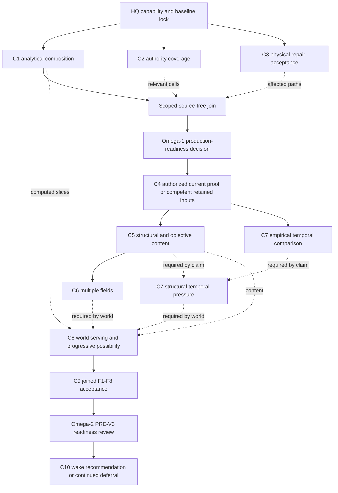

# Overall program through the PRE-V3 readiness gate

[Start](README.md) · [Original dependency DAG](https://github.com/maidiu/rawlsing/blob/b3b2fa13049513078c301a1f6574b661fcf390c5/PYAT_CONTROL_ROOM/ASTRA_PYAT_INTEGRATED_DEVELOPMENT_ATLAS_R1/DEPENDENCY_DAG.md) · [Final gate](13_PREV3_GATE.md)

The destination is a competent, served objective PRE-V3 world satisfying declared-estate F1–F8, followed by an explicit readiness decision about the later PRE-V3→V3 seam. Building actors, generated psyches or durable person change is beyond this program. This is rolling-wave planning: the first tranche is executable in detail; later stages are specified by inputs, products and acceptance, and refined using actual returned evidence.

Diagram edges summarize the audited DAG; they do not make every C4 execution or all C6/C7 content universal prerequisites. Competent retained inputs may satisfy specific input obligations without proving fresh production. C11 LiTS-D2 wakes only for an actual relation-preimage need.

| Stretch | Main work | Required result | Decision/authority limit |
|---|---|---|---|
| T0 | Capability profile, baseline, roster, fixture/oracle preparation | Executable assignments with exact identities | No fake runtime or agent capability |
| T1 | C1, C2, C3 source-free foundations | Independently reviewed analytical composition, explicit authority coverage/residuals, accepted current physical repair scope | Detailed in first-tranche specifications |
| Omega-1 | Evaluate actual T1 results against proposed next production scope | Written scoped go/revise/hold, required authority and warrant conditions, next stretch | First planned Astra decision; not automatic source permission |
| T2 | C4 exact current production and minimal horizontal proving set where needed | Current implementation/authority/source/oracle bound; result and retained reuse evidence at exact grade | Live work needs its own explicit warrant and suitable execution surface |
| T3 | C5 demanded structural/objective producers; conditional C11 | Positive structural contributions plus honest refusals; demanded position/context/opportunity etc. | Empirical success cannot manufacture structural or causal authority |
| T4 | C6 multiple fields and C7 empirical/structural temporal lanes | Source-separated composition and exact comparability/time evidence | No fabricated respondent joins or time semantics; C6/C7 need not wait on one another |
| T5 | C8 current/historical world serving and progressive possibility | Actual producers, computed slices, joined consumer, permission/currentness/replay closure | A primitive with supplied fixtures is not world occupancy |
| T6 | C9 declared-estate F1–F8 acceptance | Full claim/estate ledger, positive required world content and scoped unresolved work | No silent shrinking of mandatory scope |
| Omega-2 / C10 | Readiness of objective world and downstream interfaces | Explicit readiness recommendation or continued deferral with exact conditions | No automatic actor wake or actor implementation |

## After Omega-1

Browser HQ writes the next tranche only from the accepted decision and actual products. It may keep operating across T2–T6 without an Astra visit for every phase if it remains within the accepted scope and existing authority. Use exceptional escalation triggers when evidence changes the governing premise. Do not treat an Omega-1 go as permission to invent new model families or authorizations later.

Contract/fixture preparation for later serving or temporal functions can run earlier when it uses competent existing contracts and does not steal the critical-path worker. Actual live/structural/world proof waits for its own premises. Later work orders inherit original C4–C11 node and acceptance dossiers; they are not placeholders for another global audit.
