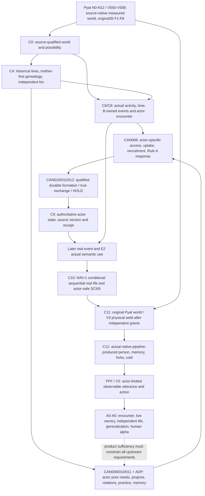

# RAWLSING / SOROK — TOTAL TRAJECTORY SPACE BEFORE CAMPAIGNS
## R1 START HERE | Working source-graded top view | 2026-10-28

**USER INSTRUCTION CONTROLS:** **Work OFF the existing program.** The canonical 19 C0–C12/A0–A5 milestones, Neo N01–N12 requirements, historic M01–M40, O01–O16 original questions, E01–E15 consumer edges, SYN02, Astra D09/D11/D18, actual Pyat N0–N12, Sorok 100/101 product and existing control/authority are the inherited intellectual and operational substrate. THIS workspace is a crosswalk/coverage question set, not a new architecture, set of milestones, HQ or reason to dispatch agents. Nothing here regrades the command JSON. No plan from this read-only candidate receives authority merely because it is elaborate.

### What is in this workspace (read in this order)

1. [01_EXISTING_COMMAND_REGISTER_19_12_16_15_AND_M40_CROSSWALK_R1.md](01_EXISTING_COMMAND_REGISTER_19_12_16_15_AND_M40_CROSSWALK_R1.md) — literal source-exact 19 completion milestones, 12 Neo requirements, 16 scientific decisions and 15 first-consumer edges from `COMMAND/02_CAPABILITY_REGISTER.json` at `a47dca7f29196b4da10451ca4f2dd047c99ed56a`, plus 40 inherited historic mechanism **families**, their later semantic jurisdictions and original-control document navigation. Not a new registry or atlas.
2. [02_TOP_LEVEL_PRIORITIES_AND_BLINDSPOTS_R1.md](02_TOP_LEVEL_PRIORITIES_AND_BLINDSPOTS_R1.md) — ranked TOP-LEVEL constitutive obligations, with every item tied to C/A, N, M, O, E, Pyat, Astra, Sorok product and actual first consumer; 11 distinct *types of attention*, 18 source-graded coverage-risk hypotheses, outstanding competent owner/user choices, and alpha/fidelity differentiation. Not dispatch orders.
3. [03_N01_N12_SOURCE_EXACT_PHENOMENA_AND_OPEN_QUESTIONS_R1.md](03_N01_N12_SOURCE_EXACT_PHENOMENA_AND_OPEN_QUESTIONS_R1.md) — direct-read all twelve existing Neo requirement README phenomena, unresolved questions, historic M candidates and proper prerequisite/owner distinctions. No newly issued human science.
4. [04_M01_M40_CODE_AFFORDANCE_PRESERVE_ADAPT_QUARANTINE_R1.md](04_M01_M40_CODE_AFFORDANCE_PRESERVE_ADAPT_QUARANTINE_R1.md) — all forty existing M README historic source functions and Neo gaps, with practical preserve/adapt/remove evidence; specifically recover the substantially working old V3 machine instead of redesigning it. No new atlas or current source execution.
5. [05_CROSS_SOURCE_COLLISIONS_NAMESPACE_AND_PRODUCT_RELEASE_CHOICES_R1.md](05_CROSS_SOURCE_COLLISIONS_NAMESPACE_AND_PRODUCT_RELEASE_CHOICES_R1.md) — scientifically and architecturally consequential noncollapses, apparent collisions, different Pyat/Sorok N11 namespaces, O16/SCI05 batch semantics and lab alpha vs native A5 claims.
6. [06_PYAT_NATIVE_WORLD_N0_N12_SOURCE_AND_WELD_FULL_TRAJECTORY_R1.md](06_PYAT_NATIVE_WORLD_N0_N12_SOURCE_AND_WELD_FULL_TRAJECTORY_R1.md) — Pyat's existing N0–N12, F1–F8, full estate, actual R157 scoped preparation and Sorok C0/C11/native seam; no treating Pyat as one external blocker.
7. [07_TERMINAL_PRODUCT_A0_A5_SOROK_100_101_BACKWARD_SUFFICIENCY_R1.md](07_TERMINAL_PRODUCT_A0_A5_SOROK_100_101_BACKWARD_SUFFICIENCY_R1.md) — live human-product acceptance A0–A5, charter, all ten bounded/fidelity options of 100, expressive/phenomenological 101, and source/science/engineering/participant evidence separation.
8. [08_ACTUAL_CURRENT_CODE_SOURCEGRAPH_HISTORICAL_REUSE_AND_FIRST_MISSING_EDGES_R1.md](08_ACTUAL_CURRENT_CODE_SOURCEGRAPH_HISTORICAL_REUSE_AND_FIRST_MISSING_EDGES_R1.md) — RA-A/S08/R3 grounded actual S39–S52 code chain, S50 old machine isolation, C9 reader/held memory/dry batch, existing imports, first missing psychology and current source-first consumers.
9. [09_DISTRIBUTED_EXISTING_CODE_AND_JOINED_SOURCEFREE_CONSUMER_ADJUDICATION_R1.md](09_DISTRIBUTED_EXISTING_CODE_AND_JOINED_SOURCEFREE_CONSUMER_ADJUDICATION_R1.md) — correction of S39-only undercoverage: BP2P4J actual sourcefree C8/C9/E2/C12/A0–A3 physical implementation, V2 B-first, R3 LIFE1/W01 native-entrypoint negative, R15 renderer code, status/science/authority distinctions and reuse implications.
10. [10_BRANCH_FAMILY_DISCOVERY_ROSTER_SEARCH_ONLY_R1.json](10_BRANCH_FAMILY_DISCOVERY_ROSTER_SEARCH_ONLY_R1.json) — 150 selected branch-name pointers across Codex S, rabochii R3/R15/V2/BP, SYN02 and HQ; discovery only, not 150 verified code or accepted implementations.
11. [09_EXISTING_BRANCH_CODE_DISCOVERY_CENSUS_R1.json](09_EXISTING_BRANCH_CODE_DISCOVERY_CENSUS_R1.json) — expanded **228 unique existing Sorok branch-name** query-scope coverage across seven fully paginated prefixes (including 65 reviewer and 24 Codex branches), 27 independently verified selected branch tips and B3/B3A author→review history. **Names are not 228 source-code acceptance reports.** Complements the earlier 150-name four-prefix roster; does not replace its frozen evidence.
12. [10_ALREADY_BUILT_B1_B2_B3A_REVIEWED_CODE_LINEAGE_AND_REUSE_MAP_R1.md](10_ALREADY_BUILT_B1_B2_B3A_REVIEWED_CODE_LINEAGE_AND_REUSE_MAP_R1.md) — exact V2 B1/B2/B3 developmental source/code and independent S3/X3 review; subsequent B3A refusal-atomic repair and B3AS independent `ACCEPT_SCOPED` schema/readset repair; R3 M01/C0P/G13/OUT12 and R15 RFA code inheritance. Read alongside 09's **BP2P4J physically joined sourcefree A0–A3 chain and seven severance edges**: these are DISTINCT already-built sourcefree positives, not competing invented milestones. Original CAN/ADP/native/human-person proof still withheld.
13. Existing primary [COMMAND/00_COMMAND.md](https://github.com/maidiu/rawlsing/blob/a47dca7f29196b4da10451ca4f2dd047c99ed56a/SOROK_PRODUCT_CONTROL_ROOM/COMMAND/00_COMMAND.md), [COMMAND/02_CAPABILITY_REGISTER.json](https://github.com/maidiu/rawlsing/blob/a47dca7f29196b4da10451ca4f2dd047c99ed56a/SOROK_PRODUCT_CONTROL_ROOM/COMMAND/02_CAPABILITY_REGISTER.json), and [COMMAND/03_COMPLETION_SEQUENCE.md](https://github.com/maidiu/rawlsing/blob/a47dca7f29196b4da10451ca4f2dd047c99ed56a/SOROK_PRODUCT_CONTROL_ROOM/COMMAND/03_COMPLETION_SEQUENCE.md) remain controlling derivative *execution* views with exact grade rules, currentness and update protocol; original CAN/ADP/Pyat/source and HQ authority outrank them.
14. Existing [V3_COURTS/02_ATLAS.md](https://github.com/maidiu/rawlsing/blob/a47dca7f29196b4da10451ca4f2dd047c99ed56a/SOROK_PRODUCT_CONTROL_ROOM/V3_COURTS/02_ATLAS.md), [07_USER_DECISION_LEDGER.md](https://github.com/maidiu/rawlsing/blob/a47dca7f29196b4da10451ca4f2dd047c99ed56a/SOROK_PRODUCT_CONTROL_ROOM/V3_COURTS/07_USER_DECISION_LEDGER.md), exact SYN02 S01–S09 at `321fa29bb3e51849a43cb7caf1600625bf215539`, Astra D09/D11/D18 and corrected mother-first 16 `3b2d9a1b644a9fa024ed1bd895b67be5c8789531`, product Sorok 01/100/101 remain first-class inherited documents.
15. The earlier applicant branch `RESEARCH_BRIEFS/00_INDEPENDENT_PRELIMINARY_SCIENTIFIC_ANSWER_AND_RISK_REGISTER_R1.md`, `SCI_P0_A_MAXIMAL_WHOLE_PERSON_FORMATION_R1.md`, `WORLD_P0_B_INDEPENDENT_OTHER_MATERIAL_LIFE_C8_R1.md` are **PARKED DETAILED CANDIDATES**, not the top-level program, not adopted commissions and NOT launched. They may be narrowed, combined, changed or rejected by the later full-coverage assessment; user has expressly instructed TOP VIEW FIRST.

### The entire actual product demand, graph in inherited names

Arrows are required conceptually, not a claim that the real native graph executes, nor a demand to serialize all preparatory work. Later C9→C10 events preserve actual world/actor writes and separate SCI05 aftercall rights. Original source, original actor, original science, independently accepted engineering and authorized human trial have DIFFERENT permissions.

### Highest-level areas of required attention (NOT new headings/IDs)

1. **C0/Pyat original world and data/source authority** — real surveyed structural capacity, historical temporal semantics and full all35, no original native N11/N12 evidence yet.
2. **C4/C6/C8 genuinely independent lives and material social reproduction** — actual other actors, mother-first genealogy, household and institutional work/care/time; real actor-access boundary; no introjected stereotype.
3. **C1/C2/C3/C5/C7 + N01–N10 source-qualified developmental science** — bodily need and motive objects, ordinary baselines and love, contradictory historical life, acquired practice vs external support, memory/reflection and ideological concepts; no universal Rule T shortcut.
4. **C9/C10/C12 reliable actor-history causality and time** — first actual semantic read/receipt, fork and replay, change vs legitimate unchanged, real N/N+1 with settled irreversible policy; test-only first, native later.
5. **C11 and native C12 actual physical Pyat weld** — original source plus actor/world-qualified consent/owner rights, first real generated person, independent C12.
6. **A0–A5 real product and encounter** — person not hand-authored seed, voice and actor limitations, absence/offscreen life, user action/phenomenal rights, actual relational consequence, generalization and release.
7. **All owners original science/rights, historical code inheritance, proof/economics and social risks** — source/semantic and respondent licensing, false universalism, human evaluation, paid/local Mac and orchestration readiness.

These overlap intentionally. A separate goal-first program launched around only item 3 would neglect item 1,2,5,6; a Codex-only program around item 4 would neglect the scientific product; a Pyat-only program around item 1 would leave actor life and human contact empty.

### How to judge whether the TOTAL workspace is really complete

- **COVERAGE:** each inherited C/A, N, M, O, E and Pyat/PFF/100/101 function is represented and no life/product domain silently excluded.
- **INHERITANCE:** each existing code, owner semantics, authority and source evidence used where actually relevant; no duplicative schema or re-opening closed architecture.
- **OPEN PROBLEM DEFINITION:** for every material unresolved function, explain exactly the required source input→operation→first actual consumer and the rival/no-change path. Open policy/user rights separated.
- **TYPE OF ATTENTION:** determine `scientific clarification` vs `original issuance` vs `code/adapter` vs `historical adaptation` vs `test/adversarial` vs `source/host permission` vs `product/user experience` vs `later fidelity` — not all need new agent.
- **INTERDEPENDENCE:** map causal prerequisites, parallel independent activity, ownership/grants and risk of premature adoption. Refuse false one bottleneck/theory as total finish line.
- **PRIORITY:** rank *impact on actual living human otherness*, feasibility/available accepted capital and cost of error, not number of passing files or number of research papers.
- **VERIFIABILITY:** exact SHA/callgraph for positive claim; sourcefree and qualified original studies separate; who can issue rule; real user trial not asserted; no self-certification.
- **MAXIMAL VISION, BOUNDED RELEASE:** full human/social/ideological complexity conserved while first evidence-rich individual/alpha can be bounded with honestly stated fidelity limits.

**R1 completion status (expanded again):** source-reconciled *nine interpretive maps (01–09) + one discovery-only branch roster (10)*. All twelve N READMEs and forty M READMEs were directly crosswalked at their historical science/test ceiling, then current code RA-A/S08/R3 and **additional actual BP2P4J/V2/R3 HQ319–320/R15 source** were incorporated. A physically executed L1 joined technical product already exists; do not mistake this for native CAN/ADP/Pyat/C11/C12 or A5. Two nonconflicting branch-name rosters exist: earlier four-prefix 150 and expanded seven-prefix 228. Only a selected subset of branch tips/source/independent reviews and actual BP2P4J/B3A code were directly inspected; neither count is a whole native-code acceptance census. Remaining unknowns: exhaustive acceptance and import/currentness of branch-distributed source, some existing R3/R15/V2 worker return outcomes, competent original rule/source issuance, true native empirical person and independent integrated runtime/human product validation. **No parallel Neo-V3 science rereview** is inferred or commissioned.

**Warning:** Actual project authority belongs to incumbent humans/HQs/source owners. This applicant has only documentary write rights to the isolated accession branch; cannot confer scientific or launch authority. Historical Browser HQ R3 appointment at `28e4a576abea5933b34bb6933612d8f5175580d3`; current PR509 foundation is draft. Do not silently move or merge any command.
