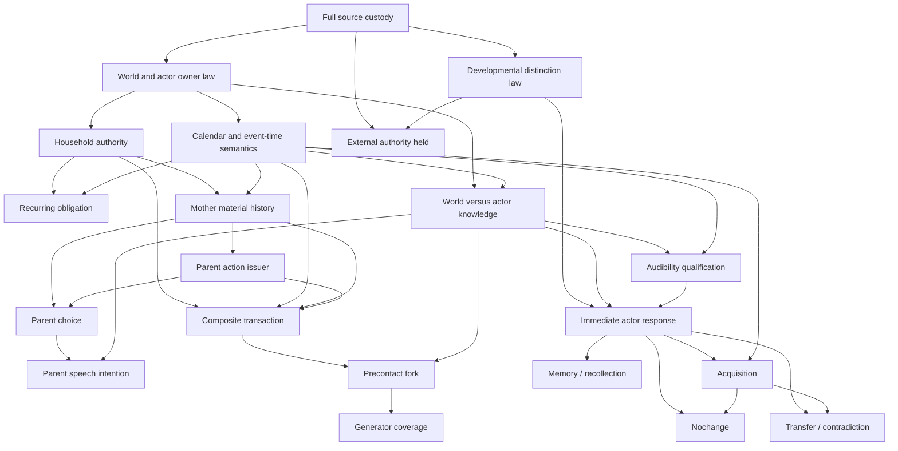

# PROGRAMMA SOROK — 27-task semantic labels and decision hierarchy (CG-B–G R1)

> **PROMINENT SOURCE-GRADED CANDIDATE — NOT ADOPTED.** This file adds a typed *decision dependency hierarchy* to the existing 27 implementation packets without replacing their actual task DAG or declaring new original PW/O/CAN/ADP rules. Exact machine-readable companion: [27 keyed task labels + 21 decision nodes](CG_B_G_TASK_SEMANTIC_LABELS_AND_DECISION_HIERARCHY_20261112_R1.json); supporting [25-issue audit](CG_B_G_ARCHITECTURAL_AND_SEMANTIC_ISSUES_TO_ADDRESS_20261112_R1.md). Original programme [#938](https://github.com/maidiu/rawlsing/pull/938) frozen at `08a323b490df4e2ddd0dca7f8b3cd394dfe17e0a`. The issue audit was frozen at `1022e827abcddbdd096752c3f4a70eabe1dad8fb`.

**Operating condition:** USER STOP AFTER PRESENT ASSIGNMENTS still applies to the Codex controller. This is **documentation and supervision preparation**, not a new agent dispatch, retry, relay, protected merge or source/science/person authority. Live returns and their correct source SHAs must be reconciled separately before upgrading any status.

## 1. What is newly classified

Every packet `B01–G04` receives two independent dimensions:

- **G / M / T implementation class:** **G (6)** grounded engineering against already-settled interfaces; **M (12)** engineering with architectural/representation decisions; **T (9)** operations whose core human-world behavior depends on substantive theory. These mark a packet's *highest risk*, not a prohibition on constructing its safe portions.
- **Five decision kinds:** `SETTLED_PROGRAMMA_LAW`, `BOUNDED_MODEL_CHOICE`, `EXECUTIVE_ARCHITECTURE_CHOICE`, `OPEN_SCIENTIFIC_MECHANISM`, `EXTERNAL_AUTHORITY_HOLD`. Multiple kinds can bind one task. Each task identifies (i) safe engineering available now, (ii) decisions required **before expanding beyond a fixture**, (iii) decisions/issuer qualifications required **before its full original claim**, (iv) actual original task dependencies and (v) SA-xx issue links.

An **original unissued psychological Rule T** blocks a claim to native acquisition, **not** an actual sourcefree store, honest fixture response, or tested replay. Conversely an unresolved household owner choice may legitimately block replacing a shared general J1 material ABI even if all its tests would be easy to write.

## 2. The missing hierarchy: prerequisites before decisions before implementation

**Do not create false dependency gates:** The 'full original capability' column means **unqualified downstream human/person-world generalization**, *not* whether a bounded sourcefree packet can receive scoped engineering acceptance. All 27 packets may close at their warranted sourcefree grade with genuine consumer/falsifier evidence and proper independent tranche receiving, even when listed scientific or executive generalization nodes remain held. In particular **C01 independent-actor registration does not require A04 mother's full employment history**, and **G04 scoped no-drop receiving does not require H01 native/human issuance**; H01 applies only to those higher claims.

The pre-existing **engineering DAG** states e.g. C03 depends on C02+B04; D03 depends on D02+C04; E01 depends on B04+C04+D03; E02 depends on E01+B05+C05+D04. Those dependencies are preserved exactly.

The new **semantic DAG** identifies which decisions can lawfully be reached *only after other decisions or governing source reconstructions*. It contains 21 acyclic nodes, arranged into prerequisite levels. Levels are a partial order, **not** 8 successive committee meetings.

| Prerequisite depth | Decisions or laws that become eligible once predecessors are established |
|---|---|
| 0 | `K00` Reconcile exact full Nov11 SOROK documents and original source/own |
| 1 | `K01` P2 objective world and existing time owner; P3 actor organization;; `K02` Separate opportunity, activation/inhibition, immediate response, d |
| 2 | `A01` Select actual household account, tenancy/controller and focal Nadi; `A02` Map calendar/as-of age and owner clock, require material condition; `H01` Original CAN/ADP Rules A/T, memory, Pyat source rights, independen |
| 3 | `A03` Choose recurring obligation cadence, due/partial/unpaid/discharged; `A04` Decide own mother employment/funding/care/energy and dated contrib; `A05` Qualify world/proposal context separately from actor-visible acces |
| 4 | `A06` Distinguish external/admin/harness commands from parent-owned choi; `A07` Choose minimal source-qualified audibility/exposure/attention for  |
| 5 | `S01` Parent practical selection across motives, projects, care, contrad; `S03` Actor-local immediate interpretation/appraisal, conditional recrui; `A08` Select ordered parent/market/world/P3 lock, rollback, event-keyed  |
| 6 | `S02` Parent's communicative intention and outward utterance from her ow; `S04` Durable acquired-practice formation versus prior competence, mere ; `S06` Formation/access/recollection/first-person warrant separately from; `A09` Select inherited source read versus fork-local authorized new effe |
| 7 | `S05` Target/occasion-sensitive evaluated psychological NO_CHANGE, not a; `S07` Cross-relation transfer, contradictory organizations, latent/activ; `A10` Choose generator's sourcefree parameter variation, ordinary silenc |

### Four high-impact decision chains

**Household and time:** `K00→K01→A01 (who controls household assets)` and `A02 (calendar/as-of effective time)` → `A03 (obligation cadence and unpaid rent)`. Fixed-A P6 house and S46 one-tick/day can remain test fixtures. **B01–B05 general family accounting/J2 may not turn those fixtures into Nadia's childhood economic relations.**

**Mother's independently continuing life:** `A01+A02→A04 (mother's own dated resources/work/care)` → `A06 (parent action issuer and intent boundary)` → `S01 (how she chooses among feasible alternatives)` → `S02 (how her own intention becomes speech)`. C01/C02 source/owner writer and C03/C04 receipt engineering proceed where sourcefree; **neither conservative purchase policy nor caller-supplied language proves parental autonomy.**

**Nadia's situated understanding and development:** `K00→K01/K02`, with `A02→A05 (actor-qualified read, distinct from world truth)` → `A07 (actual encounter's qualified hearing)` → `S03 (immediate response/recruitment)` → `S04 (durable formation)` → `S05 (sensitive evaluated psychological NO_CHANGE)`. `S06` memory and `S07` relation transfer/contradictions remain separate branches with their own warrants. D01/D02 can safely use P3 state and sourcefree projection without inventing Rule A/T or a native memory.

**Whole-life operations and generations:** `A01+A02+A04+A06→A08 (cross-owner transaction)` → `A09 (read inherited precontact; write lawful future fork)` → `A10 (common generator variation and uncurated roots)`. This governs E03/F01–F04/G01–G04; it does **not** require scientifically settled complete human psychology before building a bounded seed manifest or sourcefree cold importer.

### Compact dependency map

The diagram is deliberately simplified. **The machine-readable JSON contains the validated exact edges and safe-versus-full-claim prerequisites.**

## 3. All 27 implementation tasks: BOTH prerequisite graphs

| Task | Class | Prior implementation tasks | Decision prerequisites to expand beyond existing fixture | Decisions/authority before FULL original capability | Existing issue IDs |
|---|---|---|---|---|---|
| `B01` | **M** | — | `K01` | `A01` | `SA-01`, `SA-24` |
| `B02` | **M** | `B01` | `K01` | `A02` | `SA-02`, `SA-04`, `SA-05`, `SA-06`, `SA-23` |
| `B03` | **M** | `B01` | `K01` | `A01` | `SA-01`, `SA-20` |
| `B04` | **M** | `B02`, `B03` | `K01` | `A01`, `A03`, `A04` | `SA-03`, `SA-20`, `SA-21`, `SA-23` |
| `B05` | **M** | `B02`, `B04` | `K01` | `A02`, `A03`, `A08` | `SA-01`, `SA-02`, `SA-03`, `SA-05`, `SA-21`, `SA-22` |
| `C01` | **M** | `B01` | `K01` | `K01` | — |
| `C02` | **T** | `C01`, `B02`, `B03` | `K01` | `A04`, `A06`, `S01` | `SA-01`, `SA-03`, `SA-04`, `SA-06`, `SA-07`, `SA-08`, `SA-10` |
| `C03` | **T** | `C02`, `B04` | `K01` | `A01`, `A04`, `A06`, `S01` | `SA-01`, `SA-04`, `SA-07`, `SA-08`, `SA-09`, `SA-10`, `SA-20`, `SA-21`, `SA-24` |
| `C04` | **T** | `C03` | `K01`, `A05` | `A07`, `S02`, `S03` | `SA-09`, `SA-10`, `SA-11`, `SA-12`, `SA-21` |
| `C05` | **T** | `C01`, `C04` | `K01` | `S07` | `SA-25` |
| `D01` | **M** | — | `K01`, `K02` | `S04` | `SA-14` |
| `D02` | **M** | `D01`, `B02`, `C01` | `K01`, `A05` | `S03`, `S07` | `SA-05`, `SA-06`, `SA-11`, `SA-12`, `SA-13`, `SA-15`, `SA-16`, `SA-17`, `SA-18`, `SA-24` |
| `D03` | **T** | `D02`, `C04` | `K02`, `A05` | `A07`, `S03` | `SA-09`, `SA-11`, `SA-12`, `SA-13`, `SA-14`, `SA-15`, `SA-17`, `SA-19`, `SA-25` |
| `D04` | **T** | `D01`, `D03`, `B05` | `K02` | `S04`, `S05`, `S06`, `S07` | `SA-14`, `SA-16`, `SA-17`, `SA-18`, `SA-19`, `SA-25` |
| `D05` | **M** | `D04` | `K02` | `S04`, `S07` | `SA-14`, `SA-15`, `SA-16`, `SA-18`, `SA-25` |
| `E01` | **M** | `B04`, `C04`, `D03` | `K01`, `A05` | `A01`, `A02`, `A04`, `A06`, `A07`, `S01`, `S02`, `S03` | `SA-01`, `SA-05`, `SA-07`, `SA-09`, `SA-10`, `SA-11`, `SA-12`, `SA-13`, `SA-15`, `SA-20`, `SA-24`, `SA-25` |
| `E02` | **T** | `E01`, `B05`, `C05`, `D04` | `K01`, `K02` | `A01`, `A02`, `A03`, `A04`, `S01`, `S03`, `S04`, `S05`, `S07` | `SA-01`, `SA-02`, `SA-03`, `SA-04`, `SA-05`, `SA-06`, `SA-08`, `SA-18`, `SA-19`, `SA-24`, `SA-25` |
| `E03` | **G** | `E02` | `K01` | `A08` | `SA-21`, `SA-22` |
| `E04` | **G** | `E03`, `D05` | `K01`, `K02` | `A08` | `SA-22` |
| `F01` | **M** | `E02` | `K01` | `A09` | `SA-06`, `SA-23`, `SA-24` |
| `F02` | **G** | `F01` | `K01`, `A05` | `A09` | `SA-10`, `SA-13`, `SA-23` |
| `F03` | **T** | `F02` | `K01`, `A05` | `A09`, `S03`, `S07` | — |
| `F04` | **M** | `F03`, `E04` | `K01` | `A09` | `SA-23` |
| `G01` | **G** | `F04` | `K01` | `A09` | — |
| `G02` | **T** | `G01` | `K01`, `K02` | `A10`, `S05`, `S07` | `SA-19` |
| `G03` | **G** | `G02` | `K01` | `A10` | — |
| `G04` | **G** | `G02`, `G03` | `K00`, `K01`, `K02` | `K00`, `K01`, `K02` | — |

## 4. Task-by-task split: safe to grind versus not yet warranted

#### B01 — Select existing material writer and bounded household state ABI

**Label:** M · **Existing tasks:** none · **Pre-expansion prerequisite(s):** K01 · **Full generalization prerequisite(s):** A01 · **Mapped issues:** SA-01, SA-24.

**Safe grindable implementation:** Implement verified material writer/household source binding. **Prohibited premature general claim:** Adult/child account and tenancy generalization.

#### B02 — Map historical calendar/as-of to existing P3/S46 logical clock and split periods

**Label:** M · **Existing tasks:** B01 · **Pre-expansion prerequisite(s):** K01 · **Full generalization prerequisite(s):** A02 · **Mapped issues:** SA-02, SA-04, SA-05, SA-06, SA-23.

**Safe grindable implementation:** Implement bounded calendar-as-of and period split. **Prohibited premature general claim:** Authoritative person-time admission.

#### B03 — Commit selected inhabited dwelling/tenancy/noise/space/resource facts

**Label:** M · **Existing tasks:** B01 · **Pre-expansion prerequisite(s):** K01 · **Full generalization prerequisite(s):** A01 · **Mapped issues:** SA-01, SA-20.

**Safe grindable implementation:** Write dwelling/market facts; validate space/noise/price. **Prohibited premature general claim:** General household holder authority.

#### B04 — Implement consequential household work/care/resource and acquisition/refusal operations

**Label:** M · **Existing tasks:** B02, B03 · **Pre-expansion prerequisite(s):** K01 · **Full generalization prerequisite(s):** A01, A03, A04 · **Mapped issues:** SA-03, SA-20, SA-21, SA-23.

**Safe grindable implementation:** Construct purchase/stock/source/idempotent debit/refusal. **Prohibited premature general claim:** General household economy and parent contribution semantics.

#### B05 — Prove multicycle material duration and later first-consumer parity

**Label:** M · **Existing tasks:** B02, B04 · **Pre-expansion prerequisite(s):** K01 · **Full generalization prerequisite(s):** A02, A03, A08 · **Mapped issues:** SA-01, SA-02, SA-03, SA-05, SA-21, SA-22.

**Safe grindable implementation:** Run bounded interleave, material-reader cold replay. **Prohibited premature general claim:** Whole multiyear causal reproduction/atomicity.

#### C01 — Stable other-actor identities and dynamic participation without changing Nadia root

**Label:** M · **Existing tasks:** B01 · **Pre-expansion prerequisite(s):** K01 · **Full generalization prerequisite(s):** K01 · **Mapped issues:** none.

**Safe grindable implementation:** Register stable independent parent/other identities and separate perceptions. **Prohibited premature general claim:** A separately registered actor is not yet a fully independently continuing mother; C01 scoped actor identity/participation can be accepted without completing C02 material history or scientific motive..

#### C02 — Independent mother antecedent and continuing materially conditioned activity

**Label:** T · **Existing tasks:** C01, B02, B03 · **Pre-expansion prerequisite(s):** K01 · **Full generalization prerequisite(s):** A04, A06, S01 · **Mapped issues:** SA-01, SA-03, SA-04, SA-06, SA-07, SA-08, SA-10.

**Safe grindable implementation:** Commit parent-local circumstance and author-labeled performed work/care/debt. **Prohibited premature general claim:** Independently selected long-term activity and finance.

#### C03 — Materially situated parent decision and action admission

**Label:** T · **Existing tasks:** C02, B04 · **Pre-expansion prerequisite(s):** K01 · **Full generalization prerequisite(s):** A01, A04, A06, S01 · **Mapped issues:** SA-01, SA-04, SA-07, SA-08, SA-09, SA-10, SA-20, SA-21, SA-24.

**Safe grindable implementation:** Calculate material feasible choices, admit explicit decision and actual action. **Prohibited premature general claim:** Mother's independently generated motives and chosen action.

#### C04 — Separate parent hidden reason, performed utterance, and Nadia-qualified uptake

**Label:** T · **Existing tasks:** C03 · **Pre-expansion prerequisite(s):** K01, A05 · **Full generalization prerequisite(s):** A07, S02, S03 · **Mapped issues:** SA-09, SA-10, SA-11, SA-12, SA-21.

**Safe grindable implementation:** Write speech event, private/public separation, causal child read. **Prohibited premature general claim:** Self-generated parent intention, qualified hearing and Nadia uptake.

#### C05 — Continuing relations and variable-depth supporting actors

**Label:** T · **Existing tasks:** C01, C04 · **Pre-expansion prerequisite(s):** K01 · **Full generalization prerequisite(s):** S07 · **Mapped issues:** SA-25.

**Safe grindable implementation:** Maintain relation identity, enter/leave, actor-local histories. **Prohibited premature general claim:** Substantive relationship formation and transfer.

#### D01 — Exact-reuse positive-development producer selection and sourcefree native-rule boundary

**Label:** M · **Existing tasks:** none · **Pre-expansion prerequisite(s):** K01, K02 · **Full generalization prerequisite(s):** S04 · **Mapped issues:** SA-14.

**Safe grindable implementation:** Reuse P3/PsycheStore actual indexed targets, cold state and holds. **Prohibited premature general claim:** Positive scientific acquisition from flagged response.

#### D02 — Actor-local situated-field projection of actual world, state and accessible relations

**Label:** M · **Existing tasks:** D01, B02, C01 · **Pre-expansion prerequisite(s):** K01, A05 · **Full generalization prerequisite(s):** S03, S07 · **Mapped issues:** SA-05, SA-06, SA-11, SA-12, SA-13, SA-15, SA-16, SA-17, SA-18, SA-24.

**Safe grindable implementation:** Project bounded objective and actor-qualified readsets to P3. **Prohibited premature general claim:** Unrestricted recruitment/general knowledge or transfer.

#### D03 — Sourcefree CAN-008 immediate uptake versus durable formation

**Label:** T · **Existing tasks:** D02, C04 · **Pre-expansion prerequisite(s):** K02, A05 · **Full generalization prerequisite(s):** A07, S03 · **Mapped issues:** SA-09, SA-11, SA-12, SA-13, SA-14, SA-15, SA-17, SA-19, SA-25.

**Safe grindable implementation:** Connect admitted speech to actual immediate sourcefree actor consumer. **Prohibited premature general claim:** Qualified appraisal/response generalization.

#### D04 — Acquire, inhibit, reinforce or explicitly hold one bounded actor-state target

**Label:** T · **Existing tasks:** D01, D03, B05 · **Pre-expansion prerequisite(s):** K02 · **Full generalization prerequisite(s):** S04, S05, S06, S07 · **Mapped issues:** SA-14, SA-16, SA-17, SA-18, SA-19, SA-25.

**Safe grindable implementation:** Store bounded target with valid refused/held routes. **Prohibited premature general claim:** Acquired practice, memory or actual evaluated nochange.

#### D05 — Distinct prospective performed consumer of acquired state

**Label:** M · **Existing tasks:** D04 · **Pre-expansion prerequisite(s):** K02 · **Full generalization prerequisite(s):** S04, S07 · **Mapped issues:** SA-14, SA-15, SA-16, SA-18, SA-25.

**Safe grindable implementation:** Prove changed target affects actual later performed sourcefree act. **Prohibited premature general claim:** Warranted acquisition/portability beyond selected fixture.

#### E01 — J1 drum-kit complete objective-parent-speech-child causal join

**Label:** M · **Existing tasks:** B04, C04, D03 · **Pre-expansion prerequisite(s):** K01, A05 · **Full generalization prerequisite(s):** A01, A02, A04, A06, A07, S01, S02, S03 · **Mapped issues:** SA-01, SA-05, SA-07, SA-09, SA-10, SA-11, SA-12, SA-13, SA-15, SA-20, SA-24, SA-25.

**Safe grindable implementation:** Compose actual material-parent-speech-child sourcefree vertical. **Prohibited premature general claim:** Full independent human motive/actor/experience claim.

#### E02 — J2 multiple years: ordinary world and mother change, Nadia develops or holds

**Label:** T · **Existing tasks:** E01, B05, C05, D04 · **Pre-expansion prerequisite(s):** K01, K02 · **Full generalization prerequisite(s):** A01, A02, A03, A04, S01, S03, S04, S05, S07 · **Mapped issues:** SA-01, SA-02, SA-03, SA-04, SA-05, SA-06, SA-08, SA-18, SA-19, SA-24, SA-25.

**Safe grindable implementation:** Prove multicycle material/parent/actor continuity and selective changes. **Prohibited premature general claim:** Unqualified full historical person or invented development.

#### E03 — Composite multi-owner commit/cold refusal/recovery across whole life operation

**Label:** G · **Existing tasks:** E02 · **Pre-expansion prerequisite(s):** K01 · **Full generalization prerequisite(s):** A08 · **Mapped issues:** SA-21, SA-22.

**Safe grindable implementation:** Implement existing P3/P2 fail-stop and cross-owner replay. **Prohibited premature general claim:** Composite atomicity without chosen lock/receipt protocol.

#### E04 — Whole J1/J2 adversarial matrix and measured provenance/economics

**Label:** G · **Existing tasks:** E03, D05 · **Pre-expansion prerequisite(s):** K01, K02 · **Full generalization prerequisite(s):** A08 · **Mapped issues:** SA-22.

**Safe grindable implementation:** Run first-consumer positive/negative/restore, cost and no-drop against scoped J. **Prohibited premature general claim:** Accepting unsupported J1/J2 behavioral semantics.

#### F01 — Current P6 generated-root import ABI selection and initial sourcefree loader

**Label:** M · **Existing tasks:** E02 · **Pre-expansion prerequisite(s):** K01 · **Full generalization prerequisite(s):** A09 · **Mapped issues:** SA-06, SA-23, SA-24.

**Safe grindable implementation:** Implement sourcefree cold root loader with unchanged history. **Prohibited premature general claim:** Valid fork-forward child life operation.

#### F02 — J3 live P4/P5/P6 user actions on imported precontact person/world

**Label:** G · **Existing tasks:** F01 · **Pre-expansion prerequisite(s):** K01, A05 · **Full generalization prerequisite(s):** A09 · **Mapped issues:** SA-10, SA-13, SA-23.

**Safe grindable implementation:** Wire existing P4/P5/P6 actual user action to sourcefree imported root. **Prohibited premature general claim:** General human/actor authority based only on fixture.

#### F03 — MI/II/III lawful historical depth, viewer exposure and independent movement

**Label:** T · **Existing tasks:** F02 · **Pre-expansion prerequisite(s):** K01, A05 · **Full generalization prerequisite(s):** A09, S03, S07 · **Mapped issues:** none.

**Safe grindable implementation:** Reuse already owned MI/MII/MIII exposure and movement mechanics. **Prohibited premature general claim:** Historically independent actor behavior from narrative prompting.

#### F04 — J3 cold precontact→live transition with branching and actor-psych reader

**Label:** M · **Existing tasks:** F03, E04 · **Pre-expansion prerequisite(s):** K01 · **Full generalization prerequisite(s):** A09 · **Mapped issues:** SA-23.

**Safe grindable implementation:** Build cold fork/reopen and qualified P3 reader. **Prohibited premature general claim:** Fully lawful prior-vs-future mutation across generated roots.

#### G01 — Freeze common sourcefree generator invocation/seed identity

**Label:** G · **Existing tasks:** F04 · **Pre-expansion prerequisite(s):** K01 · **Full generalization prerequisite(s):** A09 · **Mapped issues:** none.

**Safe grindable implementation:** Pin seed/config, create repeated sourcefree root manifest. **Prohibited premature general claim:** Unfounded general person equivalence.

#### G02 — Generate >=3, target five independent roots including ordinary/silence/nochange

**Label:** T · **Existing tasks:** G01 · **Pre-expansion prerequisite(s):** K01, K02 · **Full generalization prerequisite(s):** A10, S05, S07 · **Mapped issues:** SA-19.

**Safe grindable implementation:** Run fixed common generator across varied inputs and retain failures. **Prohibited premature general claim:** Generated lives as scientifically adequate human persons.

#### G03 — Actual bounded economic/reliability evidence and failure analysis

**Label:** G · **Existing tasks:** G02 · **Pre-expansion prerequisite(s):** K01 · **Full generalization prerequisite(s):** A10 · **Mapped issues:** none.

**Safe grindable implementation:** Measure actual calls/tokens/latency/RSS/retries/seed failures. **Prohibited premature general claim:** Fictitious economics or hidden uncounted backend work.

#### G04 — J4 end-to-end no-drop receiving handoff and separate native/human source holds

**Label:** G · **Existing tasks:** G02, G03 · **Pre-expansion prerequisite(s):** K00, K01, K02 · **Full generalization prerequisite(s):** K00, K01, K02 · **Mapped issues:** none.

**Safe grindable implementation:** Assemble exact lineage and scoped independent receiving evidence. **Prohibited premature general claim:** Sourcefree conservation and independent scoped receiving can close with native/human grants explicitly held; H01 blocks only their promotion, never this task's scoped completion..

## 5. Each governing or open decision: dependencies, current status, safe work

#### K00 — SETTLED_PROGRAMMA_LAW

**Must follow:** source root · **Status at source cut:** `GOVERNING_SOURCE_PRESENT__LOCAL_CODEX_CUSTODY_UNVERIFIED` · **Related issues:** SA-24.

**Determination:** Reconcile exact full Nov11 SOROK documents and original source/owner/authority; do not redecide already settled rules.

**Safe meanwhile:** Execute already source-bounded mechanics without new law.

**Blocks if unresolved:** Any new governing theory/owner rule.

#### K01 — SETTLED_PROGRAMMA_LAW

**Must follow:** K00 · **Status at source cut:** `ESTABLISHED_BUT_CODE_CONFORMITY_UNDER_TEST` · **Related issues:** SA-01, SA-04, SA-10, SA-13.

**Determination:** P2 objective world and existing time owner; P3 actor organization; parent/child separate; objective occurrence, actor experience and public narration never conflated.

**Safe meanwhile:** Reuse existing qualified stores, receipts and owner ABIs.

**Blocks if unresolved:** General world/actor semantics violating original owner boundaries.

#### K02 — SETTLED_PROGRAMMA_LAW

**Must follow:** K00 · **Status at source cut:** `ESTABLISHED_BUT_NATIVE_RULES_HELD` · **Related issues:** SA-14, SA-18, SA-19, SA-25.

**Determination:** Separate opportunity, activation/inhibition, immediate response, durable formation, memory and genuinely evaluated nochange; no elapsed-time trait delta.

**Safe meanwhile:** Build typed sourcefree read/write/refusal/negative operations.

**Blocks if unresolved:** Scientific claims conflating these processes.

#### A01 — EXECUTIVE_ARCHITECTURE_CHOICE

**Must follow:** K01 · **Status at source cut:** `EXECUTIVE_SELECTION_REQUIRED` · **Related issues:** SA-01, SA-03.

**Determination:** Select actual household account, tenancy/controller and focal Nadia versus adult/parent spending authority; preserve valid fixed-A workshop fixture.

**Safe meanwhile:** Keep existing fixed-A house and material transactions as bounded fixture.

**Blocks if unresolved:** J1/J2 childhood household financing and general account ABI.

#### A02 — EXECUTIVE_ARCHITECTURE_CHOICE

**Must follow:** K01 · **Status at source cut:** `EXECUTIVE_MAPPING_REQUIRED__PRE_EVENT_RULE_ALREADY_SETTLED` · **Related issues:** SA-05, SA-06.

**Determination:** Map calendar/as-of age and owner clock, require material conditions effective BEFORE relevant event admission, allow subsequent after-event progress; do not equate all action ticks with days.

**Safe meanwhile:** Use explicit S46_TEST_ONLY one-tick/day fixture and incremental period reader.

**Blocks if unresolved:** General multi-year event admission and changed-period causal first consumer.

#### A03 — EXECUTIVE_ARCHITECTURE_CHOICE

**Must follow:** A01, A02 · **Status at source cut:** `EXECUTIVE_SCOPE_SELECTION_REQUIRED` · **Related issues:** SA-02, SA-03.

**Determination:** Choose recurring obligation cadence, due/partial/unpaid/discharged semantics, source-qualified balances and what remains outstanding after refusal; not automatic eviction.

**Safe meanwhile:** Preserve bounded one-period rent attempt as test-only fixture.

**Blocks if unresolved:** J2 ordinary material reproduction and rent/arrears claims.

#### A04 — EXECUTIVE_ARCHITECTURE_CHOICE

**Must follow:** A01, A02, K01 · **Status at source cut:** `EXECUTIVE_OWNER_ABI_SELECTION_REQUIRED` · **Related issues:** SA-04, SA-08.

**Determination:** Decide own mother employment/funding/care/energy and dated contributions distinct from fixed-A employment, with source-qualified activity and authority.

**Safe meanwhile:** Preserve C02 parent-local material/readable work plus separate A B02 fixture.

**Blocks if unresolved:** General independent mother longitudinal material history.

#### A05 — EXECUTIVE_ARCHITECTURE_CHOICE

**Must follow:** K01, A02 · **Status at source cut:** `ESTABLISHED_EPISTEMIC_LAW__PROJECTION_ABI_NEEDS_PROOF` · **Related issues:** SA-11, SA-12, SA-13, SA-15.

**Determination:** Qualify world/proposal context separately from actor-visible access; private other data excluded; present encounter selection need not require fresh stimulus for enduring anticipation.

**Safe meanwhile:** Build distinct world and actor readsets with current source, provenance and privacy negatives.

**Blocks if unresolved:** Actor can know hidden parent/world facts through provider, or first-consumer claim without qualification.

#### A06 — EXECUTIVE_ARCHITECTURE_CHOICE

**Must follow:** A04, K01 · **Status at source cut:** `EXECUTIVE_ISSUER_AND_INTENT_BOUNDARY_REQUIRED` · **Related issues:** SA-08, SA-10.

**Determination:** Distinguish external/admin/harness commands from parent-owned choice and independent performed actor acts; keep parent event admission distinct.

**Safe meanwhile:** Build parent event admission and bounded externally supplied test inputs with honest source.

**Blocks if unresolved:** Independent-parent-agency claims from externally puppeted decisions.

#### A07 — BOUNDED_MODEL_CHOICE

**Must follow:** A05, A02 · **Status at source cut:** `SOURCEFREE_SCENE_FIDELITY_SELECTION_REQUIRED` · **Related issues:** SA-11, SA-12.

**Determination:** Choose minimal source-qualified audibility/exposure/attention for selected mother-child encounter, keeping heard, not-heard and perceived-but-misunderstood distinct.

**Safe meanwhile:** Use same-location auditory receipt clearly labeled as sourcefree fixture.

**Blocks if unresolved:** General Nadia hearing and normal interpretation claims.

#### S01 — OPEN_SCIENTIFIC_MECHANISM

**Must follow:** A04, A06, K02 · **Status at source cut:** `OPEN__BOUNDED_PARENT_SELECTION_ONLY` · **Related issues:** SA-07, SA-08, SA-25.

**Determination:** Parent practical selection across motives, projects, care, contradiction and mistaken beliefs; feasibility != wanting != acting.

**Safe meanwhile:** Compute feasible alternatives; experiment with explicit nonnative budgeting hypothesis.

**Blocks if unresolved:** General autonomous parental decision producer and valid motive explanations.

#### S02 — OPEN_SCIENTIFIC_MECHANISM

**Must follow:** A06, A05, S01 · **Status at source cut:** `OPEN__CALLER_TEXT_NOT_GENERATED_INTENTION` · **Related issues:** SA-09.

**Determination:** Parent's communicative intention and outward utterance from her own situated organization; hidden reason not proven causal by supplied text.

**Safe meanwhile:** Commit actual parent-attributed speech events from caller fixture with private/public isolation.

**Blocks if unresolved:** General independent parental speech generation.

#### S03 — OPEN_SCIENTIFIC_MECHANISM

**Must follow:** K02, A05, A07 · **Status at source cut:** `OPEN__EXPERIMENTAL_RECRUITMENT_AND_RESPONSE` · **Related issues:** SA-12, SA-15, SA-17, SA-25.

**Determination:** Actor-local immediate interpretation/appraisal, conditional recruitment of history, simultaneous motives and response; neither stale cue nor universally fresh-event-only rule.

**Safe meanwhile:** Run scoped P3 candidate rules with event access and real later reader.

**Blocks if unresolved:** Scientifically adequate general CAN-008 and full Nadia psychological response.

#### S04 — OPEN_SCIENTIFIC_MECHANISM

**Must follow:** S03, K02, A02 · **Status at source cut:** `OPEN__ORIGINAL_RULE_T_NOT_ISSUED` · **Related issues:** SA-14, SA-17.

**Determination:** Durable acquired-practice formation versus prior competence, mere opportunity, assistance, activation or cue; source-qualified later performed use.

**Safe meanwhile:** Reuse P3 state/target store, bounded hypothetical acquisition with exact sources.

**Blocks if unresolved:** Native acquired practice and unrestricted developmental state.

#### S05 — OPEN_SCIENTIFIC_MECHANISM

**Must follow:** S03, S04, K02 · **Status at source cut:** `OPEN__NO_SENSITIVE_NATIVE_EVALUATOR` · **Related issues:** SA-19.

**Determination:** Target/occasion-sensitive evaluated psychological NO_CHANGE, not absence of rule or absence of a visible difference.

**Safe meanwhile:** Keep MATERIAL UNCHANGED and MISSING_RULE separate; test bounded O07 rival.

**Blocks if unresolved:** General psychological nochange or native Rule T negative.

#### S06 — OPEN_SCIENTIFIC_MECHANISM

**Must follow:** K02, A05, S03 · **Status at source cut:** `OPEN__ADP_MEMORY_ISSUANCE_HELD` · **Related issues:** SA-18.

**Determination:** Formation/access/recollection/first-person warrant separately from archived event and model narration.

**Safe meanwhile:** Preserve memory custody, no first-person claims without rule and evidence.

**Blocks if unresolved:** Native memory/recollection.

#### S07 — OPEN_SCIENTIFIC_MECHANISM

**Must follow:** S03, S04, K01 · **Status at source cut:** `OPEN__RELATION_SPECIFIC_AND_CONTRADICTION_RULES_HELD` · **Related issues:** SA-16, SA-17, SA-25.

**Determination:** Cross-relation transfer, contradictory organizations, latent/active inhibitions and changing relationships without forced winner.

**Safe meanwhile:** Store multiple history/relations, withhold unauthorized portable effects.

**Blocks if unresolved:** General transfer and unified dominant motive rules.

#### A08 — EXECUTIVE_ARCHITECTURE_CHOICE

**Must follow:** A01, A02, A04, A06 · **Status at source cut:** `ENGINEERING_TRANSACTION_CONTRACT_REQUIRED` · **Related issues:** SA-21, SA-22.

**Determination:** Select ordered parent/market/world/P3 lock, rollback, event-keyed idempotence and crash-recovery boundary under existing owners.

**Safe meanwhile:** Build isolated owner transaction/replay tests and fail-stop markers.

**Blocks if unresolved:** Composite whole-life event commit/reopen without partial orphan state.

#### A09 — EXECUTIVE_ARCHITECTURE_CHOICE

**Must follow:** A08, A02, A05 · **Status at source cut:** `FORK_FORWARD_CONTRACT_REQUIRED` · **Related issues:** SA-23.

**Determination:** Select inherited source read versus fork-local authorized new effects, preserve immutable precontact and actor-private history.

**Safe meanwhile:** Build cold importer with source-qualified refusal pending genuine fork write.

**Blocks if unresolved:** J3 import/fork valid continuation.

#### A10 — EXECUTIVE_ARCHITECTURE_CHOICE

**Must follow:** A09, K02 · **Status at source cut:** `GENERATOR_SCOPE_SELECTION_REQUIRED` · **Related issues:** SA-20, SA-25.

**Determination:** Choose generator's sourcefree parameter variation, ordinary silence/holding coverage and controls against manual backsolving; separate native-person claim.

**Safe meanwhile:** Build deterministic seeds and reproduce sourcefree fixture cohort.

**Blocks if unresolved:** J4 multi-person generalization from a single curated script.

#### H01 — EXTERNAL_AUTHORITY_HOLD

**Must follow:** K00, K02 · **Status at source cut:** `EXTERNAL_ISSUANCE_HELD` · **Related issues:** SA-14, SA-18, SA-19, SA-24.

**Determination:** Original CAN/ADP Rules A/T, memory, Pyat source rights, independent actor/person rights, S14/human A5, protected CAS and native source reviewers remain separately competent.

**Safe meanwhile:** All lawful sourcefree engineering, provenance, explicit unissued behavior.

**Blocks if unresolved:** Native source/scientific/actor/human/production promotion.

## 6. Post-pause orchestration rule (no new commission bureaucracy)

When the user resumes the controller, Codex should load this keyed overlay with its original 27-packet queue and current SA register **during its normal dispatch wake**.

For every planned code/ABI change, ask:
1. Is this merely implementation of established law, or does it choose who owns resources, how historical conditions become effective, what an actor knows, who selects a parent's action, how a practice forms, or how memory is warranted?
2. If an executive mapping is not settled, can the work remain an explicit fixture with its general interface held? If yes, proceed sourcefree; do not claim the original full phenomenon.
3. If science is genuinely open, keep an explicit scoped hypothesis + falsifier + later consumer. **Never turn a model's preferred behavior into authoritative CAN/ADP science.**
4. If code discovers a superior architectural ABI, version affected **queued** descendants; never silently rewrite the contracts of running agents or reopen the currently paused fleet.
5. Stop duels when actual capabilities increase no further, receive only coherent integrated tranches, and preserve external native/actor/human/protected authority separately.

**This is not a new theory campaign.** The existing SOROK sourcepack already settles the necessary distinctions. The new hierarchy prevents the agents from deciding substantive questions merely by writing a convenient function, while leaving the grindable 6+ mixed/task engineering free to advance when the user authorizes its continuation.
