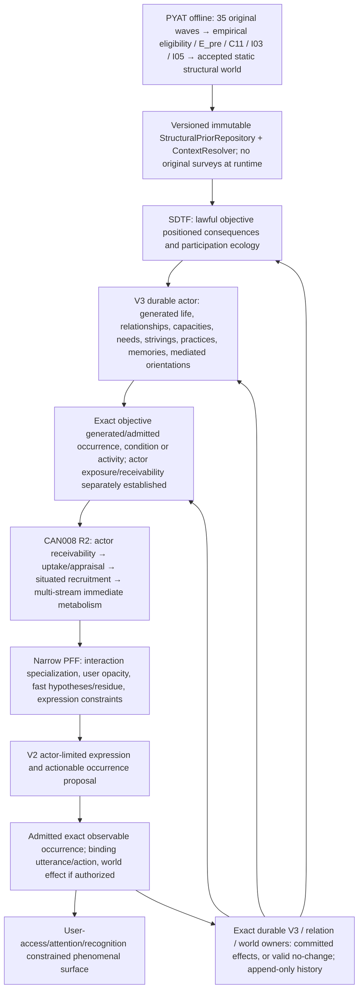

# Conative–Relational Person-in-Activity Spine — Architecture and Preservation R1

**Date:** 2026-10-17
**Status:** RESEARCH_ARCHITECTURE_PROPOSAL__NOT_ADOPTED__NOT_A_SEMANTIC_ISSUER__NOT_A_RUNTIME_GRANT
**Repository:** maidiu/rawlsing (private)
**Lineage:** Sorok PRE-A0 conative bank + PFF psychic mediation + SDTF transduction + CAN008 R2 + Sorok D007/56/74/101 + October 17 user-level synthesis.
**Base:** integration/pre-main-reconciliation-r1 @ 15d677e9c3ac3c260ec18e72edb68c523085faee
**Purpose:** Preserve without new user ideation; define a buildable, falsifiable whole-machine composition. The older V2/V3 mechanisms are experimental ancestors, not constitutional psychological primitives.

## 0. One-sentence decision

**The durable V3 person is an historically and relationally constituted, irreducibly particular organization of living activity; CAN008 is the event-time operation of that same person, rather than a second psyche.** Pyat supplies compiled, source-right actor-independent historical/structural possibility; SDTF derives governed objective actor-positioned social conditions; PFF specializes fast interaction; V2 produces admitted actor-limited expression; independently authorized V3/world owners commit effects into a world that remains prior to and larger than the player.

This is a proposed architectural synthesis. It is **not** an assertion that all its mechanisms currently execute, nor a mandate to mint fresh owners, enums or uniform mathematical coefficients.

## 1. Restored whole-machine circulation



Important ordering: no actor-private cause is automatically user-perceptible. No candidate V2 speech becomes a real event until admitted under the applicable exact-artifact/occurrence boundary. PFF/V2 do not own durable psyche or canonical world truth. Some world activities and conditions persist independently of discrete event production; they must not be laundered into artificial occurrences. Multi-person interactions have actor-specific responses to one occurrence, never one shared psyche.

## 2. The retained theoretical kernel (working hypotheses)

### 2.1 What is primitive and what is derived

- **Living organism / need:** embodied requirements, vulnerability, regulation, capacities and biological development. Need is not identical to desire for a specific target.
- **Conation / desire:** historically situated directed living activity: exploration, care, refusal, mastery, play, pleasure, sexuality, attachment, projects, creation, defense and action toward possible futures. Desire is not behavior, emotion, or the person's conscious explanation.
- **Relation / love:** actual historically developing mutual or asymmetric participation among distinct persons. Love is a possible form of investment in another's life and flourishing and in the relation without requiring annihilation of alterity. Neither love nor flourishing is a single causal scalar.
- **Recognition / witness:** the social reality of someone's act, experience, accomplishment or claim to another; not equivalent to praise, approval, accurate understanding or obedience.
- **Power:** differential capacity to establish or contest the terms of material access, risk, action, obligation, recognition, legitimacy, interpretation and future possibilities. Distinguish power-to, power-with, power-over and power-against as analytic cases, **not four canonical enums**.
- **Pressure:** arises when living activity encounters limits, incompatible initiatives, dependency, demand, misrecognition, scarcity or competing possibilities. Pressure is not the primitive substance or necessarily a conserved numerical quantity.
- **Flow:** historically conditioned realized routing/organization of activity through bodily, practical, symbolic, relational, institutional and psychic affordances; includes delight, creative agency, cooperation and play, not only blocked-pressure discharge.
- **Pre-conscious organization:** sedimented dispositions, action-readiness, procedural expectations, memories/traces, salience, socially formed affordances and modes of *being able to act with, toward, before, against, and dependent upon others*. Conscious self-report is neither complete nor reliably causal.

### 2.2 The individuality/relationality constitutive tension

**Relations produce individuated capacities; those capacities enable persons to cooperate with and resist relations that helped produce them.** Differentiation makes mutuality possible; permeability permits reciprocal development. Neither monadic independence nor undifferentiated relational fusion is the target.

Canonical research contrast: a parent helps a child master a task; the child performs the action (not merely obeys); the accomplishment is shared in recognition yet belongs to the child's newly developed capacity. Later, the same child may resist doing a previously desired act once it becomes another's demand. Identical physical action ≠ identical practical authorship, encounter or developmental meaning.

The relationship remains consequential and can support refusal, conflict, differentiation, repair and love without either party controlling the other's entire history.

This is not a universal normative ideal-family script or a hardcoded positive-development rule. Real caregiving is culturally and materially heterogeneous; love may foster capacity, constrain it, or coexist with coercion, contradiction, dependence and conflict. Support and refusal have no predetermined psychological outcome.

### 2.3 The shortest candidate kernel

> Distinct, embodied centers of living activity are historically constituted through material and social relations; they encounter one another through limited perspectives, act under conditions of asymmetric power and irreducible difference, and recursively transform persons, relations and worlds through their actual consequences.

No modeled synthetic first-person organization proves phenomenal consciousness; Rawlsing models subjective organization and representation without asserting literal machine consciousness.

## 3. Causal grain and ownership matrix

| Grain / object | Current proper authority / source | May produce | Must NOT silently produce |
|---|---|---|---|
| Survey/material evidence and actor-independent structural possibility | Pyat PRE-V3 compiled offline + producer authority | Provenance-bearing temporal/relational priors, uncertainty and negative authority | A generated person's actual experiences, traits, memories, psychology |
| Objective positioned social consequence / activity ecology | SDTF D1-prime or accepted successor rule at precise scope | Typed material-dependency, directed authority, organized activity/time, institutional gate, counterpart-channel consequences | Subjective meaning, actual uptake, first-person premises or independent realization without witness |
| Person and developmental history | V3 and existing exact durable owners | Generated personal history, organismic constraints, projects, learned practices, actor-local models and histories | Demographic/type-implied psyche without generated causal history |
| Relationship / shared-world histories | V3 relationship/ADP and world/occurrence owners as applicable | Objective interaction, asymmetric orientations/models, dyadic conventions, material effects | One common interior, automatic agreement or total-person ownership by dyad |
| Current event and access | Exact generated/admitted occurrence + perception/epistemic owners | Objective event, actor opportunity/access/knowledge and time | Actor uptake or change simply because a fact exists |
| Immediate person × event transformation | CAN008 R2 | Receivability, uptake/appraisal, situated recruitment, multi-stream immediate response; bounded temporary state and qualified owner-effect requests | Independent durable identity, memory, relation, world or unissued behavioral rule |
| Fast interaction specialization | Narrow PFF | User opacity, live discourse/pragmatics, response residue / hypotheses, actor-to-V2 constraints, occurrence re-entry | Another total psyche or long-term psychological truth |
| Actor-limited realization | V2/actor surface | Candidate wording, action, gesture and voice in authorized actor envelope | Objective actor-private causal truth, event history before admission |
| Observable occurrence and user lens | Exact occurrence admission and user phenomenal/perception system | Binding what occurred; selective finite user-experienced surface | Hidden-motive leakage; user attentional profile authoring the actor's causal occurrence |
| Durable consequences | Exact competent V3, relationship, institution and world owners | Typed effects or valid no-change, committed provenance, later conditions | Cross-owner mutation merely because an event sounds psychologically meaningful |

Current program must verify exact names and interfaces against project-current adoption records before engineering; this matrix is an architectural ownership crosswalk, not a replacement of existing law.

## 4. One person, several noncollapsible states

1. **Objective history/world:** what happened and what social/material relations exist independently of an actor's apprehension.
2. **Durable generated person:** a temporally situated configuration of organismic capacity, needs/strivings, practical projects, interpretive mediators, tensions, practices, self-model, memory traces, and history of participation. Relation-constituted does NOT mean dyad-owned.
3. **Objective specific relation:** actual shared history, conventions, dependencies, property, obligations; separate from both parties' meaning.
4. **Directed actor-to-other orientation and models:** A→B is not B→A; model-of-other is not other; meta-perception is not fact.
5. **Event-local recruited organization:** only relevant accessible/latent warranted slices become operative; multiple contradicting tendencies can coexist and need not yield one winner.
6. **Actor access/interpretation/conscious field:** felt != named != correctly explained != disclosed.
7. **Communication/action:** intention != attempt != objective emitted occurrence != other-person uptake.
8. **User phenomenal observation:** the user's finite seeing/hearing/noticing/recognition, distinct from actor/private state and objective occurrence.
9. **Consequent state:** exact permitted modification of person/relationship/world, including persistence without change, deferred effects and changed future affordances.

Objective shared convention can coexist with opposing inner meanings; subjective interpretation may become causally powerful without retroactively making it objectively true.

## 5. Port and transition sketch — new proposal, NOT adopted schema

These are semantic data contracts, not new owners or approved runtime classes. Implementers should map them onto existing approved APIs/records before minting any type or endpoint.

```text
A. StructuralWorldPort.resolve(position_refs, world_time, context_refs)
   -> admitted structural context + provenance + uncertainty + temporal limits.
B. PositionedSocialConsequence.derive(context, actual_actor_position,
      counterpart/institution/role/activity bindings, rule_ref)
   -> typed objective ecology fact or UNKNOWN/DEFER/DENY.
C. V3.read_actor_slice(actor_ref, time, event_scope, relation_refs)
   -> scoped durable organization + provenance + warranted memory/access distinctions.
D. Occurrence/Access.read(event_ref, actor_ref)
   -> objective occurrence + independently justified exposure/perception opportunities.
E. CAN008.transduce(event, actor_slice, actor-specific access, relevant relation/world facts,
      licensed rule_ref, prior non-durable carryover)
   -> candidate actor-local uptake, competing conative/relational recruitment,
      immediate response, optional bounded carryover, 0..N owner-scoped effect proposals;
      or explicit valid-empty/defer/deny.
F. PFF.specialize(response_envelope, interaction history, actor-user boundary)
   -> legal expression/interaction constraints, no new psyche source.
G. V2.realize(actor-limited envelope, objective local world slice)
   -> exact actor expression/action candidate and machine-readable occurrence sidecar.
H. OccurrenceOwner.validate_and_commit(exact candidate, world/actor prerequisites,
      time, version, permission)
   -> binding objective event receipt OR rejection. Candidate is not history.
I. V3/Relation/World exact target owners apply lawfully authorized effects,
      transactionally/replayably, or preserve no-change.
J. PhenomenalLens.project(admitted occurrence, user sensory access, attention,
      recognition and learned lawful user history)
   -> only the finite user-visible presentation; never rewrites H or I.
```

Caveat on sequence J/I: the exact timing must preserve atomic admission, emission and consequences. Current Sorok OUT work has open cold-crash/multiwriter flaws; a diagram is not proof that this transaction is implemented. ACTOR_EVENT≠RESPONSE and RESPONSE≠DURABLE_EFFECT remain hard gates.

The latent-person conditional model SHOULD NOT materialize every possible situation-specific 'meaning' as stored state. Current event meaning should normally be **derived** from the canonical person, particular counterpart and event, and only changed through realized history.

## 6. Dynamics: requirements, not invented numerical physics

- Multi-source recruitment: allow multiple concurrent desires, concerns, identifications, anticipations and defenses; no compulsory single dominant channel.
- Context-conditional organization: same historic person and same surface content can mean differently when performer, audience, ownership, recognition/power relation or practical project changes.
- Reciprocity: each participating actor has independent access and processing; effects pass through actual actions, events and world responses, not direct mind-to-mind access.
- Development: actual repeated practices and social conditions can reinforce, generalize, narrow, destabilize or transform later affordances. Distinguish latent cause, learned practice, memory, actor self-story and objective fact.
- Nonteleology: parental support does not guarantee competence; refusal does not guarantee autonomy; care does not guarantee flourishing; conflict does not guarantee rupture or repair.
- Reification negative: a person's concern for an abstract relationship/category can become antagonistic to its living participants; no mystical 'idolatry' engine necessary.
- Constraints matter: biological/material limits, finite time, role obligations, institutional power and specific social reproduction mediate possibility.
- No archetype shortcuts: Enneagram-like patterns are optional ex-post attractor interpretations, never first cause.
- Actor opacity: some operative processes are pre-conscious, inaccessible or misinterpreted. The output must not narrate analyst causal provenance as first-person insight.
- Scientific humility: until externally calibrated, a plausible transition rule remains a modeling hypothesis, not an empirical human law.

## 7. Executable proof cases — counterfactual comparisons, not scripted outcomes

**K1 — Shared competence without absorption.** Two developed actor states (caregiver, child), with typed support/attention and a realistic task. Establish the child's active exploration and parent cooperation. Verify achievement is produced through permissible actions, yields possible changed child capacity and shared recognition, and does not imply identical inward meanings. Include a failed task and parental absence counterfactual. No 'loving support ⇒ competence' shortcut.

**K2 — Invitation-to-command inversion.** Hold the child's intended physical task fixed. Change an unsolicited parental imperative, authority scope and existing refusal history. Require different legally distinguishable practical configurations (authorship, demand and alternatives), not necessarily a prescribed defiant emotion.

**K3 — Same embarrassing story, different storyteller.** Hold the factual narrative fixed while varying performer, consent, current partner history, audience, ownership of framing, reciprocity and alternative witness. Inspect actor-local recruitment and social consequences. Same words alone cannot determine response.

**K4 — Relationship alters developmental reception.** Identical correction from trusted mentor, punitive supervisor and peer, with generated actor histories. No universal authority-trigger coefficient or stereotype.

**K5 — Independent multiple minds.** Two actors attend one objective event with different perceptions and meanings. Their ensuing actual acts may alter the same dyad, yet neither actor gains the other's private state and no renderer leaks it.

**K6 — Deep pre-conscious trace.** Historically established inaccessible residue demonstrably alters a later action route, while actor interpretation stays wrong/partial/unknown. Must not implant hidden cause via narration.

**K7 — Differentiation without relationship dissolution.** Resistance and boundary negotiation may lead to durable changes in expectations, capacities and specific dyadic conventions without obligatory rupture or moral victory.

**K8 — Relation reification.** One actor preserves a 'good parent' or 'good partner' ideal while materially constraining the actual child/partner. Verify idealization is historically earned through practices, power and recognition, not directly spawned by label.

**K9 — Cross-context plurality.** Keep person genealogy constant; vary co-participants, activities and power. Preserve contradictory learned ways of acting; reject global summation into one 'defiance' score.

**K10 — Reciprocal world feedback.** Actor action changes an independently owned institutional or material condition only via lawful external realization, and later changes actor opportunities through re-resolution. No psyche-to-Pyat direct writes.

**K11 — Causal/history authority and replay.** Exact artifact receipts, crash/retry, time ordering, idempotence, full/differential replay, atomic owner effects, unknown/no-change states; no lost/duplicated event, no retrocausal later interpretation.

**K12 — Observer membrane.** Same admitted actor occurrence, different users' lawful attention/recognition. Different phenomenal rendering is allowed; objective event, exact speech, and actor causal process must remain identical.

Test evaluation must include provenance tracing, negative cases, ablation and differential inputs. 'Sounds emotionally plausible' or a manually scripted happy result is NOT a positive mechanism result. Positive actor-level cases require exact live owner-issued permission; lab-only exercises must be labeled as such.

## 8. Work program: parallel engineering without false readiness

**Stage 0 — archive and jurisdiction audit (parallel, no authority required).**
- Crosswalk recovered V2/V3 source *mechanisms* (not field names) to canonical current owners. Mark REUSE / GENERALIZE / REPLACE / REJECT / NOT-YET-REALIZED, test and evidence per row.
- Build typed port schema drafts for durable person, actor-local response, objective social activity and recipient-specific expression/access, with no owner proliferation.
- Translate K1–K12 into minimal source-free fixtures and explicit negative controls.
- Bank every hypothesis as research, every runtime contract as proposal, every actual owner decision as separate authority.

**Stage 1 — nondelegable owner decision.** Competent V3/CAN008 authority resolves Sorok W01 option A/B/C: exact actor, event and rule issuer; immediate-response mapping; response-history-only target (A) or independently issued foreign durable target (B), or refusal (C). A is cheapest first proof but **not issued**. CAN008 R2 semantics are adopted; a concrete positive rule is not presently proved issued.

**Stage 2 — first real bounded owner-positive cell.** Implement licensed CAN008 receivability/uptake/recruitment/immediate response for two events with a durable owner-relevant distinction and causal retrieval; test denial, empty, cold replay, provenance and counterfactual sensitivity. No '16 LIFE1 DEFER' theater: prove actual positive, not a new test harness pass.

**Stage 3 — constitutive relational cell.** Add two independently generated actors, asymmetric models/relationship histories, practical activity and refusal/recognition contrasts (K1–K5). Use exact owner-issued foreign effects before claiming lasting person/relationship change.

**Stage 4 — developmental time.** Couple live response to life-epochal transition, genuine caregiver/co-parent genealogy where authorized, recurrent practices, cross-context plurality and delayed consequences (K6–K9). Same actor across slow and fast time; no 'backstory persona' separated from live character.

**Stage 5 — world-loop and binding surface.** Integrate SDTF activity ecology, external world-owner response and re-resolution; bind exact observable acts through V2/PFF/occurrence owner; validate user phenomenal membrane and multiwriter cold-journal safety (K10–K12).

**Stage 6 — real Pyat weld and science.** Replace explicitly synthetic port data only after lawful Pyat/SDTF original-35 compilation, actual serving/actor rights and current exact owner tests qualify. No original survey runtime dependency; never conflate source-free proof with all35 installation or real empirical calibration.

Stage 0 tasks should proceed IN PARALLEL and may precede issuance. Stages 2–5 can be prepared in parallel with Stage 1, but their *positive execution claims* require actual grants and their acceptance depends on receipts. Do not globally serialize independent source archaeology, cost/performance profiling, relation ontology and port design.

## 9. Engineering first deliverables and stop/go conditions

- **Deliverable P0:** semantic-preservation matrix, owner-by-owner, for legacy mechanisms and PRE-A0 conation/love/power/recognition theory.
- **Deliverable P1:** current API/port diagram + schemas + valid/empty/defer/deny/unknown taxonomy grounded in actual existing code.
- **Deliverable P2:** independent minimal failing test evidence of what current CAN008 cannot do, retaining 16/16 historical LIFE1 DEFER.
- **Deliverable P3:** W01 competent owner issuance/refusal docket.
- **Deliverable P4:** reproducible positive two-event/one-actor native cell, with no fictive owner/actor issuance.
- **Deliverable P5:** positive two-actor developmental relationship cell, independent actor histories, later consequence and no-cross-mind guards.
- **Deliverable P6:** actual coupled result Pyat→SDTF→V3→CAN008→PFF/V2→event history, with original-source authority separately verified.

**Fail/hold** where rules map people from class, country, survey category or Enneagram directly to psychic truth; where a fixed stimulus determines psychological response; where a relation is a single bond-strength scalar; where actor response lacks an actual occurrence, actor state or rule; where LLM plausibility replaces causal authority; where queried user interest manufactures backstory; where renderer rewrites observable truth; where replay changes canonical history; or where stage status is mislabeled.

## 10. Legacy mechanisms: scientifically plunder, not constitutionalize

Historical V2/V3 promising executed capital: need↔compensation cycles, persistent strivings and expectation baselines, pressure-flow accounting, grooves/conductance and trace memory, frameworks/buffers, rupture/metabolism, relational contexts, conversation refraction and public/private/inner expression boundaries. Source audit TD-R05 supports that these had real code and bounded tests.

Do **not** inherit automatically: demographic wound shortcuts, pseudo-random event causation, scalarized social pressures, universal conserved 'psychic energy', a single primary response channel per domain, fixed wound-to-behavior formulas, frozen Enneagram priors, universal emotional labels, thin V3→V2 adapters or keyword psychological explanations.

The legacy build is **mechanism archaeological evidence**, not an authority to freeze final psyche ontology or import its numeric coefficients.

## 11. Status, source lineage, and no-loss rule

**Adopted current semantic authority (do not modify via this proposal):**
- CAN008 R2 adopted 379e259c71c6e36d22a957f94e81afb83f582462: actor receivability, uptake/appraisal, situated recruitment, bounded multistream metabolism; persistent state owned elsewhere.
- Whole-spine TD-R07 accepted jurisdiction model: upstream world prior; V3 causal person; V2 phenotype; exact occurrence/admission.
- Other V3/CAN/ADP and SDTF adopted interfaces remain exact-owner requirements and cannot be overwritten by this proposal.

**Recovered banked Sorok research (not automatically operative law):**
- PRE_A0_PSYCHIC_ARCHITECTURE_R1/00_PRE_A0_ARCHITECTURAL_BANK_R1.md §§7–14 — need/desire/love/recognition/power/pressure/flow; infant-caregiver achievement, agency and resistance; psychic relational field.
- PRE_A0_PSYCHIC_ARCHITECTURE_R1/01_PRE_A0_V3_PFF_BUILD_CAMPAIGN_R1.md C0–C12 — large-grain roadmap, older proposed interface named StructuralWorldPort.
- Sorok 02, 00A, 53–56, 70–75 and D007 — relation-constituted distinct persons; centralized derived meaning; non-exhaustion; recursive self-interpretation and no retrocausal truth.
- Sorok 74 corrects overreach: no independent self-retcon/framework metabolism owner; use CAN008 + existing durable owners.
- Sorok 101 corrects render boundary: independently caused observable occurrence before user attentional personalization, binding exact speech and sidecar.
- SDTF narrowing 23 and constitution R3 29: positive objective positioned social consequence (D1') without a second psyche, typed primitive mechanisms and exact law/witness boundaries.
- Historical TD-R05 V2/V3 source audit; actual legacy code archaeological capital.
- Sorok HQ320 current-progress report and HQ321 four-return candidate 2026-10-16: real actor-bound positive gap, LIFE1 16/16 DEFER, W01 options only; HQ321 is *not* a formal HQ adoption.

**New October 17 synthesis from conversation (candidate, preserved here):**
- Relational differentiation is not secondary to love; autonomy can emerge from scaffolded joint activity, and the child can resist being assimilated by that same supporting relation.
- Refusal can arise when the *authorship* of an act changes although its physical content does not; the infant/parent case and same-party-story different-speaker case expose the shared mechanism.
- Conative activity is not a passive reservoir of pressure; desired accomplishment, shared delight, competitive will, opposition and playful cooperation are positive first-class explanatory phenomena.
- No global automatic moral gradient: loving influence may enable or constrain; resistive differentiation may support or damage; consequences must be historically particular.
- **Revised kernel:** relation constitutes individuality; individuality makes relation possible; both remain porous and causally formative without becoming identical.
- **Architectural center:** historically formed actor-in-practical-activity, with actor-specific uptake and real multi-party consequence, rather than any universal trait, mood, need, or scalar relationship score.

**Integrity/authority disclaimer:** This research artifact is a preservation and engineering proposal only. It does not modify CURRENT, approve semantic rules, actuate an actor, dispatch worker execution, alter source rights, authorize 35 original waves, adopt an SDTF rule or install a CAN008 response handler. Competent HQ/owner must separately decide adoption, permissions and implementation stages. This artifact may be harvested and challenged without being mistaken for executed science.
