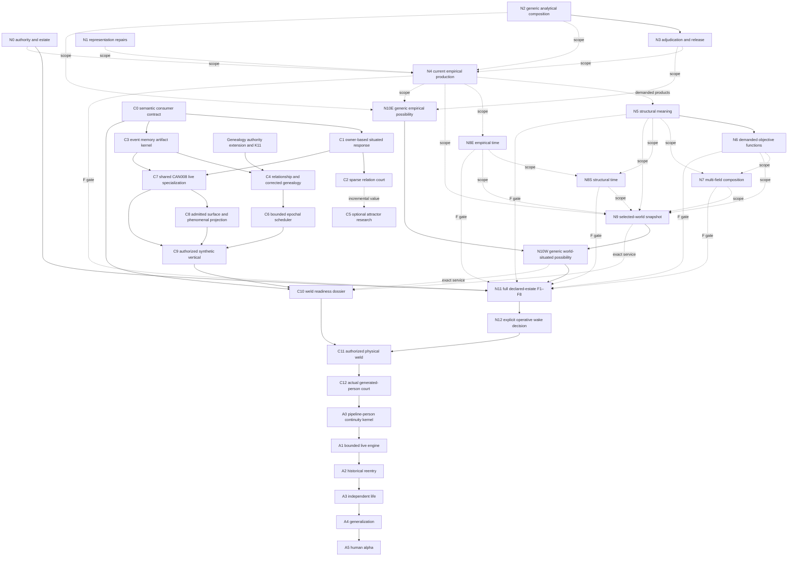

# D09 — Joint dependency program

**ASTRA_NEW_RECOMMENDATION**, respecting accepted Pyat graph and the user correction. N labels are Pyat nodes; C labels below are Sorok campaign nodes (not Pyat C8 commission); A labels here are product milestones (not docket architecture questions). No edge is an execution grant.

## Graph

N13 (exact LiTS D2 preimages) remains a conditional auxiliary to N5 when that particular relation is demanded; it is not a new global predecessor. Competent retained inputs can satisfy conditional edges without fresh reexecution. C0/C3 can begin independently of source issuance. C5 is deliberately not an unconditional predecessor to C6/C9: extra attractor state must earn its role.

## Pyat node dispositions

| Node | Phase | Product/condition |
|---|---|---|
| N0 | NOW | Reconcile exact control, issuer/custody and all35 ledger; no automatic adoption of later returns |
| N1 | NOW / AFTER BOUNDED COURT | Independent review/integration of V2K and relevant repair residuals; don't rerun solved A04B diagnosis |
| N2 | NOW | Reuse generic C1 joint/multi-condition/recursive machinery; prove public path and source-authorized directions |
| N3 | NOW | Authenticate demanded product family release/lifecycle; no count-as-release |
| N4 | NOW where granted; WAIT only on exact source/use dependencies | First actual issued slice→consumer, then rolling all35 proof |
| N5 | NOW | Positive source-warranted structural fields, no opinion-as-law |
| N6 | NOW | Demand-specific position/opportunity/constraint/route functions, not all historical stages by name |
| N7 | NOW method/issuer work; production after exact fields | Two-family non-pooled positive composition; no false household/person joint |
| N8E | NOW exact release/design/comparability bridge | Actual per-wave facts and measured temporal product; no invented trend |
| N8S | NOW independent objective-time path | Objective rules/material change; depends on N8E only if used |
| N9 | NOW contract/components; positive proof as inputs mature | Atomic selected-world closure/current/historical/as-of consumer receipt |
| N10E | NOW | Generic computed support, public multi-condition/reversed roles where authorized |
| N10W | NOW generic service work; proof after N9+N10E | Ordered world-situated possibilities; parent example not semantic owner |
| N11 | Prepare NOW; WAIT FOR PYAT full required evidence | Full declared-estate acceptance; global F6/F7/F8 not reducible to per-wave cells |
| N12 | WAIT FOR PYAT N11 and competent decision | Operative wake/defer; no automatic event from a report |

## Sorok C0–C12 dispositions, including A3 engineering-ahead adjudication

| Node | Phase | Precise dependency / lock-in risk |
|---|---|---|
| C0 | NOW design; AFTER K9/K10 bounded freeze | Freeze invariants/demand version, not final owner wire shape; generic facade |
| C1 | NOW owner mapping/spec; AFTER K1/K3/K5/K6 for new causal rules | Reuse CAN008/010/011; wholesale new primitive stores risk semantic duplication |
| C2 | AFTER small relation vocabulary court | Sparse graph implementation can be lab-scoped; no all-pairs ontology commitment |
| C3 | NOW ledger/access/artifact specs; lab execution after grant | Independent of actual Pyat sources; prohibit prose truth/memory laundering |
| C4 | NOW corrected genealogy contract; AFTER ADP015 extension/K11 | Mother-first construction, independent back-generated second parent, asymmetric relation; no upstream parent object |
| C5 | MAXIMAL LATER / bounded research | Incremental value must beat graph/history; STOP type-first causation |
| C6 | AFTER C1/C3/C4 cell proof | Bounded scheduler and world requery; final adapter waits exact Pyat service |
| C7 | AFTER exact concrete CAN008 rule/interface binding | Same person, no second live psyche; generic U1 ownership need not be reopened |
| C8 | NOW surface authority/access spec; AFTER bounded admission court | Learned/adaptive lens later; renderer cannot unilaterally materialize |
| C9 | AFTER bounded courts and explicit lab actor/model grant | Synthetic vertical demonstrates engine only; must include corrected genealogy, not substitute hand-authored parent shells |
| C10 | NOW readiness dossier; WAIT FOR PYAT for final proof | Compare real terminal demands and exact adapter map; no premature physical freeze |
| C11 | WAIT FOR PYAT N11/N12 plus explicit weld grant | Operative physical seam, independent review, exact versions |
| C12 | AFTER C11 | Real generic world→generated family/person→live/history court; gate to product A0/A1 |

## Product A0–A5 dispositions

A0 executable continuity kernel: design/lab scaffolding NOW, actual milestone waits C12 pipeline-produced person. A1 complete bounded live engine: isolated admission/projection court AFTER BOUNDED COURT; product claim waits A0 and exact actor grant. A2 historical reentry: AFTER A1, require genuine durable consequence and access. A3 independent life: AFTER A2, bounded agenda and causally important supporting persons, not global simulation. A4 generalization: AFTER A3 and multiple independently generated people/ecologies. A5 human alpha: AFTER A4 and explicit release/participant scope; no unasked human study is run here.

MAXIMAL LATER: global ecology, unlimited social recursion, elaborate adaptive lens, research attractor/Enneagram. STOP: any parallel “fast psyche,” upstream parent constructor, child-outcome-driven parent history, all35 shrinkage, global sequentialism and fixture-as-wake. The sequencing is a proposed dependency court, not invented adoption.
