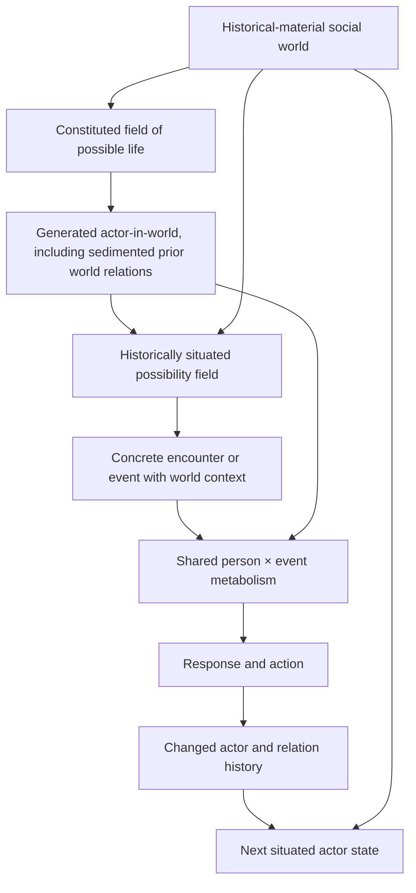

# Corrective amendment — structural primacy and conception-conditioned genealogy

**Controlling completion amendment to recovered 00–06, preserved byte-for-byte at recovery commit `66cad80088d05e32ecd0e8d37741b96ac8faafab`.** This file supersedes conflicting recommendations, not historical evidence. ASTRA_NEW_RECOMMENDATION under USER_ARCHITECTURAL_CONSTRAINT; not adopted Pyat/V3 law.

Read in full: Sorok correction06 blob `4f2bfad4ad2a0c88bb67440c8aeec8b9784bc9b9` and instruction07 blob `67ab57fcbe43464df04082c2b388910649440b73`, both at `bace7640777098732d425e9368cf28ada0e57aeb`. Instruction07 references the earlier correction commit `abce6309cc4fa4d00ec7eb3004f5685990723460`; the user-directed bace commit is the actual read cut. No shadow-completion branch or artifact was inspected or used. MiMo scratch is quarantined and is not a source of Astra judgments.

## 1. Historical-material ordering — accepted as intended architecture

“Event-/relation-first” survives only as canonical-state/anti-reification engineering: keep causal truth near **historically situated** events and relations before promoting abstractions to independent stores. It does not mean event before world, an autonomous psyche with sociology added later, or world conditions as a peer feature. Preferred name: **world-conditioned event-sourced developmental architecture**.

An event lacking required world context is underspecified, even if its text is psychologically vivid. The actor's existing expectations, practices and relationships are partly sedimented actor↔world history. Conversely, constitutive structural priority does not mean social position mechanically fixes individual response. World possibilities, actual exposure, uptake and durable change remain separate. Nor must the complete whole world be materialized for every event: an explicit relevant snapshot and typed unknowns bound the claim. Historical contextual gaps cannot be repaired with free narrative.

## 2. Depth of Pyat specialization and generic capacity — Q1–Q4, Q11–Q12

| Layer | Inspected evidence | Adjudication |
|---|---|---|
| Accepted HQD125 F8 | “positioned-subject / parent-prior usability”; distributions useful to parents/coparents and later generation, preserving actor firewall | Consumer-example specialization in accepted functional law; **not** a grant to generate parents. Recommend competent wording clarification/generalization, not assertion that existing law already transfers genealogy upstream. |
| N10W / C8 | Parent/coparent titles; N10W body binds worlds, generated-fact criteria, progressive possibilities and no actor state; C8 is DRAFT_NOT_DISPATCHED | Operational framing is overspecialized; mechanisms are generic. Keep N9+N10E prerequisites and all acceptance obligations. Propose N10W = progressively conditioned world-situated possibility; F8 = positioned-subject empirical possibility usability. |
| POSITIONED_CODE | Arbitrary exact subject/target refs, tuple of conditioner bindings, EMPIRICAL_POSSIBILITY_ONLY, same source/release, exact/walkback modes; no parent/coparent/household terms in inspected file | Reuse unchanged generic semantics. “Arbitrary” means schema-general under exact coordinate/operation authority, not arbitrary queries authorized. |
| C1_CODE | `_all_bindings`, compound response/position leaves, multi-binding witness, joint topology, direct/discovery/recursive routes | Multi-conditioner composition already exists below the narrower public facade. Do not commission its wholesale reinvention. A `pairing_authority_ref` here pairs subject facts with predicate leaves; it is **not romantic/parent pairing**. |
| N10E_CODE public facade | `_single_binding` in request constructor; exact C1 invocation and rejection of supplied probability geometry | Reuse; extend/version the public boundary only where the generic consumer needs existing richer C1 functionality, with exact regression and authority evidence. |
| W10 adapter | Parent/coparent contract/stage names and household care fixture keys; output explicitly forbids generated parent/dyad joint | Real test-only specialization, not production parent ontology. Retain as consumer fixture; extract/reframe generic world/conditioner/evidence receipt semantics only after independent review. No deletion of useful evidence. |

**Q2 answer:** the existing generic machinery is the correct substrate and can represent much of the intended evidence without parent semantics. It does **not yet prove** the full intended consumer: public multi-conditioner exposure, source-authorized reversed target/condition roles, full N9 joint use and calibrated route/model semantics remain specific gaps. A generic class name does not prove every demographic variable is queryable as a target. Reversal requires newly valid target topology, risk set, denominator, operation/design and comparability/use authority; P(A|D) is not P(D|A), and neither is a causal effect.

**Q3 answer:** yes, propose a versioned HQ terminology/acceptance clarification. Preserve exact old IDs/aliases and required downstream usefulness; don't silently rewrite HQD125 or weaken F8. Parent generation remains an important V3 witness alongside another nonparent consumer. N11 estate and N12 authority do not disappear through renaming.

**Q4 answer:** W10's institutional/care-time contrast, currentness distinction, negative/dyad refusal, replay/invalidation and no-actor checks remain useful. Its “jointly enter” language means carriage in the tested adapter, not demonstrated joint estimation: route states depend on world premises, N10E changes are carried/hash-bound. Retire parent-specific labels from a proposed generic core, retain them in explicit downstream fixtures, and stop treating W10 as a fertility/pairing model.

**Q11 answer:** PRE-V3 correctly owns generic source-grounded bidirectional empirical-social possibility and objective world constraints. V3 owns the woman's desire, candidate encounter/person, actual route realization, relationship, conception, second-parent biography, household and genealogy. PRE-V3 can contain source-backed population household structure or institutional care rules; the prohibition concerns **generated household entities**, not erasing household sociology.

**Q12 answer:** preserve native coordinate/value semantics; target and conditioner roles/order; same-person topology versus household sampling units; source/release/issuer; exposure/routing/nonresponse; risks/denominators/design/uncertainty; all minority/counterpatterns; effective/publication/as-of times; joint/marginal distinction; model/proxy/backoff provenance; exact generated criteria and comparability links; structural route eligibility and prerequisites; replay and permission closure. An opaque generic subject ref is enough—no `is_father_query` flag or parent object is required.

## 3. Accepted V3 law versus proposed generation schedule — Q5

V3_COMPLETION §12 and TD_R05 §20 show two parent developments before encounter. ADP015 (blob `a4dab0a12102aaa0b584ef6ff4fdc9206a28d456`) §§8/10 requires already-generated stable actors, exact independent history anchors and rule-bound witnesses before relationship/child admission. These sources require independent **represented histories**, not necessarily statistically independent parent draws. They do not explicitly authorize retrospective endpoint-constrained construction.

Thus the user correction does not require discarding independent personhood or causal chronology. It requires an explicit scheduling/construction extension to the older ordinary-recursion sketch: generation dependency may run mother→candidate endpoint→second-parent prehistory, while represented event causality runs both earlier lives→encounter→conception. Keep two distinct DAG edge types and timestamps. Never put endpoint constraint edges into the causal-parent DAG.

A second, substantive extension is required: ADP015 §11 has deterministic base profiles, zero default draws, and explicitly forbids normalizing demographics, prevalence, narrative plausibility or LLM judgment into partner/fertility weights. A user design requirement is not an existing adopted stochastic rule. The competent ADP015/ADP020/science court must define a new finite-candidate selection contract and weights policy before execution. Conception/gestation/birth timing and child identity are not automatically covered by the bare CHILD_GENERATED profile; exact biological/occurrence meanings and required authorities must be bound separately. Do not merge conception and birth by convenience.

## 4. Concrete proposed algorithm — Q6–Q10

### A. Mother and provisional conception boundary

Develop the mother as a complete situated person to the focal conception boundary, preserving parity: first, second, third or later child. Existing partners, children, mobility, projects, institutions, material life and prior relationship histories constrain the boundary. Do not reset her into a generic “mother” profile.

Use the exact immutable mother state immediately before the event plus already admitted noncontradictory conception-context facts. If counterpart identity/history is unresolved, the conception is a **construction target/pending decision**, not an already admitted two-parent occurrence with missing required anchors. If prior history already names the second parent, reuse that actor and history; do not generate a replacement. If already admitted shared events constrain him, include them as hard constraints and preserve mother's exact memories/testimony/access. No post-hoc mutation of the mother to make a chosen father fit.

### B. Finite scenario proposal and generic empirical inquiry

A bounded LLM may propose concrete candidates with stable IDs, encounter route/time/place, provisional endpoint configuration, relationship context, required world premises, history compatibility, empirical query requests, unknowns and explicit alternatives. Proposal examples may include local conventional, demographically similar but personally incompatible, travel/work/study, short romance or unconventional encounter **where the actual life permits them**. Require no typicality mandate, no demographic→personality mapping, no hidden desired-child trait, no invented probability, and no demographic-dissimilarity=rebellion rule.

The finite candidate set is not an exhaustive sample space merely because several vivid stories exist. Record the scenario grammar and coverage gaps; include unresolved/other where meaningful. Deduplicate paraphrase-equivalent candidates before weighting so ten phrasings do not acquire ten times the probability. An impossible premise is rejected; unknown support remains unknown, not impossible.

V3 submits generic exact forward/reverse/multi-condition queries. Empirical support can constrain candidate claims; individual mother's attitudes cannot be treated as direct evidence of a partner's attitudes absent an independently justified relational/encounter model. Query feedback may revise candidates before sealing the decision, with all iterations retained; it must not cherry-pick until a desired child outcome is achievable.

### C. Qualified selection, not LLM probability laundering

Separate hard feasibility, empirical support, model-relative plausibility and actual event occurrence. An explicit decision model may assign coarse ordinal support classes or interval/set-valued plausibility before any probability is warranted. A stochastic execution still needs exact governed weights: either independently calibrated weights at declared scope, or an explicitly authorized synthetic selection design (for example equiprobable eligible scenario classes) labeled as simulation policy, not population frequency. Ordinal rankings alone do not determine unique probabilities. Sensitivity runs across several defensible weight vectors are preferable to false precision.

A chosen candidate is selected under that model, not “the most likely father in the data.” Use stable candidate ordering, complete candidate-set hash, model/version/weight units, seed and named scope/stream receipt. No ambient randomness; no draw on missing authority. Authorize the exact new decision kind and stream use rather than assuming the old deterministic ADP015 profile covers it. Keep empirical error and selection-policy uncertainty visible.

### D. Retrospective whole-person construction

Treat selected endpoint constraints as an inference/construction problem over admissible prior histories. Backward planning may nominate a finite history skeleton, but validate by forward replay through the same V3 developmental owners from lawful roots. Do not invert an irreversible psychological transition as though it had a unique past. Many histories can reach similar endpoint conditions; preserve independently varied histories and ambiguity.

The endpoint should constrain facts necessary for the encounter/conception, not every current trait. Generate independent projects, non-mother relationships, prior disappointments/successes, material/organismic history, attitudes/practices, expectations/strivings, memory/traces, category relations and organization through lawful transitions. No history is admitted merely because it is coherent prose. A demanded missing state receives an exact owner effect or remains unknown.

Bound search by declared attempts, historical horizon and evidence support. Failure yields endpoint-infeasible/underdetermined/HOLD, not invented childhood or silent mother edit. If history feasibility changes which endpoint can be selected, represent this as an explicit conditional sampler with recorded rejection/acceptance policy; repeated unreported retries distort selection weights. Where no calibrated posterior exists, describe constrained scenario generation honestly, not empirical posterior sampling.

### E. Anti-teleology and sufficient independence

**Q8:** embargo child personality, later child outcomes and author-preferred family arc from scenario proposals, selection weights and second-parent back-generation. Precommit model/constraints before child generation. A held-out desired-child label inserted into inaccessible metadata must not change parent history. Admit only endpoint-relevant constraints, retain rejected histories and reasons, and use neutral root/actor randomness independent of future descendants. Endpoint conditioning may explain how a person arrives at an encounter; it may not manufacture his childhood to explain a desired child's wound.

**Q9:** no fixed number of ancestors or years proves independence. Sufficient depth means all consequential endpoint state has lawful antecedents or explicit root/unknown status; the person has independent commitments, relations and material constraints; he can act in held-out contexts without the mother/child prompt; and relevant state replays forward to the endpoint. Generate the entire **relevant** prehistory to that standard. Finite ancestor roots are allowed; a demographic shell with invented trait prose is not. Promote antecedent actors when their causal role requires it, not recursively to infinity.

### F. Admission and forward continuation

**Q10:** initialize second-parent identity/root state under ADP007, then use ordinary competent owners for development. Before admitting the shared conception/genealogy event, require both exact parent-history anchors, compatible world snapshots, actual route/encounter and required causal witnesses. Provisional software identities must be mapped deterministically to final refs without changing mother history or making causal ID cycles.

Instantiate one objective shared relation/history with distinct Mom→Dad and Dad→Mom perceptions, metaperceptions, desires, recognition, category meanings, care/dependency/autonomy and power/material relations, each where earned by its owner. Never infer reciprocity, household membership or marriage merely from conception. If a relationship precedes conception, back-generated history must reconcile those shared events once, not duplicate them in both ledgers.

Continue both adults and their relationship forward. Marriage, separation, absence, respectful coparenting, migration, new partners including same-sex later relationships, additional children and household changes are possible generated events under applicable rules, not predetermined categories. Child effects require the child's own exposure/uptake/development; no parental-state averaging. Focal-child birth/initialization and later development use their own exact event/identity rules.

## 5. Explicit amendments to 00–06 — Q13

| Recovered file | Preserve | Amendment / supersession |
|---|---|---|
| 00 executive | Two-contract facade, one person, owner and wake boundaries | Replace ambiguous event-/relation-first shorthand with world-conditioned developmental architecture; generic possibility is PRE-V3 product, genealogy V3 consumer. Prior completion terminal was draft text, not proof of completion. |
| 01 conflicts | Independent critiques, demand closure, alternatives | Parent row's “calibrated pairing model” is V3 candidate-selection/use model, not PRE-V3 parent output. Add mother-first endpoint construction as required comparator. |
| 02 port | Exact units/clocks/refs, two contracts, generic negative algebra | Replace parent-specific service interpretation with generic N10W. Public N10E single-binding limit is real, but richer lower C1 already exists; extend boundary, not reinvent composition. |
| 03 person | Owner state, anti-reification, memory/access, shared runtime | World is constitutive and already sedimented in actor. P9 does not authorize symmetric independent completed-parent sampling as intended default. Use mother-first, provisional conception, retrospective independent second-parent history, then shared forward development. |
| 04 science | Three warrants, non-ecological inference, no fake frequencies | Its illustrative P(X,Y,H|W) factorization is an analysis/model identity only, not intended generation schedule or PRE-V3 product. Replace default pairing court with situation-conditioned scenario/weight/history court. |
| 05 engineering | Relational ledger, derived graph, access-filtered retrieval, budgets | Add separate construction-dependency and represented-causal DAGs, pending endpoint transactions, constrained history search, replay/ID-cycle checks and rejected-attempt receipts. Existing cost example omits back-generation search overhead. |
| 06 feasibility | No aggregate readiness, no F5, transition validity risk | Split generic PRE-V3 possibility from V3 genealogy. Retrospective endpoint construction is F1/FU, not shown by W10. Strong added risk: endpoint consistency without teleology at tractable search cost. |

## 6. Remaining program/test/freeze/wake changes — Q14

Add K11; require structural-context binding in K1–K8, generic nonparent controls in K9/K10, and generation-order/causal-time checks in replay. C4/C6 now depend on the narrow genealogy extension and K11, not symmetric completed-parent sampling. C5 remains optional research, not a prerequisite for all life. Pyat next work generalizes terminology/public service exposure and proves bidirectional/multi-condition use under exact authority; no new parent constructor. Sorok next work owns the scenario/selection/back-generation court.

Freeze structural primacy, generic PRE-V3 jurisdiction and distinct DAG meanings as **proposed design invariants**. Do not freeze LLM weights, biography search algorithm, fertility/conception semantics, performance or full successor runtime. N11 still joins full estate F gates; N12 still requires competent explicit operative wake. The final physical weld additionally needs generic port conservation and an authorized V3 consumer satisfying the revised genealogy court. No new mandatory empirical dyad data is imposed on every individual possibility query.

**Adjudication:** support the user's structural and jurisdiction corrections; support the intended algorithm as a PROVISIONAL, falsifiable V3 design requiring narrow authority extension. Reject any reading that makes it already adopted, statistically validated, biologically complete or computationally demonstrated.
