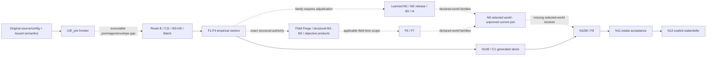

# W1-C source-to-PRE-V3 producer/consumer and ABI map

Status: **independent investigator return; 37 seams, 43 atomic findings; no integration/adoption decision.**
Canonical source cut: `9809203fd915a84bae056a67210e9213879840db`. Current code in the assigned checkout is byte-identical to that cut under `rawlsing_next/`. The launch-startup cut is `acbe2326c8f52dfe8bfa200e87c5c07a62a5c93a`; the assigned branch was already prepared through R2 `e9c86af556c4b44acc38bde10e83780d46f88774`. Startup remains an immutable input, not a rewritten launch base.

## How to read the records

`SEAMS.jsonl` is the machine-readable edge table. `W1C-S01..S37` are provisional lane C IDs, explicitly anchored to original Astra N/F/EE/AT, WG0–WG4, work-register and RRIF lineage IDs. They do not replace those namespaces. `ATOMIC_FINDINGS.jsonl` uses `W1C-AF01..AF43`, with `seam_id` reverse links for the first 37 findings.

`producer_code` and `receiver_code` name exact source contracts. `actual_first_consumer` names the receiving implementation/proposal **with its proof limit**, rather than inventing a historical first invocation. `producer_entrypoint_first_located_caller` and `located_callers` separately show direct imported-name call sites found by the bounded AST scan. Non-test Python calls are source-code calls, not deployment/production telemetry. `invocation_proved` is not promoted from static source. `runtime_evidence` identifies only the runs actually made here; the permitted local S2 observations remain separate from the shared `evidence_grade` vocabulary and from external reviewer receipts.

For interfaces with no verified real receiver, production invocation is UNKNOWN. A planned dossier in the receiver field is explicitly `PLANNED_RECEIVER_ONLY`, never an executable caller. Currentness is pinned to the stated cut. Neither file location nor an import confers source/scientific/actor authority.

## Whole path, preserving conditional scope

There is no source→actor shortcut. Structural relation, comparable temporal evidence, selected current world, model use, N11 and N12 have distinct owning contracts and rights. Existing competent retained products can satisfy a conditional input without a fresh raw-source read. F6/F7 are relation-scoped obligations, not mandatory per-wave serial stages.

## Seam matrix

| ID | Edge | Scoped status | Original stable anchors |
|---|---|---|---|
| W1C-S01 | SRC01..SRC35 configured source → C11 projection | `HISTORICAL_DISCONNECTED` | SRC01..SRC35, S15, P04, LIN-R157_SOURCE_CONFIGURATION |
| W1C-S02 | Source config / original inventory → WG0 prospective U/E_pre | `CANDIDATE_INPUT_ADAPTER_MISSING` | WG0, WG1, WG2, S01, S16, P08 |
| W1C-S03 | P1 E_pre plan → Batch manifest | `MANIFEST_ONLY_EXECUTABLE_JOB_GAP` | WG0, WG3, P07, P08 |
| W1C-S04 | P1 E_pre plan → Issued NativeWorkload | `ABI_ADAPTER_MISSING` | WG0, WG3, P08, S13, S14 |
| W1C-S05 | Native preimage bundle → Unary sourcefree workload | `CURRENT_SOURCEFREE_LOWERER` | WG0, WG1, P04, P08, F1 |
| W1C-S06 | ScientificFrontier + inventory/policy → Executable I05 catalog | `CURRENT_SOURCEFREE_RECONNECTOR` | WG0, WG2, WG3, EE04, EE07, P08 |
| W1C-S07 | NativeWorkload + current resolver → Admitted execution envelope | `CURRENT_OWNER_NO_ISSUER_VERIFIED` | WG1, WG2, WG3, S13, S14 |
| W1C-S08 | Admitted native workload → Route B | `CURRENT_STATIC_CALL_NO_NATIVE_RUN` | WG3, P05, P06 |
| W1C-S09 | Physical source + governed projection → C11 repository | `CURRENT_STATIC_COMPOSITION` | N1, F1, P01, P04, P05 |
| W1C-S10 | C11 + supplied query refs → I03 EmpiricalFact | `CURRENT_STATIC_CALL` | N2, N4, EE04, F1, F2 |
| W1C-S11 | C11 + discovery authority → I05 finite frontier | `CURRENT_STATIC_CALL` | N2, N4, EE07, F3, WG2, WG3 |
| W1C-S12 | Issued native requests/discoveries → Batch QUERY/DISCOVERY executor | `CURRENT_STATIC_CALL` | WG3, P07 |
| W1C-S13 | I03 facts and query witness → C1 computed analytical geometry | `CURRENT_STATIC_COMPUTED_CONSUMER` | N2, EE08, EE14, F2, F4, AT08, AT13 |
| W1C-S14 | I05 discovery → Recursive branch handoffs | `CURRENT_STATIC_RECONNECTOR` | N2, EE07, F3, Q06 |
| W1C-S15 | C1 analytical composition → N10E provider | `CURRENT_BOUNDED_PROVIDER` | N10E, W03, EE14, AT17 |
| W1C-S16 | I03 two-target joint fact → Field Forge count support | `CURRENT_NARROW_RELATION_OWNER` | N5, F01, F02, F5, EE15, AT22 |
| W1C-S17 | M01 discovery object graph → M1 learned adjudication | `CURRENT_CONDITIONAL_ADAPTER` | N3, L01, EE09 |
| W1C-S18 | M1 learned disposition → M2 immutable release | `CURRENT_CONDITIONAL_ADAPTER` | N3, L03, EE09 |
| W1C-S19 | M2 release artifacts → B5 lifecycle subject | `CURRENT_STATIC_ADAPTER_LOCAL_ONLY` | N3, N9, L04, EE16 |
| W1C-S20 | M2 subject / closures / release → Exact local representation resolver | `CURRENT_LOCAL_RELEASE_PATH` | N3, L03, L06, AT18, LIN-LEARNED_WORLD_PRODUCT |
| W1C-S21 | Empirical fact → Structural admission | `CURRENT_SEMANTIC_ISSUER_BOUNDARY` | N5, F02, F03, F5, EE15 |
| W1C-S22 | Field Forge relation → Admitted structural M1 basis | `CURRENT_NARROW_STRUCTURAL_ADAPTER` | N5, F5, AT23 |
| W1C-S23 | Structural V554 M1 evaluation → Structural V555 atomic route | `CURRENT_DISTINCT_M2_CONTRACT` | N5, N6, F5, G05 |
| W1C-S24 | Objective position fact → V557/V558 publication/context | `CURRENT_DEMANDED_OBJECTIVE_OWNER` | N6, F05, AT24 |
| W1C-S25 | Current P07 source-universe relations → F6 field/estimand composition | `GUARD_PRESENT_PRODUCT_CONSUMER_UNKNOWN` | N7, F6, F07, F08, EE13 |
| W1C-S26 | Historical F6M synthesis → Historical F6P partial-bound consumer | `HISTORICAL_TEST_ONLY_RECONNECTOR` | N7, F6, LIN-F6_HETEROGENEOUS_SYNTHESIS |
| W1C-S27 | Historical comparable anchors → Current F7 relation authority | `HISTORICAL_AUTHORITY_ABI_GAP` | N8E, F7, T02, T03, T04, LIN-F7_TEMPORAL_COMPARABILITY |
| W1C-S28 | Historical V553 pressure → Current structural temporal M1 admission | `LEGACY_PRODUCER_CURRENT_ADMISSION_GAP` | N8S, F7, T05, T06, T07 |
| W1C-S29 | F6/F7 admitted products → N9 world snapshot | `PLANNED_CURRENT_RECEIVER_UNKNOWN` | N7, N8E, N8S, N9, F6, F7, W01, AT31 |
| W1C-S30 | Current B5/M2 → Historical I01 lifecycle glue | `CURRENT_METHOD_SOURCEFREE_VERIFIED__FULL_I01_COMPATIBILITY_UNVERIFIED` | N9, L04, W02, LIN-I01_WORLD_LIFECYCLE |
| W1C-S31 | Current N10E/C1 → E03 progressive fixture | `CURRENT_FIXTURE_ONLY` | N10E, N10W, F8, AT33, LIN-N9_N10W_PROGRESSIVE |
| W1C-S32 | N9 selected snapshot → N10W progressive service | `PLANNED_NOT_PROVED_BY_E03` | N9, N10E, N10W, F8, W05 |
| W1C-S33 | Historical world binding → Historical R117 prefix consumer | `HISTORICAL_TEST_ONLY_RUNTIME_DEPENDENCY` | N9, N10W, F8, LIN-WORLD_BINDING |
| W1C-S34 | Service applicability → F8 source scope | `CURRENT_NARROW_BINDER` | N10W, F8, EE14, LIN-F8_SERVICE_SOURCE_SCOPE |
| W1C-S35 | F1..F8 scoped receipts → N11 acceptance | `PLANNED_OWNER_ADJUDICATION` | N0, N11, F1, F2, F3, F4, F5, F6, F7, F8, A04, A11 |
| W1C-S36 | N11 accepted product → N12 wake/defer | `PLANNED_AUTHORITY_HELD` | N11, N12, A12, AT35 |
| W1C-S37 | Survey empirical fact → Sorok actor belief/action | `PROHIBITED` | N12, G05, W07, AT34, AT35 |

## Four complete bounded traversals and reverse links

These are complete traces of the **actual inspected/tested subpath plus its explicit gap**. None is presented as a complete production source-to-N12 run.

### T1 — WG0 constructor, manifest acceptance, executable receiver gap

Forward: R157 historical config factory (`W1C-S01`) can target the existing C11 facade; it does not feed P1 automatically. P1 `d1278613e9e1a5d986ccce15782a697f19cbd722` takes `Original35Input(waves, scientific_method)` (`S02`), enumerates synthetic administered-item operation slots and constructs current `BatchUnitSpec`/`BatchManifest` (`S03`). W1C-RUN04 observed 35 synthetic waves, 70 supplied items, **840 units**, `no_drop_ok=True`, `TEST_ONLY_SOURCEFREE`. Every job ref has kind `PROGRAMMA_PYAT_EPRE_OPERATION`; the returned plan has no runtime catalog. The same fixed current Route B catalog resolves its own exact query; replacing only that requested ref with a P1 QUERY ref or a P1 DISCOVERY ref raises exact-preimage-unavailable. This is a controlled non-substitutability probe, not a claim that an unrelated fixture catalog should know original P1 waves.

**Gap:** P1 does not emit current `EmpiricalQuerySpec`, predicate, `DiscoveryAuthority`, projection/catalog, `NativeWorkload` envelope or independently issued resolver record (`S04`). Existing `compile_governed_frontier` already lowers a caller-frozen `ScientificFrontier`/inventory/policy into those test-only discovery owners (`S06`); reuse its semantic lowering where applicable. W1C-RUN02 exercised that current lowerer through real Batch/C11/I05 using synthetic input, conserved its eligible/pending/unsupported operation accounting, cold rebuilt identical results and ran a source-value fault/change/restore witness. This positive is independent of P1; there is no fabricated P1→I03 execution.

Reverse: actual I05 receipt ← Batch DISCOVERY unit ← exact discovery/catalog preimages ← governed frontier/native inventory (`S06/S11/S12`) ← **missing P1/source-inventory bridge** (`S02–S04`) ← original source/semantic issuer. The derived P1 U_unit ref is not proof of native household/person scope. `no_drop_ok` conserves supplied items; it is not an independent original administered-item census.

### T2 — local learned M2 release after PR #605

Forward: synthetic Route B graph (`S09–S11`) → selected discovery receipt and exact M1 family rule (`S17`) → learned disposition → I4 `adapt_m1_disposition_to_m2` registers subject and five closures, then constitutes exact `ReleaseCore` (`S18`) → `adapt_m2_release_to_b5` creates the lifecycle protocol (`S19`). Current M2 local path also registers exact representation, publishes a same-release binding and resolves the exact producer subject (`S20`). W1C-RUN01 passed the inspected Route B/M2/I4 suites, including full synthetic M01→M1→M2→B5 composition and the v1.1 foreign-binding tests.

The active PR605 tests 17/18 first require invalid foreign writer setup to fail atomically, then import the foreign exact subject, closures and release lawfully and still require downstream `PUBLICATION_BINDING_MISMATCH`. The old v1.0 archive is historical, not silently regraded. M2 `publish_binding` does not itself produce B5 CURRENT, source permission or consumer/model use. I4 runs B5 actions only when explicitly requested in its contract.

Reverse: resolved subject ← exact same-release representation/binding ← M2 release/closures ← exact M1 disposition and family rule ← selected M01 receipt/fact/query/predicate ← governed C11. Any missing/foreign exact preimage breaks the claimed identity. **Gap:** source-qualified producer, real current non-test receiver, external authenticated custody and relevant permissions remain distinct. Structural `m2_v555_atomic_route.M2Evaluation` (`S23`) is not this learned `ReleaseCore` ABI.

Changed historical blocker (`S30`): RRIF-D5 at its old cut reported `AttributeError` for absent `verify_m2_release_subject_exact`. Current post-PR605 B5 defines it. W1C-RUN04 staged an actual current I4-produced lifecycle subject, verified the matching native M2 release and observed `RELEASE_UNAVAILABLE` with missing M2 preimages. This establishes the current method’s sourcefree feasibility. **Full historical I01 build/restore/serve, durability and selected-world overlays were not run and are not declared compatible.**

### T3 — N9→N10W claim versus actual E03 and historical world binding

Forward actual current path (`S31`): `build_synthetic_world` builds 58 synthetic rows using test fixture imports; `run_single_conditioner_step` calls current N10E; subsequent steps call C1 multi-conditioner composition directly; each step’s own produced evidence is passed separately to plain F8. W1C-RUN01 passed the E03 tests and observed the asserted **32/16/8 denominators; 9/16, 5/8, 3/4 target fractions**, both response alternatives retained and uncertainty unquantified. No selected N9 world is supplied to that chain. Current N10E’s one-conditioner ABI is distinct from C1’s multi-conditioner interface (`S15`).

Reverse: F8 exact evidence ref ← step-owned computed slice ← C1/N10E exact empirical query/predicate/witness ← synthetic C11/source refs ← **E03 fixture, not a current/as-of N9 resolver**. The canonical N9→N10W edge remains unproved (`S32`); an E03 file/import/green test cannot discharge it.

Strongest inspected historical reconnectors: I01K lifecycle glue after the above changed method (`S30`), and R117 `849a76de18ef627c3c403b426ebe70f0951a7e7b` world binding/prefix consumption (`S33`). R117 calls `product.nonparent.consume` from the pinned P41 runtime `f27d1101048638bba395143a48efb7ef00bfcda4`; its loader uses `git archive`, and the pinned runtime packet/current world-binding paths are absent from the current tree. It reads structural catalog values and empirical prefixes at test-only grain. `operative_N9=False`, `operative_N10W=False`, `route_probability=None`. We read it, did not execute its arbitrary historical runtime loader. **Gap:** current selected-world owner, world/as-of/dependency identity, versioned current-owner compatibility and real receiver; historical partial acceptance is not current installation.

### T4 — prohibited source→actor edge and actual zero-positive consumer

Forward attempted edge (`S37`): a survey `EmpiricalFact`/correlation cannot become an actor belief, desire or action. Lawful objective ingress (`S16/S21/S22`) preserves empirical versus structural meaning, with exact admitted use and negatives; N11/N12 remain separate (`S35/S36`). The existing GT0 PRE-V3→V3 adapter binds the authoritative zero-positive guard with `GT0_NO_ACTOR_BOUND` and `VALIDATE_ZERO_EFFECT_ONLY`.

W1C-RUN03 exercised that actual guard: `DENY_ZERO_EFFECT`, `ZERO_POSITIVE_REGISTRY`, `before == after`; a controlled guard-version mutation refused with `GT0V3GuardBindingError`. This is a **sourcefree zero-effect firewall witness**, not a performed actor transition and not universal security proof.

Reverse: unchanged checkpoint + guard receipt ← authoritative V3 zero-positive decision ← opaque-provenance GT0 envelope ← objective reference-preserving PRE-V3 lineage. There is no positive actor fact to trace back to survey values. **Gap:** no direct adapter is allowed; any future positive actor seam needs its own separately governed ontology, issuer and transition authority following the competent N11/N12 decision.

## Existing reconnectors versus missing work

| Existing capital | What is actually missing at the next seam |
|---|---|
| Current native-preimage/unary compiler and governed-frontier lowerer (`S05/S06`) | Source-competent original item/frontier/permission input and P1 lowering/envelope adapter; no new general query engine needed |
| Current Route B/C11/I03/I05/Batch (`S07–S12`) | Actual eligible invoked workloads and product/consumer receipts; manifest declarations do not supply exact preimages |
| Current I4 learned M1→M2→B5 (`S17–S20`) | Family-scoped rule/validator/currentness and non-test receiving invocation; independent external custody only if the stronger claim requires it |
| Current narrow Field Forge/admission/structural/objective owners (`S16/S21–S24`) | Actual qualified relation/structural focal claim and demanded output population; no generic correlation-to-cause conversion |
| Historical F6M→F6P partial-bound consumer (`S26`) | Current admitted source pair/target and real receiver; preserve unknown mass instead of reviving S03FO renormalization |
| Current source-relation guards; historical exact temporal comparability (`S25/S27/S28`) | Versioned comparable-wave authority/request/custody and current temporal product/world consumer; `TEMPORAL_EVIDENCE` is not `TEMPORAL_COMPARABILITY` |
| Current B5/M2 identity cross-check and historical I01K (`S30`) | Full overlay compatibility and selected-world/durable contract; old absent-method claim alone is obsolete |
| Current E03 and historical R117/P41 (`S31–S33`) | Operative N9→N10W receiver and qualified world/model inputs; fixture output is not selected original world |
| Existing N11/N12 law (`S35/S36`) | Actual estate acceptance and competent wake/defer, not more filenames or test-count aggregation |

## Counts, namespaces and bounded completeness

The frozen tree contains **8,109 tracked paths**. All **350 tracked `rawlsing_next/**/*.py` files** parsed successfully for the bounded imported-name call scan. This is syntax/caller-search coverage, not full human semantic review of all 350 files. Consequential edge evidence is anchored below to **52 distinct (commit,path) sources**; functions are direct-read at their exact source ranges and schema/signature. Static scanning did not follow arbitrary dynamic imports, reflection, callbacks or external deployments. Selected historical cuts were read only for named R157/P1/F6M/F6P/F7/I01K/R117 dependencies; no 845-branch recensus or global history search was performed. `main` was not exhaustively audited; original legacy paths were read only where needed for the named temporal genealogy. Lane B/G own broader current/historical variant comparison.

The JSON global work register has **151** `G001...`-style work classes; Markdown and `TASK_LEDGER_101_MACHINE.json` have **101** `G01...`-style classes. Preserve both ID grains. The estate matrix has 35 sources and **1,890 axes**, and relation matrix 63 temporal candidates / 36 family-field candidates. None is an issued original-item operation denominator or completion percentage. SRC01–SRC35 are retained as a governed estate scope; this lane did not certify 35 original instruments. SRC04/SRC17 scoped native C11 and SRC04 177 unary/31 joint products are recorded by Programma as retained owner claims (`AF41`), not freshly executed/authenticated by this lane. The historical SRC04 `B` and SRC17 `P` dossiers are representation-grain records, not contradictory current full-source verdicts.

Cross-lane dependencies are carried on every row: A for original plan identity/conditionality; B for current/pending code and integration; D for original inventory/source/semantic/estimand/issuer; E for current owner/reviewer/decision provenance; G for exact historical variants. W1-C proposes no scientific choice or author/reviewer adoption. Library was not available among the connected tools and was not represented as inspected.

## Exact Python ABI excerpts

These signatures come from parsing the exact cited source, not from guessed APIs. Class/record schemas, authority, input qualifications, negatives and version migration are in `SEAMS.jsonl`.

| Seam | Exact source location | Signature |
|---|---|---|
| W1C-S01 | `rawlsing_next/source_configuration/factory.py:516` | `def build_validated_c11_release_from_config(config: SourceConfig \| Mapping[str, Any], *, stream: ExactPhysicalCellStream \| None=None, incidence: PhysicalSourceIncidence \| None=None, source_sha256: str \| None=None, row_count: int \| None=None, row_native_keys: Mapping[int, ExactRef \| TypedAbsence] \| None=None, batch_size: int=10000)` |
| W1C-S01 | `rawlsing_next/pre553_source_backed_c11_facade.py:587` | `def build_validated_source_backed_c11_release(incidence: PhysicalSourceIncidence, projection: GovernedC11Projection \| None, *, batch_size: int=10000)` |
| W1C-S02 | `rawlsing_next/programma_pyat_original35_constructor.py:783` | `def construct_original35_epre(input: Original35Input) -> Original35EprePlan` |
| W1C-S03 | `rawlsing_next/programma_pyat_original35_constructor.py:518` | `def _operation(*, wave: WaveAdmission, item: EligibleItem, kind: str, target: str \| None=None, conditioner: ConditionerBinding \| None=None, conditioner_value: str \| None=None, joint: JointBinding \| None=None, joint_value: str \| None=None, stratum: ExactRef \| None=None, status: str, reason: str \| None, semantic_input_refs: Iterable[ExactRef]=()) -> EpreOperation` |
| W1C-S05 | `rawlsing_next/pre553_universal_workload.py:143` | `def compile_universal_workload(*, bundle: NativePreimageBundle, as_of: str, host: str, purpose: str, measure_kind: str='RAW') -> WorkloadCompilation` |
| W1C-S06 | `rawlsing_next/pre553_universal_workload.py:473` | `def compile_governed_frontier(*, bundle: NativePreimageBundle, inventory: SourceInventory, policy: GrammarPolicy, frontier: ScientificFrontier, as_of: str, host: str, purpose: str) -> GovernedFrontierCompilation` |
| W1C-S06 | `rawlsing_next/pre553_native_workload_binding.py:638` | `def build_frontier_native_catalog(*, bundle: NativePreimageBundle, inventory: SourceInventory, policy: Any, frontier: Any, as_of: str) -> tuple[NativeCatalog, AuthoritySnapshot, Any, ExactRef]` |
| W1C-S07 | `rawlsing_next/pre553_issued_workload.py:211` | `def admit(workload: NativeWorkload, resolver: CurrentDecisionResolver, *, host: str, purpose: str, allow_test_only: bool=False, expected_wave: OriginalWaveIdentity \| None=None) -> IssuedWorkloadRecord` |
| W1C-S08 | `rawlsing_next/pre553_issued_workload.py:270` | `def execute_issued_workload(workload: NativeWorkload, resolver: CurrentDecisionResolver, *, source_factory: Callable[[ExactRef], Any], host: str, purpose: str, allow_test_only: bool=False, prior_receipts=(), max_units=None, expected_wave: OriginalWaveIdentity \| None=None)` |
| W1C-S08 | `rawlsing_next/pre553_route_b_production.py:494` | `def execute_route_b_production(*, source: PhysicalSourceIncidence \| ExactPhysicalCellStream, projection: GovernedC11Projection, runtime_catalog: RuntimeObjectCatalog, i03_requests: Iterable[I03ExecutionRequest \| Mapping[str, Any]], discovery_authority_ref: ExactRef \| Mapping[str, Any], cache: SourceBackedC11SessionCache \| None=None, batch_size: int=10000) -> RouteBProductionResult` |
| W1C-S09 | `rawlsing_next/pre553_route_b_production.py:494` | `def execute_route_b_production(*, source: PhysicalSourceIncidence \| ExactPhysicalCellStream, projection: GovernedC11Projection, runtime_catalog: RuntimeObjectCatalog, i03_requests: Iterable[I03ExecutionRequest \| Mapping[str, Any]], discovery_authority_ref: ExactRef \| Mapping[str, Any], cache: SourceBackedC11SessionCache \| None=None, batch_size: int=10000) -> RouteBProductionResult` |
| W1C-S09 | `rawlsing_next/pre553_source_backed_c11_facade.py:642` | `def build_source_backed_c11_repository(source, projection, *, cache=None, batch_size=10000)` |
| W1C-S10 | `rawlsing_next/pre553_route_b_production.py:494` | `def execute_route_b_production(*, source: PhysicalSourceIncidence \| ExactPhysicalCellStream, projection: GovernedC11Projection, runtime_catalog: RuntimeObjectCatalog, i03_requests: Iterable[I03ExecutionRequest \| Mapping[str, Any]], discovery_authority_ref: ExactRef \| Mapping[str, Any], cache: SourceBackedC11SessionCache \| None=None, batch_size: int=10000) -> RouteBProductionResult` |
| W1C-S10 | `rawlsing_next/pre553_carrier_execution.py:427` | `def execute_i03(self, *, query_ref: ExactRef \| Mapping[str, Any], predicate_ref: ExactRef \| Mapping[str, Any]) -> QueryExecutionResult` |
| W1C-S11 | `rawlsing_next/pre553_route_b_production.py:494` | `def execute_route_b_production(*, source: PhysicalSourceIncidence \| ExactPhysicalCellStream, projection: GovernedC11Projection, runtime_catalog: RuntimeObjectCatalog, i03_requests: Iterable[I03ExecutionRequest \| Mapping[str, Any]], discovery_authority_ref: ExactRef \| Mapping[str, Any], cache: SourceBackedC11SessionCache \| None=None, batch_size: int=10000) -> RouteBProductionResult` |
| W1C-S11 | `rawlsing_next/pre553_discovery_exact.py:1050` | `def execute_exact_bounded_discovery(*, repository, discovery_authority: DiscoveryAuthority, authority_registry: AuthorityRegistry, release_refs: Iterable[ExactRef], predicate_catalog: Iterable[EmpiricalPredicate], query_template_catalog: Iterable[EmpiricalQuerySpec]) -> ExactBoundedDiscoveryResult` |
| W1C-S12 | `rawlsing_next/pre553_issued_workload.py:270` | `def execute_issued_workload(workload: NativeWorkload, resolver: CurrentDecisionResolver, *, source_factory: Callable[[ExactRef], Any], host: str, purpose: str, allow_test_only: bool=False, prior_receipts=(), max_units=None, expected_wave: OriginalWaveIdentity \| None=None)` |
| W1C-S13 | `rawlsing_next/pre553_empirical_query.py:373` | `def execute_empirical_query(*, repository: C11Repository, query: EmpiricalQuerySpec, predicate: EmpiricalPredicate, authority_registry: AuthorityRegistry, release_refs: Iterable[ExactRef]) -> QueryExecutionResult` |
| W1C-S13 | `rawlsing_next/pre553_analytical_composition.py:1008` | `def compose_positioned_subject_possibility(*, repository: Any, empirical_query: EmpiricalQuerySpec, predicate: EmpiricalPredicate, authority_registry: Any, release_refs: Iterable[ExactRef], consumer_query: PositionedSubjectPossibilityQuery, model_rule: PositionedSubjectPossibilityModelRule, condition_binding_witness: ConditionValueBindingWitness, discovery_result: ExactBoundedDiscoveryResult \| None=None, discovery_receipt_ref: ExactRef \| None=None, recursive_handoff: RecursiveBranchHandoff \| None=None) -> AnalyticalCompositionResult` |
| W1C-S14 | `rawlsing_next/pre553_discovery_exact.py:1050` | `def execute_exact_bounded_discovery(*, repository, discovery_authority: DiscoveryAuthority, authority_registry: AuthorityRegistry, release_refs: Iterable[ExactRef], predicate_catalog: Iterable[EmpiricalPredicate], query_template_catalog: Iterable[EmpiricalQuerySpec]) -> ExactBoundedDiscoveryResult` |
| W1C-S14 | `rawlsing_next/pre553_recursive_handoff.py:516` | `def execute_exact_bounded_discovery_with_handoffs(*, repository: C11Repository, discovery_authority: DiscoveryAuthority, authority_registry: AuthorityRegistry, release_refs: Iterable[ExactRef \| Mapping[str, Any]], predicate_catalog: Iterable[EmpiricalPredicate], query_template_catalog: Iterable[EmpiricalQuerySpec]) -> RecursiveHandoffDiscoveryResult` |
| W1C-S15 | `rawlsing_next/pre553_analytical_composition.py:1008` | `def compose_positioned_subject_possibility(*, repository: Any, empirical_query: EmpiricalQuerySpec, predicate: EmpiricalPredicate, authority_registry: Any, release_refs: Iterable[ExactRef], consumer_query: PositionedSubjectPossibilityQuery, model_rule: PositionedSubjectPossibilityModelRule, condition_binding_witness: ConditionValueBindingWitness, discovery_result: ExactBoundedDiscoveryResult \| None=None, discovery_receipt_ref: ExactRef \| None=None, recursive_handoff: RecursiveBranchHandoff \| None=None) -> AnalyticalCompositionResult` |
| W1C-S15 | `rawlsing_next/pre553_empirical_possibility_provider.py:531` | `def provide_empirical_possibility_slice(*, repository: Any, empirical_query: Any, predicate: Any, authority_registry: Any, release_refs: Iterable[ExactRef], consumer_query: PositionedSubjectPossibilityQuery, model_rule: PositionedSubjectPossibilityModelRule, condition_binding_witness: Any) -> EmpiricalPossibilitySliceProviderResult` |
| W1C-S16 | `rawlsing_next/pre553_empirical_query.py:373` | `def execute_empirical_query(*, repository: C11Repository, query: EmpiricalQuerySpec, predicate: EmpiricalPredicate, authority_registry: AuthorityRegistry, release_refs: Iterable[ExactRef]) -> QueryExecutionResult` |
| W1C-S16 | `rawlsing_next/field_forge_conditional_support.py:467` | `def produce_exact_conditional_support_profile(*, joint_fact: EmpiricalFact, joint_query: EmpiricalQuerySpec, conditioner_ref: ExactRef \| Mapping[str, Any], target_ref: ExactRef \| Mapping[str, Any], producer_permission_ceiling: Iterable[str], relation_permission_ceiling: Iterable[str] \| None=None) -> ExactConditionalSupportProfile` |
| W1C-S17 | `rawlsing_next/pre553_learned_world_composition.py:750` | `def build_m1_bundle_from_m01(result: RouteBProductionResult, *, contract: LearnedWorldProductContractBinding, family_rule_binding: M1FamilyRuleBinding \| None, selected_discovery_receipt_refs: Iterable[ExactRef], requested_scope: Mapping[str, Any], additional_authority_snapshots: Iterable[Any]=(), prerequisite_channels: Iterable[M1PrerequisiteChannel]=(), additional_dependency_refs: Iterable[ExactRef]=()) -> M1AdjudicationInputBundle` |
| W1C-S18 | `rawlsing_next/pre553_learned_empirical_adjudication.py:2103` | `def adjudicate_learned_empirical(input_bundle: M1AdjudicationInputBundle, family_rule_binding: M1FamilyRuleBinding \| None, *, validator_registry: M1ValidatorRegistry) -> LearnedEmpiricalDisposition` |
| W1C-S18 | `rawlsing_next/pre553_learned_world_composition.py:818` | `def adapt_m1_disposition_to_m2(disposition: LearnedEmpiricalDisposition, *, contract: LearnedWorldProductContractBinding, repository: M2Repository) -> M2ProductArtifacts` |
| W1C-S19 | `rawlsing_next/pre553_learned_world_composition.py:818` | `def adapt_m1_disposition_to_m2(disposition: LearnedEmpiricalDisposition, *, contract: LearnedWorldProductContractBinding, repository: M2Repository) -> M2ProductArtifacts` |
| W1C-S19 | `rawlsing_next/pre553_learned_world_composition.py:936` | `def adapt_m2_release_to_b5(artifacts: M2ProductArtifacts, *, contract: LearnedWorldProductContractBinding) -> M2B5LifecycleProtocolView` |
| W1C-S20 | `rawlsing_next/pre553_learned_product_release.py:791` | `def constitute_release(repository: M2Repository, *, release_subject_ref: ExactRef \| Mapping[str, Any], release_subject_kind: str, semantic_producer_contract_ref: ExactRef \| Mapping[str, Any], authority_closure_ref: ExactRef \| Mapping[str, Any], dependency_closure_ref: ExactRef \| Mapping[str, Any], determinant_closure_ref: ExactRef \| Mapping[str, Any], replay_reconstruction_ref: ExactRef \| Mapping[str, Any], explanation_lineage_ref: ExactRef \| Mapping[str, Any], release_contract_ref: ExactRef \| Mapping[str, Any]=M2_RELEASE_CONTRACT_REF) -> ReleaseCore` |
| W1C-S20 | `rawlsing_next/pre553_learned_product_release.py:1024` | `def resolve_release_exact(repository: M2Repository, release_ref: ExactRef \| Mapping[str, Any], *, publication_binding_refs: Sequence[ExactRef \| Mapping[str, Any]]=(), unavailable_binding_refs: Iterable[ExactRef \| Mapping[str, Any]]=()) -> ResolutionResult` |
| W1C-S21 | `rawlsing_next/pre553_empirical_query.py:373` | `def execute_empirical_query(*, repository: C11Repository, query: EmpiricalQuerySpec, predicate: EmpiricalPredicate, authority_registry: AuthorityRegistry, release_refs: Iterable[ExactRef]) -> QueryExecutionResult` |
| W1C-S22 | `rawlsing_next/wave1_ff_prev3_relation_admission.py:569` | `def evaluate_gt2_relation_admission(request: RelationAdmissionRequest, rule: FieldForgeRelationAdmissionRule) -> Prev3FieldForgeRelationAdmission` |
| W1C-S22 | `rawlsing_next/m1_admitted_field_forge_relation_v554_ingress.py:355` | `def prepare_admitted_field_forge_relation_basis(payload: Any) -> RelationBasisPreparation` |
| W1C-S23 | `rawlsing_next/m1_temporal_v554_admission_dedup.py:291` | `def evaluate_m1_temporal_v554_admission_dedup(payload: Any) -> M1Evaluation` |
| W1C-S23 | `rawlsing_next/m2_v555_atomic_route.py:170` | `def evaluate_m2_v555_atomic_route(m1: Any, request: Any) -> M2Evaluation` |
| W1C-S24 | `rawlsing_next/prev3_objective_position_v557_v558_publication.py:423` | `def publish_objective_position_fact(fact: ObjectivePositionFact) -> ObjectivePositionPublicationCarrier` |
| W1C-S24 | `rawlsing_next/prev3_objective_position_v557_v558_publication.py:622` | `def resolve_bound_objective_position_context(carrier: ObjectivePositionPublicationCarrier, query: ContextQuery, *, external_store: Mapping[str, Mapping[str, Any]] \| None=None) -> ResolutionResult` |
| W1C-S25 | `rawlsing_next/pre553_source_relations.py:794` | `def guard_estimand_composition(*, resolver: SourceRelationResolver, source_universe_refs: Iterable[ExactRef \| Mapping[str, Any]], operation_scope: Any, target_use: str, effective_scope: Any, semantic_equivalence_ref: ExactRef \| Mapping[str, Any], overlap_nonduplication_ref: ExactRef \| Mapping[str, Any], estimand_composition_ref: ExactRef \| Mapping[str, Any], composition_authority_operation: str, semantic_equivalence_authority_operation: str='I07_SOURCE_SEMANTIC_EQUIVALENCE', overlap_authority_operation: str='I07_OVERLAP_NON_DUPLICATION') -> OperationGuardReceipt` |
| W1C-S26 | `WORKER_RETURNS/PYAT-R29-F6M-NATIVE-AUTHORITY-REPAIR-R1/candidate/rawlsing_next/pre553_heterogeneous_synthesis.py:186` | `def synthesize(target: dict, sources: list[dict], policy: dict, admit: Callable[[dict, dict, str], bool] \| None=None) -> dict` |
| W1C-S26 | `WORKER_RETURNS/PYAT-R39-F6P-PARTIAL-BOUND-EVIDENCE-CONSUMER-R1/f6p_partial_bound_evidence_consumer.py:125` | `def verify_f6m_bundle(bundle)` |
| W1C-S27 | `rawlsing_next/pre553_temporal_comparability.py:836` | `def compare_temporal_anchors(request: TemporalComparisonRequest, registry: AuthorityRegistry \| None=None) -> TemporalRelationReceipt` |
| W1C-S28 | `rawlsing_next/m1_temporal_v554_admission_dedup.py:291` | `def evaluate_m1_temporal_v554_admission_dedup(payload: Any) -> M1Evaluation` |
| W1C-S30 | `rawlsing_next/pre553_learned_product_lifecycle.py:1919` | `def verify_m2_release_subject_exact(self, repository: Any, release_ref: ExactRef \| Mapping[str, Any]) -> LearnedProductLifecycleSubject` |
| W1C-S30 | `rawlsing_next/pre553_i01_sourcefree_world_lifecycle_candidate.py:213` | `def serve(product, *, historical=False)` |
| W1C-S31 | `rawlsing_next/pre553_empirical_possibility_provider.py:531` | `def provide_empirical_possibility_slice(*, repository: Any, empirical_query: Any, predicate: Any, authority_registry: Any, release_refs: Iterable[ExactRef], consumer_query: PositionedSubjectPossibilityQuery, model_rule: PositionedSubjectPossibilityModelRule, condition_binding_witness: Any) -> EmpiricalPossibilitySliceProviderResult` |
| W1C-S31 | `rawlsing_next/pre553_n9_n10w_progressive_candidate.py:466` | `def run_progressive_chain(world: dict \| None=None) -> ProgressiveChainResult` |
| W1C-S32 | `rawlsing_next/pre553_n9_n10w_progressive_candidate.py:133` | `def build_synthetic_world(*, tag: str=E03_TAG) -> dict` |
| W1C-S33 | `rawlsing_next/pre553_world_conditioned_progressive_service.py:120` | `def consume_world_conditioned_prefixes(*, snapshot: Any, catalog: Any, prefixes: Sequence[WorldConditionedPrefix], budget_tokens: int=5) -> tuple[WorldConditionedPrefixResult, ...]` |
| W1C-S34 | `rawlsing_next/pre553_service_f8_source_scope_binding.py:927` | `def evaluate_bound_positioned_subject_possibility(*, binding: ServiceApplicabilityF8SourceScopeBinding, request: ServiceApplicabilityF8ScopeBindingRequest, receipt: CandidateClassApplicabilityReceipt, query: PositionedSubjectPossibilityQuery, rule: PositionedSubjectPossibilityModelRule, evidence: Iterable[PossibilitySliceEvidence]) -> PositionedSubjectPossibilityResult` |

## Evidence index

Source cuts below are evidence versions, not this return’s publication commit. Per-edge source ranges, supported assertions and counterevidence are machine-readable in both JSONL tables. Historical author/reviewer claims remain separately attributed; no old PASS is relabeled as our execution.

| Exact source path | Git commit | Git blob |
|---|---|---|
| `WORKER_RETURNS/PYAT-R39-F6P-PARTIAL-BOUND-EVIDENCE-CONSUMER-R1/f6p_partial_bound_evidence_consumer.py` | `016870e86913e6f7a811a51db6aba2d741bcfe58` | `8fa992899293f454d7abded36831a4b4a362df8e` |
| `WORKER_RETURNS/PYAT-R29-F6M-NATIVE-AUTHORITY-REPAIR-R1/candidate/rawlsing_next/pre553_heterogeneous_synthesis.py` | `1f1c72f883d0d7a6d11d7df8bad75c37d06c3ffa` | `2df811d76db258d98d89ffb43c830cb221ff9a7d` |
| `rawlsing_next/pre553_universal_world_binding.py` | `849a76de18ef627c3c403b426ebe70f0951a7e7b` | `dfb1e9fb72f1ee4b50fd7138fe978ce50db49f37` |
| `rawlsing_next/pre553_world_conditioned_progressive_service.py` | `849a76de18ef627c3c403b426ebe70f0951a7e7b` | `db573027a2416f1b43f2bc47d6f2e3b9d5cd3b31` |
| `PYAT_CONTROL_ROOM/ASTRA_PYAT_INTEGRATED_DEVELOPMENT_ATLAS_R1/ACCEPTANCE.md` | `9809203fd915a84bae056a67210e9213879840db` | `49f8a266d5330bab6010f35be4e5b0210d326917` |
| `PYAT_CONTROL_ROOM/ASTRA_PYAT_INTEGRATED_DEVELOPMENT_ATLAS_R1/nodes/N11.md` | `9809203fd915a84bae056a67210e9213879840db` | `f4f600a97d6ca92fe17b3426c1acb5fe3b201b6a` |
| `PYAT_CONTROL_ROOM/ASTRA_PYAT_INTEGRATED_DEVELOPMENT_ATLAS_R1/nodes/N12.md` | `9809203fd915a84bae056a67210e9213879840db` | `ac83e3adc83120cbd5b30d5af6d42ebcfaab78ee` |
| `PYAT_CONTROL_ROOM/ASTRA_PYAT_INTEGRATED_DEVELOPMENT_ATLAS_R1/nodes/N7.md` | `9809203fd915a84bae056a67210e9213879840db` | `75ada5f2f187a76f45d3913a2dc927df96eaa578` |
| `PYAT_CONTROL_ROOM/ASTRA_PYAT_INTEGRATED_DEVELOPMENT_ATLAS_R1/nodes/N9.md` | `9809203fd915a84bae056a67210e9213879840db` | `20827a3187f83f32228fcaceee07e4bdf4847b22` |
| `PYAT_CONTROL_ROOM/BRANCH_RECOVERY_R1/RRIF_FINITE_TERMINAL_CLOSEOUT_20261101.md` | `9809203fd915a84bae056a67210e9213879840db` | `03e609b5e30864ec4bc1a93406ce639f7ab40fa6` |
| `PYAT_CONTROL_ROOM/PROGRAMMA_PYAT/00_PROGRAMMA_PYAT.md` | `9809203fd915a84bae056a67210e9213879840db` | `d5458a8203465b0987f85409e8e12281c3cb84e2` |
| `PYAT_CONTROL_ROOM/WHOLE_MACHINE_COMPLETION_R1/ESTATE_35X_REQUIREMENTS_MATRIX.json` | `9809203fd915a84bae056a67210e9213879840db` | `2ad9a001aefef4889d8ac48a2a81cd806dec50d6` |
| `PYAT_CONTROL_ROOM/WHOLE_MACHINE_COMPLETION_R1/GLOBAL_F6_F7_F8_RELATION_SCOPE_MATRIX.json` | `9809203fd915a84bae056a67210e9213879840db` | `8870545724d2b3353e4cb4125bc06c041d463954` |
| `PYAT_CONTROL_ROOM/WHOLE_MACHINE_COMPLETION_R1/GLOBAL_WORK_REGISTER.json` | `9809203fd915a84bae056a67210e9213879840db` | `7fb47b5d57d4d207847aec347734f5888f70b75e` |
| `PYAT_CONTROL_ROOM/WHOLE_MACHINE_COMPLETION_R1/TASK_LEDGER_101_MACHINE.json` | `9809203fd915a84bae056a67210e9213879840db` | `45be0f82e72ab37bcb972236b1ef3a827b1f95ac` |
| `data/ddm_build_copy/ddm_v553_temporal_pressure.py` | `9809203fd915a84bae056a67210e9213879840db` | `5304b70f9f6522c5ae3893eff215c1d445681983` |
| `rawlsing_next/field_forge_conditional_support.py` | `9809203fd915a84bae056a67210e9213879840db` | `a70decb20747d84cbcbe27d1280babc6de88ef33` |
| `rawlsing_next/m1_admitted_field_forge_relation_v554_ingress.py` | `9809203fd915a84bae056a67210e9213879840db` | `0aeacd9e66c7e4340b36e1b622bb5c9bf2865fd5` |
| `rawlsing_next/m1_temporal_v554_admission_dedup.py` | `9809203fd915a84bae056a67210e9213879840db` | `e8bd6376720a2de132b384e7771d71d8d39cf261` |
| `rawlsing_next/m2_v555_atomic_route.py` | `9809203fd915a84bae056a67210e9213879840db` | `deef8a60613635a10faf7d89cd8cdf0c3b8a0710` |
| `rawlsing_next/pre553_analytical_composition.py` | `9809203fd915a84bae056a67210e9213879840db` | `604c8d591d4cc2b646e9b149cdb233fc9d69cf6b` |
| `rawlsing_next/pre553_batch_runner.py` | `9809203fd915a84bae056a67210e9213879840db` | `2d291600b9a10c56d9c6f6de7f7d619f6c52e829` |
| `rawlsing_next/pre553_carrier_execution.py` | `9809203fd915a84bae056a67210e9213879840db` | `see exact Git cut` |
| `rawlsing_next/pre553_discovery_exact.py` | `9809203fd915a84bae056a67210e9213879840db` | `905f24d114419dbdd93879ad2bee5b59dd2f23af` |
| `rawlsing_next/pre553_empirical_authority.py` | `9809203fd915a84bae056a67210e9213879840db` | `ca65a7fd4d52f0c44447434559b1d09412e7aa39` |
| `rawlsing_next/pre553_empirical_objects.py` | `9809203fd915a84bae056a67210e9213879840db` | `a61365b994e5c3c50de0f598fcf40e90abf757b6` |
| `rawlsing_next/pre553_empirical_possibility_provider.py` | `9809203fd915a84bae056a67210e9213879840db` | `23167aa25291fb148b1e3cf210ac33fe7769b783` |
| `rawlsing_next/pre553_empirical_query.py` | `9809203fd915a84bae056a67210e9213879840db` | `03facecf70890bfd13b80418620d274cbcd69d02` |
| `rawlsing_next/pre553_issued_workload.py` | `9809203fd915a84bae056a67210e9213879840db` | `31e84f49d624f5524906e9e7839d2873106f8249` |
| `rawlsing_next/pre553_learned_empirical_adjudication.py` | `9809203fd915a84bae056a67210e9213879840db` | `761db5924639eacf1c7c8b78a209326c1c51e2c5` |
| `rawlsing_next/pre553_learned_product_lifecycle.py` | `9809203fd915a84bae056a67210e9213879840db` | `dadf2362f3195c28ebaf97655e28cdba72c04fb3` |
| `rawlsing_next/pre553_learned_product_release.py` | `9809203fd915a84bae056a67210e9213879840db` | `1cb7692399aad8fb272c8c9ce956719527829007` |
| `rawlsing_next/pre553_learned_world_composition.py` | `9809203fd915a84bae056a67210e9213879840db` | `4a8e27a226a9c06606f5ba493d2cc7356d491a7b` |
| `rawlsing_next/pre553_n9_n10w_progressive_candidate.py` | `9809203fd915a84bae056a67210e9213879840db` | `84d404147547767be8ecd4b6e1541f5fa3a8c8a2` |
| `rawlsing_next/pre553_native_workload_binding.py` | `9809203fd915a84bae056a67210e9213879840db` | `dac73e484f8619088f5c6701b2b6991c07540f3b` |
| `rawlsing_next/pre553_recursive_handoff.py` | `9809203fd915a84bae056a67210e9213879840db` | `868f43bf9869af5501fd67c3de7a2703ba4cb1b4` |
| `rawlsing_next/pre553_route_b_production.py` | `9809203fd915a84bae056a67210e9213879840db` | `2385cd327dced3c5b887b59085aa0d21b04d78c3` |
| `rawlsing_next/pre553_service_f8_source_scope_binding.py` | `9809203fd915a84bae056a67210e9213879840db` | `848d2d0eedb04b792747e9d6aaa49bb39d108a2c` |
| `rawlsing_next/pre553_service_source_applicability.py` | `9809203fd915a84bae056a67210e9213879840db` | `3e40caca29e8c96ee1f412f919cfc7dba63f96c4` |
| `rawlsing_next/pre553_source_backed_c11_facade.py` | `9809203fd915a84bae056a67210e9213879840db` | `8a761119e4a8d68eb291fc4edfadb52e027f8284` |
| `rawlsing_next/pre553_source_native_preimage_adapter.py` | `9809203fd915a84bae056a67210e9213879840db` | `a6299c1a6e8b26bd055ced1f49e5b757f20ccd8c` |
| `rawlsing_next/pre553_source_relations.py` | `9809203fd915a84bae056a67210e9213879840db` | `5b67e3f98a5faf95a6c82700af2346fef6e306a5` |
| `rawlsing_next/pre553_structural_admission.py` | `9809203fd915a84bae056a67210e9213879840db` | `fe8f706afbb5739d026846952681081b2937e9a8` |
| `rawlsing_next/pre553_universal_workload.py` | `9809203fd915a84bae056a67210e9213879840db` | `8e7fe00a3ed008361d9f3c501e7782b2de3a636e` |
| `rawlsing_next/prev3_objective_position_v557_v558_publication.py` | `9809203fd915a84bae056a67210e9213879840db` | `7d2a5dbb3e0979c599632645867aa48a336a8e79` |
| `rawlsing_next/tests/test_pre553_route_b_production.py` | `9809203fd915a84bae056a67210e9213879840db` | `see exact Git cut` |
| `rawlsing_next/wave1_ff_prev3_relation_admission.py` | `9809203fd915a84bae056a67210e9213879840db` | `c5fb675fd6f95cb7dc9e0ad505224803839cc645` |
| `rawlsing_next/wsc_gt0_v3_runtime.py` | `9809203fd915a84bae056a67210e9213879840db` | `6c0494def59fc683241d8bff45bcbd68a25a7f3d` |
| `rawlsing_next/pre553_i01_sourcefree_world_lifecycle_candidate.py` | `a1dc59411faaee01b3acb1c4f08b2e6f09d56028` | `7899846394f079c14eae4864c8200697bd9dee4a` |
| `rawlsing_next/programma_pyat_original35_constructor.py` | `d1278613e9e1a5d986ccce15782a697f19cbd722` | `c8352c5ab0fbc1a817c38d8ef99d64beef628230` |
| `rawlsing_next/source_configuration/factory.py` | `d81bc2c67baf933461ae6cfca468f24779cc7e44` | `3f31f20e70a1ddd7c3880d21ecfaa6870b0c699a` |
| `rawlsing_next/pre553_temporal_comparability.py` | `d8a03fcdf77ca791d7f66ce58e2ed3b3d894bbb1` | `6f6b462b1cdef54d7989f15452473383c1661594` |
