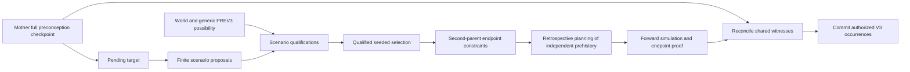
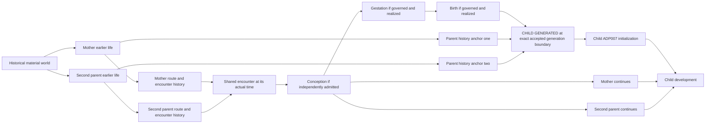

# S-G — Proposed minimal genealogy construction contract

**Status `PROPOSED_FOR_COMPETENT_V3_ADOPTION`; version `V3_CONCEPTION_CONDITIONED_RETROSPECTIVE_CONSTRUCTION_RULE@0.1-PROPOSAL`.** This is a specification, not implemented Python, a runnable V3 system, an issuer grant or accepted runtime authority. No PRE-V3 parent object is introduced.

## 0. Core types and epistemic noncollapse

All `_ref` fields denote immutable exact IDs with owner/rule version, content hashes and historically effective times; any missing required ref has a typed result, never `None` converted into a neutral actor. The scientific levels MUST remain separate:

```
WORLD_FEASIBILITY         = hard institution/location/time/route/actor facts
EMPIRICAL_POSSIBILITY     = source/release/denominator/design/universe uncertainty and ceiling
MODEL_PLAUSIBILITY        = proposal/ranking under named model, NEVER frequency
SIMULATION_SELECTION      = declared selection design, NEVER frequency unless separately calibrated
ADMITTED_OCCURRENCE       = after competent V3 witnesses and owner admission
```

No entity named `Person`, `Father`, `Household`, `ParentPrior` is created by PRE-V3. The candidate references **provisional constraints**, not a generated man.

### 0.1 `MotherPreconceptionAnchor@1` — local constructed input

```text
anchor_id/hash; causal_run_id; focal_generation_scope_request_ref
mother_actor_id; mother_last_committed_event_ref/index; checkpoint_ref/hash
time_basis_id; t_preconception; read_cut = BEFORE_TARGET_OCCURRENCE
world_context_ref/hash + authority/validity/temporal range
structural_position_refs[]; organismic_state_refs[] where governed
attitude_practice_fact_refs[]; striving/project_refs[]; memory/access refs[]
admitted_partner_relationship_refs[]; existing_household_membership_refs[]
already_generated_child_refs[]; prior_pregnancy/gestation refs[] ONLY if governed
route/institution/mobility/opportunity/encounter refs[]; negative/unknown facts[]
known_counterpart_identity_ref_or_NULL; exact identity evidence ref/status
allowed_conception_context_refs[]; prohibited_future_input_hash
history_prefix_commit_hash; schema_version; snapshot_integrity
```

Only admitted pre-target records may appear. `t_preconception` is an effective instant/boundary in governed time, NOT necessarily a calendar day. Older child and prior partners remain present. `future_input_hash` is a *manifest of embargoed field names/partitions*, not child outcomes or their digest as a stochastic input. The parent-history anchor will not mutate to fit an endpoint. If a previously admitted conception event already occurred, do not rewind it into a pending target; route to explicit migration/replay HOLD.

### 0.2 `PendingConceptionTarget@1` — noncausal planning request

```text
target_id/hash; mother_anchor_ref; focal_slot_ref
planned_boundary_time_or_interval; target_status=PENDING_NOT_OCCURRED
known_invariant_context_refs[]; known_counterpart_ref_or_NULL
candidate_generation_policy_ref; authorized_use_scope_ref
previously_admitted_shared_event_refs[]; hard_negative_constraints[]
attempt_budget_ref; specification_version; provenance
```

Pending state is not `V3GenealogyEvent`, `CHILD_GENERATED`, pregnancy, conception, the existence of a father, or an ADP021 `DISCRETE_CAUSAL_EVENT`. It must consume **zero causal cursor increments**. The target may be `VALID_EMPTY`, `UNKNOWN`, `DEFERRED`, or `NONOCCURRENCE` without fabricating child genealogy.

## 1. Finite scenario / proposal grammar

```text
ConceptionScenarioCandidate@1 {
 candidate_id; candidate_replay_hash; semantic_equivalence_class_hash
 target_ref; mother_anchor_ref; scenario_grammar_version
 candidate_kind [KNOWN_COUNTERPART | PROVISIONAL_COUNTERPART | NONOCCURRENCE]
 provisional_second_parent_subject_ref_or_NULL  // not ADP007 actor_id
 constrained_encounter_route {
   route_kind_id; world/time/place/institution/opportunity_refs[]
   required_prior_encounter_refs[]; encounter_status
 }
 endpoint_constraints {
   time_or_interval; admissible world/context refs
   second_parent_structure_and_position_constraints[]
   separately justified attitude/practice_constraints[]
   required_relation_objective_refs[]; perceived_states_status[]
   already_known_shared_witness_refs[]; conception_witness_requirements[]
 }
 assumption_refs[]; uncertainty_refs[]; falsifiers[]; proof_obligations[]
 empirical_query_request_refs[]; hard_feasibility_status
 original_proposal_ref/hash; candidate_origin=LLM_PROPOSAL_OR_RULE
 candidate_authority_id/version/hash; review_receipt_ref
}
```

Structured proposal authoring has no causal side effects; an LLM never sets `candidate_authority_id` by asserting it in prose. A competent V3 reviewer grants/adjudicates scenario grammar and eligibility. `KNOWN_COUNTERPART` must be used if an admitted mother event directly identifies the counterpart; an incompatible provisional candidate is `CONTRADICTION_WITH_ADMITTED_MOTHER_HISTORY`. If a biologic parent/counterpart fact is *not* within what the mother knows, the objective witness must still be reconciled without giving her unauthorized knowledge.

**Deduplication:** Normalize under a versioned semantic equivalence rule over route, endpoint causal requirements, objective counterpart constraints and witness obligations. Linguistic paraphrases of one pathway share one equivalence class; conflicting endpoint constraints are NOT merged. Preserve every proposal, merge receipt and excluded reason. Define weighting over admitted semantic **classes**, not LLM enumeration count. If equivalence undecidable, mark `DEDUP_UNDERDETERMINED` and block a weight-sensitive draw. Canonicalize `SET_CANONICAL` ordering by ADP020 (NFC IDs/UTF-8), never input index. Include an explicit `OTHER_UNRESOLVED` or scope-coverage receipt for unenumerated scenarios; do not claim completeness.

## 2. Generic empirical inquiries — request/answer envelope

```text
GenericPositionedPossibilityRequest {
   exact_world_snapshot_ref; source_release_ref; authority/use_permission_ref
   subject_universe_and_observation_unit; target_variable_role/value_space_ref
   condition_bindings[] { coordinate, exact_value, semantics, observation_unit }
   direction=[TARGET_GIVEN_CONDITIONERS|REVERSED_TARGET_ROLES]
   joint_topology=[SAME_PERSON|MULTI_UNIT_WITH_QUALIFIED_BRIDGE]
   universe_risk_set_ref; denominator/design/routing/weight refs
   comparison_mode; effective/as_of/publication times
   operation_id/version; optional model_ref/use_ceiling; missing_semantics
}
GenericPositionedPossibilityResponse {
    request_hash; exact values-read/source/lineage refs
    result_state=[SUPPORTED|VALID_EMPTY|UNKNOWN|NOT_ESTIMABLE|DENIED|NONCOMPARABLE|HOLD]
    native support/distribution/interval/uncertainty/proxy/backoff refs
    minority_counterpattern_refs[]; missingness_and_design_receipt
    empirical_use_ceiling; no_generated_person_fact=true
}
```

This is **proposed consumer envelope**, not a claim that current N10E publishes every field. Demographics→attitudes and attitudes→demographics are separate authorized questions with potentially different denominators. A one-person survey does not automatically estimate a two-parent relationship or encounter probability. No empirical association assigns one actor psyche. A structural constraint may exclude impossible route; weak source evidence is `UNKNOWN/NOT_ESTIMABLE`, not infeasible. PRE-V3 never receives `is_father_query`, actor history, future child outcome, or a newly generated household entity as an upstream ontology.

## 3. Feasibility and selection contract

Pipeline order (at each step retain input hashes, output, blockers, durations, provenance):

1. **World/temporal hard court**: check current location, encounters/routes actually available, existing partner and children, adverse constraints, chronology and causal permissions. `INFEASIBLE` excludes; `UNKNOWN_REQUIRED` defers; `FEASIBLE` proceeds.
2. **Empirical possibility**: issue only competent generic PRE-V3 queries. Preserve source risk sets/native units, uncertainty and noncomparison. Lack of empirical sample support cannot mechanically mean population impossibility.
3. **Model plausibility**: optional non-binding explanation/ranking with model/version/prompt hash, explicitly not a frequency.
4. **Selection policy**: no draw until an adopted semantic rule authorizes one exact `decision_kind=CONCEPTION_SCENARIO_SELECTION`, a finite feasible candidate equivalence-class set, a named selection policy and ADP020 stream.

```text
GenealogySelectionPolicy@1 {
 policy_ref/hash; status=SIMULATION_POLICY | EMPIRICALLY_CALIBRATED
 policy_owner/approval_ref; calibrated_population_universe_or_NULL
 admissible_scenario_classes[]; eligibility_hashes[]
 method=UNIFORM_CANDIDATE | WEIGHTED_CANDIDATE_INTEGER
 integer_weight_units[]_OR_NULL; provenance_for_each_weight
 excluded_unknown_mass_policy; sensitivity_policy_refs[]
 no_claim_of_population_frequency_IF_SIMULATION=true
}
```

**Critical:** Ordinal LLM preferences do NOT uniquely determine numerical stochastic weights. The minimum defensible synthetic baseline after competent authorization is **equal weights per eligible semantic class**, explicitly labeled "exploratory simulation design," never "real fathers are equally likely." Sensitivity variants can change class-level integer weight vectors under separately versioned assumptions; report all variants, not choose the one yielding desired child.

Proposed stream `v3.causal.adp015.conception_scenario_selection` on exact **`GENEALOGY` scope** ONLY IF competent ADP015/ADP020 rule registration accepts it; not an existing stream in ADP015 v1. Scope ID must hash `causal_run_id + mother_anchor_hash + pending_target_hash + scenario_grammar_version + decision_semantics_version` under an adopted domain separator; **never include child outcome**, mutable model wording or transient loop count. ADP020 owns `candidate_set_hash` precisely (domain-separated canonical set with IDs, replay hashes, owner, receipt hashes and integer weights). Decision receipt binds root seed, scope/stream lineage, anchor event/index, invocation, static slot, occurrence index, exact set, policy/version and `UNIFORM_BELOW` draw/receipt; deterministic singleton consumes zero draws. Reordered proposals cannot alter selection. An unidentified/underweighted option is not silently dropped.

**Retry:** finite `max_scenarios`, `max_history_candidates_per_endpoint`, `max_forward_replays`, `max_model_calls`, `max_generic_queries`, `max_compute` chosen **before** drawing, in scope manifest, not at runtime whim. Each selected scenario can fail to yield an endpoint-consistent history. If success conditional on scenario changes selection probabilities, either (i) qualify all prospective scenario classes before stochastic selection, or (ii) declare a conditional selection/rejection sampler with exact success predicates, all draws/attempts and estimated/known acceptance per class. Report induced distribution and unknown bias bounds; if uncorrectable, `SELECTION_BIAS_UNQUANTIFIED_HOLD`. Never draw again silently until a pleasing father appears; a failed selected scenario may terminally HOLD that run.

## 4. Retrospective whole-actor construction

```text
SecondParentConstructionAttempt@1 {
 attempt_id/hash; selected_scenario_ref; mother_anchor_ref
 endpoint_constraints_ref/hash; provisional_actor_subject_ref
 allowed_preendpoint_information_set_hash; forbidden_child_future_partition
 actor_creation_request/ADP007_rule_ref
 construction_dependency_graph_ref
 initial_world/context/root_refs; prehistory_generation_rule_refs[]
 independently_admitted_event/history_refs[]; attempt_seed_scope/stream_refs[]
 partial_known_reconciliation_refs[]; forward_replay_receipts[]
 endpoint_validation_receipt; independence_probe_receipt
 status=[PROPOSED|VALIDATED|INFEASIBLE|UNDERDETERMINED|HOLD|BUDGET_EXHAUSTED]
}
```

Selected second parent is a **whole independently causal actor**, not a psychometric vector or father-themed backstory. His initial ADP007 subject must be lawfully created and content-stable; sparse initial facts remain sparse. The engine may plan backward from endpoint constraints but generates/adjudicates causes in forward temporal order: historically material/structural positions (ADP009), organismic events, encounters/exposure (ADP010), actual practices, projects, needs/strivings and relation history under competent owners, memory/traces (ADP016), accessibility (ADP017) and situated response (CAN008 R2) with target authority. Unknown history does not become fake memory. His relevant earlier partners/family ties, personal projects and nonmother commitments must be generated as causally consequential histories, not decorative strings.

**Forward validation gate:** initialize from lawful historical roots, replay every admitted causal parent in strict effective order, reconstruct endpoint state under unchanged rule versions/seed receipts and compare endpoint constraint predicates to selected scenario. If model creates an endpoint-ready psyche by fiat, fail. If a determined endpoint constraint lacks a governed causal path, return `ENDPOINT_UNDERDETERMINED` or `GENEALOGY_RULE_MISSING`. Rejection reasons must be typed and retained; no editing mother's checkpoint.

**Sufficient prehistory stopping law (not years or ancestors):**

```
SUFFICIENT =
 all endpoint-consequential fields possess lawful histories OR explicit qualified root/unknown status
 AND material, organismic, relational, project, practice, causal-memory domains are owner-validated where necessary
 AND held-out nonmother action predicates are evaluable from actor state without Mom/child prompt
 AND nonmother project/relationship effects persist into an independent future test
 AND forward replay entails endpoint constraints with correct world/history clocks
 AND no outstanding mandatory antecedent with missing authority
 AND additional generations/ancestors do not change the tested endpoint or independence observables
```

The last clause is **bounded observational closure** under declared test predicates, not a claim of global causal completeness. If a new ancestor is indispensable to a qualifying event, recursively generate/admit only that ancestor's necessary causal contribution; root/unknown are permitted only where competent semantics allow them. `DEPTH_SUFFICIENT` and `SEARCH_BUDGET_EXHAUSTED` are never equivalent. Independent-project held-out action must be machine-state change under accepted owner and a predeclared scenario, NOT eloquent dialogue.

## 5. Two graphs and causal clocks

**Software construction-dependency DAG** (not actor truth):



The `E → H` edge has type `RETROSPECTIVE_CONSTRUCTION_DEPENDS_ON`, with an **algorithm/evaluation time**, never `CAUSAL_PARENT`. Revisions/retries are logged in this graph, not backdated into represented history.

**Represented in-world causal DAG**:



**Diagram qualification:** `CO→GE→BI→CG` is a *proposed conditional temporal example*, **not** adopted timing law: no assertion is made that `CHILD_GENERATED` universally occurs at birth, or that every gestation/birth follows the same path. Concrete reproduction owner must assign exact semantics/time and admissible nonbirth cases. If `CHILD_GENERATED` is defined earlier by competent amendment, relocate the identity/admission nodes accordingly; NEVER collapse events merely because the code wants a child ID.

Strict graph validator:
- separate namespaced `CONSTRUCTION_DEP` and `CAUSAL_PARENT` refs/registries;
- only already-admitted past/current causal events may be parents of a committed event; any edge `conception_endpoint→father_childhood` in **causal** graph is `CAUSAL_TEMPORAL_INVERSION`;
- no child result/outcome can be an input or seed salt for scenario generation, selection or father construction;
- saved parent history anchors at generation; causal DAG acyclic; construction graph DAG acyclic unless finite explicitly versioned retry graph with attempt nodes and no cycles;
- actor/event IDs persist from owner authority, no circular ID derivation and no mutable `latest`.

## 6. Reconciliation and shared event admission

Before any objective relationship or parenthood event:
1. Verify mother's unchanged pre-target prefix and any existing father/partner ref; if identified, **reuse exact actor**, not new actor with matching biography. Other potential partner candidates may be irrelevant; do not replace known biological counterpart silently.
2. Validate father's independently replayed history against each already-admitted shared event/witness and effective time. If a witness conflicts, `SHARED_HISTORY_CONTRADICTION_HOLD`; neither side rewritten. No duplicate event appears once in each ledger: one shared entity event, per-actor references/access where permitted.
3. ADP010 accepts each actual opportunity/encounter/exposure with required witnesses; ADP015 accepts objective relationship creation/change where relationship-forming witness exists, never from conception alone; conception is a separate **proposed** future owner effect pending biological/admission law.
4. Initialize separately the directional Mom→Dad and Dad→Mom **perceived relationship** histories when exact causal rules justify them. Opposed or unknown perspectives coexist; objective relationship may be NONE and perception of intimacy positive. ADP017 determines actor access; ADP016 memories require experienced causal basis; neither love nor reciprocity nor marriage nor household membership inferred.
5. `CHILD_GENERATED` only once on its competent decision boundary, with both exact parent actors/history anchors, registered rule/causal witness/candidate and any ADP020 receipt; child ID derivation is exactly ADP015 §10.2, independent of name/type/trait. ADP007 then initializes new actor. Prior siblings retain stable IDs and independent actor RNG.
6. ADP021 advances each real causal event exactly once, obeys same-time causal prerequisites, and schedules prospective resolver refresh after relationship/household/child binding changes. Both parents maintain independent histories/projects, contacts, future partners, co-parenting or absence as generated—not as fixed family labels. Child effects only via lawfully encountered/exposed/processed material context, never parent-profile averaging.

## 7. Completion/refusal and replay

Required typed states:
`MOTHER_ANCHOR_MISSING`, `TARGET_PENDING`, `SCENARIOS_VALID_EMPTY`, `SCENARIOS_UNKNOWN`, `SCENARIO_INFEASIBLE`, `SCENARIO_UNDERDETERMINED`, `EMPIRICAL_USE_DENIED`, `GENERIC_QUERY_NONCOMPARABLE`, `DEDUP_UNDERDETERMINED`, `SELECTION_AUTHORITY_UNBOUND`, `SELECTION_BIAS_UNQUANTIFIED_HOLD`, `ENDPOINT_INFEASIBLE`, `ENDPOINT_UNDERDETERMINED`, `HISTORY_SEARCH_EXHAUSTED`, `PREHISTORY_OWNER_RULE_MISSING`, `INDEPENDENT_PROJECT_PROOF_MISSING`, `SHARED_HISTORY_CONTRADICTION_HOLD`, `CONCEPTION_BIOLOGY_AUTHORITY_HOLD`, `CHILD_GENERATION_NOT_ADMITTED`, `ACTOR_INIT_HOLD`, `EXACT_REPLAY_DIVERGENCE`, `INTEGRITY_FAILURE`, `COMMITTED`.

A refused/unknown path has **zero new causal events, zero retroactive mother mutations, zero ungoverned RNG draws**. The disposition references all accepted/rejected candidates and attempts, with corresponding noncausal evaluation receipts.

Replay record binds complete mother checkpoint and parent history refs/hashes, world snapshots, rule registries, generic queries/answers and source/use ceilings, proposal model output hash and admission court, scenario grammar and dedup receipt, selected candidate class/set/policy/seed/scope/stream/draw, all construction attempts, forward replay/event hashes, objective relation/subjective state refs, birth/generation admission refs, scheduler ordering, postconception continuation and child environment events. **All selected father/history outputs must be invariant to inaccessible future-child labels**. A rerun missing model output must resolve the **frozen exact proposal record** rather than resample the LLM.

## 8. Deterministic refusal examples

- Mother in already admitted partnership with identified biological counterpart A, proposed father B → `SHARED_HISTORY_CONTRADICTION_HOLD`, not B admitted.
- `n` repeated phrasings of same scenario → one class; weight unchanged.
- Missing source unit/denominator for a reverse conditional → empirical `NOT_ESTIMABLE`, not zero plausibility.
- All eligible scenarios unknown-necessary → `SELECTION_AUTHORITY_UNBOUND`, zero draws.
- Scenario selected but no lawful independent history meets its endpoint → `ENDPOINT_INFEASIBLE`, no silent resampling.
- Relationship present but only Mom perceives affection → objective relation stays as admitted; Dad perception remains unknown/contradictory.
- Father childhood trauma inferred solely from desired child wound → `FUTURE_CHILD_INFORMATION_LEAK` and invalid run.
- Many ancestors generated without a consequential independent project → `INDEPENDENT_PROJECT_PROOF_MISSING`, not sufficient prehistory.

**Terminal proposal:** one narrow ADP015 construction adjunct plus separately competent concrete conception, sampling, generic-source use, and isolated lab grants. No software classes, issuer or operative actors created.
