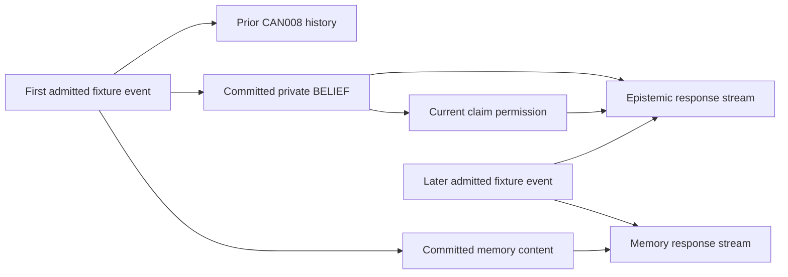

# Causal interpretation and inference ceiling

The warranted positive is execution of a stipulated finite construction. Actual candidate-owned memory/epistemic state matters to the new response graph under valid fixed selection. This reaches demonstrated technical behavior at that exact synthetic grain; it establishes no human mechanism, open-world actor, production feasibility or general experience claim.

## Frozen design and custody

The original preregistration is a Git ancestor of the final M01 return and is byte-identical there. Neither `repro/cell.py` nor `repro/test_m01.py` exists at the preregistration commit. New source/tests and first published execution evidence enter at `88a08925803a40eb3324da3013635ace6456f7e9`; final `02187a14e75ff30dd953d3c7185d689b80e62304` adds publication metadata. This verifies chronological published source custody. Commit clocks and ancestry are not an external notarized timestamp or proof about unpublished activity. The original design was openly informed by CAN2/CAN3.

M02's own literal 36-row expectation matrix and falsifiers were separately committed before candidate/owner execution. It was source-informed, not blind. No candidate test helper supplied its constants. The additional selector-isolation follow-up was designed after the first counterexample and is labelled accordingly.

## What the actual interventions show

| Question | Observed result | Limit |
| --- | --- | --- |
| Can memory content independently alter a later response at fixed response history? | Yes. CERTAIN→UNCERTAIN changes actual committed feature content and current hash, preserves memory ID and history, and changes Ym BUFFER→DEFLECT. Stronger native formation after identical epistemic setup preserves claims, emissions, stances, transitions, state sets and permissions exactly. | Formation certainty is an experimentally assigned TEST_ONLY source-feature state, not inferred psychology or a lawfully demonstrated forgetting transition. |
| Can BELIEF and current permission independently alter response? | Yes. Actual native application, exact withdrawal and accessibility supersession change the applied stance/permission store and later Ye, with memory/history fixed. Absence→AMPLIFY, accessible BELIEF→REROUTE, inaccessible BELIEF→BLOCK. | One canonical private RESPECTED claim and a finite local acquisition grant; no generic belief formation, knowledge acquisition or public ratification. |
| Does history alone change the new streams with owner state held fixed? | No in the 12 crossed contrasts: the entire owner snapshot is identical across actual stored/omitted/withheld history, while stored/delivered row counts differ. Ym and Ye stay identical. | This invariance belongs to the new rule. It does not establish that real persons ignore response history. |
| Does the original history-only mechanism remain productive? | Yes. The unchanged comparator gives first BUFFER then later DEFLECT; actually omitting that history gives AMPLIFY with the same owner state. | This is a different finite rule, not evidence for serial state mediation. |
| Is serial memory→epistemic mediation identified? | No. The main arms use no memory-basis refs. Direct-event BELIEF remains semantically the same across memory content; attaching refs supplies provenance, not a content-sensitive causal transfer. M01's later rule refuses those serial-like stances. | `MECHANISM_IDENTIFICATION_HOLD`. A separate competent content-sensitive rule and lawful selective interventions are missing. |

The valid fixed-selector DAG is parallel:

H has no output arrow in the new rule; it has an output arrow in the separate CAN3 comparator. No M→B semantic edge is established. Distinct streams are preserved; there is no winner, average, causal-response score or discovered psychological coefficient.

## Why the final review is REVISE

The two REDs expose another input to Ye: the selected claim in outer Cell metadata. That selector is outside the checked owner-state hash. An unresolved selected claim is silently treated as no stance; a different valid future claim can be selected without a causal-time-use check. A paired follow-up holds the complete owner state/hash, history, events and times identical and changes only that selector: Ye AMPLIFY becomes REROUTE.

Those are adversarial metadata/checkpoint interventions, **not lawful mediator treatments**. They must not be counted as psychological effects or among the 36 scientific arms. They nevertheless falsify the claimed fail-closed claim/time provenance boundary, and show that a verified owner hash alone does not authenticate the intended selected state. Under the frozen valid selector, the positive construction still executes as reported. Passing that finite subset does not justify accepting the hostile boundary.

## Preserved protections and unproved work

Actual K3 checks keep causal trace origin non-declarative and first-person origin inaccessible even when it affects Ym. K5 preserves private BELIEF separately from analyst objective labels and public standing. UNKNOWN access refuses with a typed HOLD rather than inventing NONKNOWLEDGE, and later admission/read/emission faults roll back registry, owner, reads and journals before a clean retry. Invalid formation proposals cannot commit merely by changing hashes or IDs; exact native validation is required.

The initial M02 test compared full provenance-bearing epistemic effect IDs after natural memory-first preparation. Those IDs legitimately depend on the whole-owner prestate. Two resulting failures were reviewer setup errors, retained in `evidence/initial_99/` and explained in `REVIEWER_HARNESS_CORRECTION.json`. The corrected experiment strengthens the original fixed-epistemic-state condition by forming memory after identical epistemic setup. It does not change an expected response or remove a candidate failure. The genuine selector/time failure remains, with a disclosed additional isolating RED.

Hard problems held fixed or excluded: actor identity, world/asof, two event forms, native acquisition content, local grants, categorical transfer functions, source-feature selection, synchronous in-process storage, and finite response grammar. No empirical calibration, natural-language understanding, human belief acquisition, open-ended memory lifecycle, crash durability, distributed transaction, real model actor or production authority is established. New graph emission is M01's candidate journaled response construction; it is not an operative accepted CAN008 production dispatcher. The 413 passes and this court cannot certify those missing capabilities.
