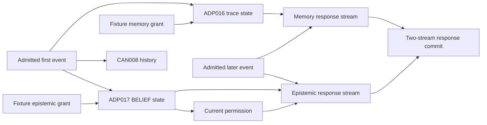

# Causal adjudication

The bounded data support two separately constructed response paths. These are interventions on synthetic fixture setup, not randomized human treatments.

The M01 rule records history but has no H→Y transfer. The original CAN3 comparator has an explicit history path and still produces DEFLECT versus AMPLIFY under actual history omission at fixed owner state. This comparator prevents a blanket assertion that history is always inert. It does not establish memory/epistemic mediation in the newer rule.

The factorial varies four trace formations, three stance/access states and three history delivery conditions. Ordinary prepare forms memory first, so full epistemic provenance IDs may vary across natural memory arms. The unchanged M02 stronger same-memory-ID test forms memory after identical epistemic setup, fixing claim/stance state and history. Different source feature contents then change only Ym. A distinct-memory-ID control at fixed content leaves outputs unchanged. These controls discriminate actual content reads from mere reference existence or label lookup in caller arguments. Later() accepts expected state and contextual event/history control, not requested output labels or mediator callbacks.

Memory absent or content unavailable maps to Ym AMPLIFY; retained source-bound content BUFFER; uncertain source-bound content DEFLECT. Applied accessible BELIEF maps to Ye REROUTE, inaccessible BELIEF BLOCK, no applied stance AMPLIFY, access UNKNOWN refusal. These maps are stipulated finite rules. Successful execution establishes implementation behavior, not empirical psychological validity or a natural effect size.

The serial alternative requires M→B, with content-sensitive memory manipulation changing a legitimately generated BELIEF through a separately authorized rule. That edge is absent from the actual factorial, whose effects have empty memory_basis_refs and a direct actor-facing E1 basis. Attaching a memory reference and seeing invariant permission does not prove the missing edge. Causal-trace influence also cannot establish conscious recall, self-explanation, knowledge or public standing (K3/K5).

The fresh counterexamples act on adversarial restored packets rather than lawful mediator treatments. Their outputs are therefore integrity failures, never additional productive factorial cells. They show that a valid source hash, canonical claim and internally consistent effect digest do not prove that the *current* owner snapshot descends from the committed actual state. This weakens hostile restore assurance while preserving the ordinary finite factorial reproduction.

Each of the three blocker families has direct saved evidence: original commitment versus erased current stance; retained native revision versus old revived permission; actual committed pre-state versus self-consistently forged ancestry. The revised implementation should make these fail closed while retaining the 587 published cases and the 41 independent positive/refusal controls.

No adopted-law collision was found. No I3 reinterpretation or extra owner is necessary for this verdict. Production authority, future general actor updates, genuine crash/distributed persistence, serial mediation, model validity, human calibration, scale/latency/cost and experiential value remain unproved. Neither 587/587 nor 41/51 estimates out-of-sample reliability: the denominator is an explicit finite designed court.
