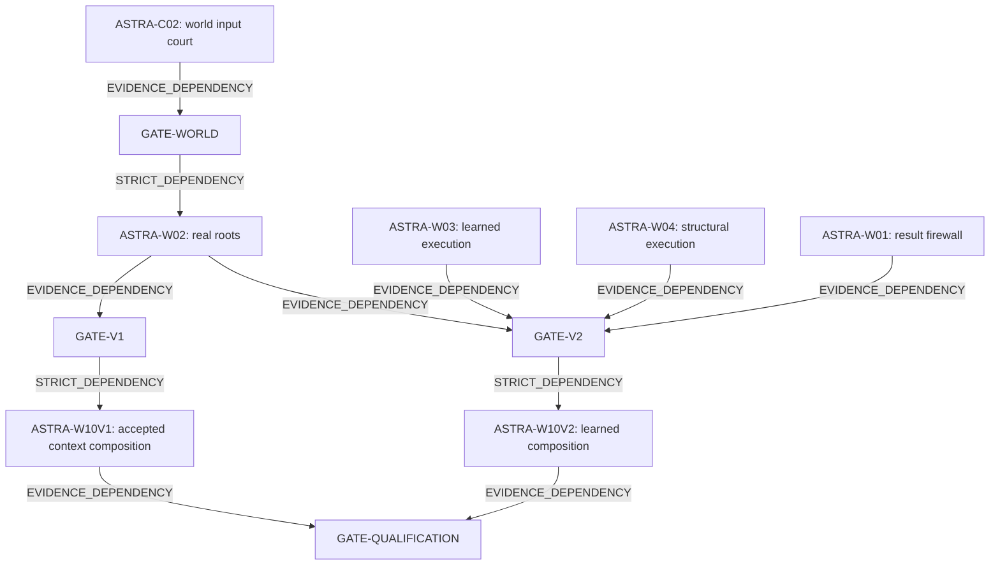

# Dependency and parallelism DAG

**Packet status: independent audit evidence and proposed construction program; NOT HQ adoption.** Current accepted authority is cited at its exact scope. Machine registers mirror this Markdown packet and have no independent authority.

This is a **proposed work DAG**, not a map of already-proved runtime composition. Each node is an exact gap, gate or commission. Every edge below states what must exist to close its successor claim. Independent preparation and per-route execution may proceed before total horizontal closure.

## Strict sequential spine

HQ audit acceptance/release → competent exact input authority → local implementation/population and qualification → the affected route composition → independent horizontal/composed qualification → operational release adoption. Physical comparison has its own gate: exact workload + oracle → HB07 packet → separate C09 authority → semantic parity → comparable measurements.

There is **no universal world→all producers→all code** barrier. V1 can compose once its world/root inputs qualify, without waiting for learned-world or SDTF population.

## Parallel fronts and independence

| Commission(s) | Why independent | Required later join |
|---|---|---|
| C01 | State/coverage reconciliation reads frozen evidence; does not own sibling semantics. | GATE-SCOPE and exact incorporation/gate decisions |
| C02 | Objective root/time owner/input court does not require V3 actor generation or finished SDTF population. | GATE-WORLD |
| C03 and C04 | Learned workload/validation and direct structural operation dockets can be prepared separately from current evidence. | Exact learned products only where a chosen structural operation requires them |
| C05 | Concrete objective rule bodies can be recovered/adjudicated before a world instance exists. | Population consumes adopted rule and exact world inputs |
| C06 | Non-event receipt semantics can be fixed without creating events, people or current world facts. | Qualified producer/root identities are required for real serving |
| C07 | Reproduced local enforcement/error contracts can be resolved without new source execution. | Repair implementation follows GATE-FIREWALL |
| C08 | Named consumer loss policies use generic adopted law, independently of source-document completeness. | Consumer execution follows GATE-DEGRADED; B wake remains HQ-owned |
| W07 and W08 | HB05 workload and HB06 oracle are independent output grains after B launch disposition. | Both qualified outputs required at GATE-B-INTAKE |
| W10V1–V4 | Each route has distinct actual producer prerequisites; a completed route need not wait for another. | All mandatory route evidence joins at whole-candidate qualification |

## Compact route dependency schematic

This scoped diagram illustrates V1/V2 independence. It is not the complete graph: V3/V4 and every remaining dependency are explicitly enumerated below and in the machine mirror.

## Gates

| Gate | Condition | Required identity/evidence |
|---|---|---|
| GATE-AUDIT | HQ accepts audit as evidence and explicitly releases first-wave bounded commissions. | Audit acceptance grants no automatic semantic adoption, live branch mutation or worker launch by this packet. |
| GATE-SCOPE | HQ adopts finite objective completion register and exact required operations. | Mandatory rows and scope-specific acceptable limits identified; inherited requirements cannot silently disappear. |
| GATE-WORLD | Competent owner adopts objective world/position/root/valid-time input contract. | Exact immutable input tuple and source of authority break A3W/A3T circularity. |
| GATE-LEARNED | Competent owners adopt exact discovery/validation/admission workload and required source premises. | Rule/owner/source identity set for each executed operation. |
| GATE-STRUCTURAL | Competent owners admit exact structural production operations and their source premises. | Field Forge R2 reused; only named new operation authorities granted. |
| GATE-SDTF | Competent mechanism owners adopt concrete executable rule bodies and required witness/use/calibration premises. | Reference/class/citation alone cannot close gate. |
| GATE-NON-EVENT | HQ/exact border owners adopt objective non-event receipt/serving contract and owner disposition. | Objective availability remains distinct from V3 uptake. |
| GATE-FIREWALL | Exact owner adopts objective result-binding/schema repair and contract expectations. | No unowned schema inference; positive objective actor-indexed and negative psychological controls fixed. |
| GATE-DEGRADED | Exact objective consumer owners adopt bounded evidence policies. | No psychic terminal dependency, missing-as-zero or implicit renormalization. |
| GATE-B-LAUNCH | HQ explicitly reassesses and releases retained B launch prerequisites. | Current HB01/B/runtime receipt identities consumed; this audit alone never wakes B. |
| GATE-B-INTAKE | HB05 workload and HB06 oracle independently qualified for the same required workload. | Both frozen outputs required before HB07 launch packet closure. |
| GATE-C09 | HQ authorizes C09 on qualified workload/oracle/host packet. | Semantic parity precedes equal-work measurements; no retirement credit without separate authority. |
| GATE-QUALIFICATION | Frozen integrated release candidate and complete coverage/evidence map available. | Independent H1-H6 attack uses exact candidate and dependencies; local producer PASS insufficient. |
| GATE-RELEASE | Mandatory horizontal/vertical/operational courts qualified and every blocking authority conflict resolved. | Central incorporation and distinct completion/interface-freeze predicates remain to be adjudicated. |
| GATE-V1 | Exact V1 producer/input/root dependencies qualified. | Reuse accepted GT12 through lawful shared roots without changing its CONTEXT-only identity/use. Only the named route inputs are required; unrelated horizontal production need not wait. |
| GATE-V2 | Exact V2 producer/input/root dependencies qualified. | Serve real positive validated learned/higher-order structural products through shared roots. Only the named route inputs are required; unrelated horizontal production need not wait. |
| GATE-V3 | Exact V3 producer/input/root dependencies qualified. | Serve actual actor-indexed objective position/standing/durative consequences without an encounter. Only the named route inputs are required; unrelated horizontal production need not wait. |
| GATE-V4 | Exact V4 producer/input/root dependencies qualified. | Prove objective occurrence/world-response succession, selective invalidation and historical replay. Only the named route inputs are required; unrelated horizontal production need not wait. |

## Complete typed edge list

| From | To | Dependency type | Reason | Required identity or evidence |
|---|---|---|---|---|
| GAP-PREV3-005 | GAP-PREV3-006 | SEMANTIC_DEPENDENCY | Required for closure of this successor gap; independent preparation and per-route qualification may start earlier. | Competent typed result/schema/executable-producer binding is specified with positive objective and negative psychological controls. |
| GAP-PREV3-001 | GAP-PREV3-008 | SEMANTIC_DEPENDENCY | Required for closure of this successor gap; independent preparation and per-route qualification may start earlier. | Every inherited required function maps to scoped positive/negative duties, owner, evidence and release gate; HQ adopts register. |
| GAP-PREV3-001 | GAP-PREV3-009 | SEMANTIC_DEPENDENCY | Required for closure of this successor gap; independent preparation and per-route qualification may start earlier. | Every inherited required function maps to scoped positive/negative duties, owner, evidence and release gate; HQ adopts register. |
| GAP-PREV3-001 | GAP-PREV3-011 | SEMANTIC_DEPENDENCY | Required for closure of this successor gap; independent preparation and per-route qualification may start earlier. | Every inherited required function maps to scoped positive/negative duties, owner, evidence and release gate; HQ adopts register. |
| GAP-PREV3-010 | GAP-PREV3-011 | SEMANTIC_DEPENDENCY | Required for closure of this successor gap; independent preparation and per-route qualification may start earlier. | Each required missing-owner function is assigned to a competent current/successor owner with a return path. |
| GAP-PREV3-011 | GAP-PREV3-012 | SEMANTIC_DEPENDENCY | Required for closure of this successor gap; independent preparation and per-route qualification may start earlier. | Executable authorized search/validation/admission and required higher-order workload have exact inputs, falsifiers and positive evidence. |
| GAP-PREV3-008 | GAP-PREV3-013 | SEMANTIC_DEPENDENCY | Required for closure of this successor gap; independent preparation and per-route qualification may start earlier. | Each required operation/source row has positive premises or an explicitly accepted typed limitation with substantive product coverage retained. |
| GAP-PREV3-012 | GAP-PREV3-013 | INTEGRATION_DEPENDENCY | Required for closure of this successor gap; independent preparation and per-route qualification may start earlier. | Missing functions consume adopted rules and emit immutable validated products with lineage and typed limits. |
| GAP-PREV3-014 | GAP-PREV3-015 | SEMANTIC_DEPENDENCY | Required for closure of this successor gap; independent preparation and per-route qualification may start earlier. | Exact objective relation/entity/position kinds have owners; generated person state excluded. |
| GAP-PREV3-001 | GAP-PREV3-016 | SEMANTIC_DEPENDENCY | Required for closure of this successor gap; independent preparation and per-route qualification may start earlier. | Every inherited required function maps to scoped positive/negative duties, owner, evidence and release gate; HQ adopts register. |
| GAP-PREV3-001 | GAP-PREV3-017 | SEMANTIC_DEPENDENCY | Required for closure of this successor gap; independent preparation and per-route qualification may start earlier. | Every inherited required function maps to scoped positive/negative duties, owner, evidence and release gate; HQ adopts register. |
| GAP-PREV3-017 | GAP-PREV3-018 | SEMANTIC_DEPENDENCY | Required for closure of this successor gap; independent preparation and per-route qualification may start earlier. | Finite P1-P5/K1-K4-applicable rule bodies specify inputs, applicability, outcomes, time, witnesses, falsifiers and separate use/calibration premises. |
| GAP-PREV3-018 | GAP-PREV3-019 | INTEGRATION_DEPENDENCY | Required for closure of this successor gap; independent preparation and per-route qualification may start earlier. | Exact adopted rule bodies execute through current binding/hosting seam with typed outcomes and replay. |
| GAP-PREV3-020 | GAP-PREV3-021 | SEMANTIC_DEPENDENCY | Required for closure of this successor gap; independent preparation and per-route qualification may start earlier. | Exact owner/input tuple and valid-time basis established independently of V3 runtime cursor; world designator remains nonauthoritative. |
| GAP-PREV3-001 | GAP-PREV3-022 | SEMANTIC_DEPENDENCY | Required for closure of this successor gap; independent preparation and per-route qualification may start earlier. | Every inherited required function maps to scoped positive/negative duties, owner, evidence and release gate; HQ adopts register. |
| GAP-PREV3-020 | GAP-PREV3-022 | SEMANTIC_DEPENDENCY | Required for closure of this successor gap; independent preparation and per-route qualification may start earlier. | Exact owner/input tuple and valid-time basis established independently of V3 runtime cursor; world designator remains nonauthoritative. |
| GAP-PREV3-023 | GAP-PREV3-024 | SEMANTIC_DEPENDENCY | Required for closure of this successor gap; independent preparation and per-route qualification may start earlier. | Lossless standing/durative/context receipt and consumer admission keep availability distinct from subjective uptake. |
| GAP-PREV3-021 | GAP-PREV3-025 | IDENTITY_DEPENDENCY | Required for closure of this successor gap; independent preparation and per-route qualification may start earlier. | Real immutable world/release/context tuple resolves exact producer and authority roots; historical replay works. |
| GAP-PREV3-024 | GAP-PREV3-025 | INTEGRATION_DEPENDENCY | Required for closure of this successor gap; independent preparation and per-route qualification may start earlier. | Direct reference or lossless typed adapter serves every required objective family without reownership. |
| GAP-PREV3-021 | GAP-PREV3-026 | IDENTITY_DEPENDENCY | Required for closure of this successor gap; independent preparation and per-route qualification may start earlier. | Real immutable world/release/context tuple resolves exact producer and authority roots; historical replay works. |
| GAP-PREV3-001 | GAP-PREV3-027 | SEMANTIC_DEPENDENCY | Required for closure of this successor gap; independent preparation and per-route qualification may start earlier. | Every inherited required function maps to scoped positive/negative duties, owner, evidence and release gate; HQ adopts register. |
| GAP-PREV3-028 | GAP-PREV3-029 | SEMANTIC_DEPENDENCY | Required for closure of this successor gap; independent preparation and per-route qualification may start earlier. | Each selected objective consumer declares evidence tiers, required/optional inputs, lawful fallback/omission/refusal and provenance. |
| GAP-PREV3-002 | GAP-PREV3-030 | INTEGRATION_DEPENDENCY | Required for closure of this successor gap; independent preparation and per-route qualification may start earlier. | HB01, B16/B17/HB04 and SDTF each have exact acceptance/incorporation/remaining-debt disposition. |
| GAP-PREV3-030 | GAP-PREV3-031 | INTEGRATION_DEPENDENCY | Required for closure of this successor gap; independent preparation and per-route qualification may start earlier. | HQ records retained/removed exact HB05/HB06/HB07/C09 prerequisites without psychic-terminal assumption. |
| GAP-PREV3-006 | GAP-PREV3-032 | INTEGRATION_DEPENDENCY | Required for closure of this successor gap; independent preparation and per-route qualification may start earlier. | Current contract-enforcing implementation rejects personal state and accepts lawful actor-indexed objective results; independent court passes. |
| GAP-PREV3-007 | GAP-PREV3-032 | QUALIFICATION_DEPENDENCY | Required for closure of this successor gap; independent preparation and per-route qualification may start earlier. | Competent error/caller/test expectations aligned; affected tests and seams pass without weakened guards. |
| GAP-PREV3-013 | GAP-PREV3-032 | INTEGRATION_DEPENDENCY | Required for closure of this successor gap; independent preparation and per-route qualification may start earlier. | V2 route has real governed positive product(s), required higher-order/joint coverage and replay. |
| GAP-PREV3-015 | GAP-PREV3-032 | INTEGRATION_DEPENDENCY | Required for closure of this successor gap; independent preparation and per-route qualification may start earlier. | Real governed objective position/relation facts resolve by entity/actor ID with provenance and valid time. |
| GAP-PREV3-016 | GAP-PREV3-032 | SEMANTIC_DEPENDENCY | Required for closure of this successor gap; independent preparation and per-route qualification may start earlier. | Required domain operations have real admitted products or justified scoped limits; exact transport only when required. |
| GAP-PREV3-019 | GAP-PREV3-032 | INTEGRATION_DEPENDENCY | Required for closure of this successor gap; independent preparation and per-route qualification may start earlier. | Required positive current facts and K4 witness/termination coverage exist across in-scope classes/domains. |
| GAP-PREV3-022 | GAP-PREV3-032 | SEMANTIC_DEPENDENCY | Required for closure of this successor gap; independent preparation and per-route qualification may start earlier. | V4 receives genuine objective occurrence/world response with owner/witness/currentness; no person experience inferred. |
| GAP-PREV3-025 | GAP-PREV3-032 | INTEGRATION_DEPENDENCY | Required for closure of this successor gap; independent preparation and per-route qualification may start earlier. | Required source/learned/structural/consequence/event/non-event paths share exact immutable roots and lossless permissions. |
| GAP-PREV3-026 | GAP-PREV3-032 | INTEGRATION_DEPENDENCY | Required for closure of this successor gap; independent preparation and per-route qualification may start earlier. | Changed dependency closure only is rebuilt; unaffected identities stable; predecessor releases reproducible; rule/application/fact/witness time distinct. |
| GAP-PREV3-029 | GAP-PREV3-032 | INTEGRATION_DEPENDENCY | Required for closure of this successor gap; independent preparation and per-route qualification may start earlier. | Component/source/family loss yields exact typed loss; supported services continue; no invented values or all-unavailable completion. |
| GAP-PREV3-032 | GAP-PREV3-033 | INTEGRATION_DEPENDENCY | Required for closure of this successor gap; independent preparation and per-route qualification may start earlier. | V1 existing context, V2 positive learned/higher-order, V3 objective position/non-event, V4 occurrence/succession all resolve with typed limits/replay. |
| GAP-PREV3-002 | GAP-PREV3-034 | INTEGRATION_DEPENDENCY | Required for closure of this successor gap; independent preparation and per-route qualification may start earlier. | HB01, B16/B17/HB04 and SDTF each have exact acceptance/incorporation/remaining-debt disposition. |
| GAP-PREV3-003 | GAP-PREV3-034 | SEMANTIC_DEPENDENCY | Required for closure of this successor gap; independent preparation and per-route qualification may start earlier. | Exact subgrains/successor identifiers preserve both provenances, owners and return paths. |
| GAP-PREV3-004 | GAP-PREV3-034 | SEMANTIC_DEPENDENCY | Required for closure of this successor gap; independent preparation and per-route qualification may start earlier. | Exact current owner statements permit objective actor-indexed relations and reserve all subjective realization to V3. |
| GAP-PREV3-033 | GAP-PREV3-034 | QUALIFICATION_DEPENDENCY | Required for closure of this successor gap; independent preparation and per-route qualification may start earlier. | H1-H6 courts close every mandatory adopted row; contradictions, degraded states and actor-indexed objective positives tested. |
| GAP-PREV3-031 | GAP-PREV3-034 | INTEGRATION_DEPENDENCY | Required for closure of this successor gap; independent preparation and per-route qualification may start earlier. | Exact workload/oracle/host packet, semantic parity and comparable measures; required world workload preserved; scoped winner only. A competent bounded implementation/retention decision that meets the complete required operational workload may close operating fit without a universal persistent/virtual/hybrid winner. |
| GATE-AUDIT | ASTRA-C01 | STRICT_DEPENDENCY | Explicit audit acceptance and bounded dispatch; no self-launch. | HQ audit acceptance and exact commission release identity. |
| ASTRA-C01 | GATE-SCOPE | EVIDENCE_DEPENDENCY | Worker return supplies evidence for competent gate decision; it does not self-adopt the result. | All required capabilities/domains have scoped duties and owners; stale rows and OBL062 identity meanings are separately disposed in a reviewable candidate. |
| ASTRA-C01 | GATE-B-LAUNCH | EVIDENCE_DEPENDENCY | Worker return supplies evidence for competent gate decision; it does not self-adopt the result. | All required capabilities/domains have scoped duties and owners; stale rows and OBL062 identity meanings are separately disposed in a reviewable candidate. |
| GATE-AUDIT | ASTRA-C02 | STRICT_DEPENDENCY | Explicit audit acceptance and bounded dispatch; no self-launch. | HQ audit acceptance and exact commission release identity. |
| ASTRA-C02 | GATE-WORLD | EVIDENCE_DEPENDENCY | Worker return supplies evidence for competent gate decision; it does not self-adopt the result. | Acyclic objective world/release/context/valid-time input contract with exact existing reuse and smallest new-owner/input grain; no V3 actor initialization dependency invented. |
| GATE-AUDIT | ASTRA-C03 | STRICT_DEPENDENCY | Explicit audit acceptance and bounded dispatch; no self-launch. | HQ audit acceptance and exact commission release identity. |
| ASTRA-C03 | GATE-LEARNED | EVIDENCE_DEPENDENCY | Worker return supplies evidence for competent gate decision; it does not self-adopt the result. | Concrete authorized-search candidate workload includes a defensible positive product class and required joint/higher-order coverage; every missing premise/source is individually named. |
| GATE-AUDIT | ASTRA-C04 | STRICT_DEPENDENCY | Explicit audit acceptance and bounded dispatch; no self-launch. | HQ audit acceptance and exact commission release identity. |
| ASTRA-C04 | GATE-STRUCTURAL | EVIDENCE_DEPENDENCY | Worker return supplies evidence for competent gate decision; it does not self-adopt the result. | Required concrete relation/position/channel operations map to existing law and exact source evidence; new work is separated from already closed R2 semantics. |
| GATE-AUDIT | ASTRA-C05 | STRICT_DEPENDENCY | Explicit audit acceptance and bounded dispatch; no self-launch. | HQ audit acceptance and exact commission release identity. |
| ASTRA-C05 | GATE-SDTF | EVIDENCE_DEPENDENCY | Worker return supplies evidence for competent gate decision; it does not self-adopt the result. | Finite concrete P1-P5/K1-K4-applicable objective rule candidates specify executable semantics, falsifiers, evidence/witness scope and separate calibration; exact population successor identified. |
| GATE-AUDIT | ASTRA-C06 | STRICT_DEPENDENCY | Explicit audit acceptance and bounded dispatch; no self-launch. | HQ audit acceptance and exact commission release identity. |
| ASTRA-C06 | GATE-NON-EVENT | EVIDENCE_DEPENDENCY | Worker return supplies evidence for competent gate decision; it does not self-adopt the result. | Standing/durative/context input can be served losslessly with exact owner/time/permissions; objective actor indexing allowed; uptake/appraisal remains V3. |
| GATE-AUDIT | ASTRA-C07 | STRICT_DEPENDENCY | Explicit audit acceptance and bounded dispatch; no self-launch. | HQ audit acceptance and exact commission release identity. |
| ASTRA-C07 | GATE-FIREWALL | EVIDENCE_DEPENDENCY | Worker return supplies evidence for competent gate decision; it does not self-adopt the result. | Exact repair contract/spec closes the reproduced alias hole, permits objective actor facts, and preserves stronger relation/use guards; implementation successor is bounded. |
| GATE-AUDIT | ASTRA-C08 | STRICT_DEPENDENCY | Explicit audit acceptance and bounded dispatch; no self-launch. | HQ audit acceptance and exact commission release identity. |
| ASTRA-C08 | GATE-DEGRADED | EVIDENCE_DEPENDENCY | Worker return supplies evidence for competent gate decision; it does not self-adopt the result. | Each named objective consumer has explicit evidence requirements, authorized fallback/omission/refusal and no-renormalization; exact B holds assessed without psychic-terminal premise. |
| ASTRA-C08 | GATE-B-LAUNCH | EVIDENCE_DEPENDENCY | Worker return supplies evidence for competent gate decision; it does not self-adopt the result. | Each named objective consumer has explicit evidence requirements, authorized fallback/omission/refusal and no-renormalization; exact B holds assessed without psychic-terminal premise. |
| GATE-FIREWALL | ASTRA-W01 | STRICT_DEPENDENCY | Positive execution must consume exact required input authority/qualified identity. | No unowned schema inference; positive objective actor-indexed and negative psychological controls fixed. |
| ASTRA-W01 | GATE-V2 | EVIDENCE_DEPENDENCY | Worker return supplies evidence for competent gate decision; it does not self-adopt the result. | Every named input gate is satisfied at exact identities and each target gap PASS condition is proved at its authorized grain. |
| GATE-WORLD | ASTRA-W02 | STRICT_DEPENDENCY | Positive execution must consume exact required input authority/qualified identity. | Exact immutable input tuple and source of authority break A3W/A3T circularity. |
| ASTRA-W02 | GATE-V1 | EVIDENCE_DEPENDENCY | Worker return supplies evidence for competent gate decision; it does not self-adopt the result. | Every named input gate is satisfied at exact identities and each target gap PASS condition is proved at its authorized grain. |
| ASTRA-W02 | GATE-V2 | EVIDENCE_DEPENDENCY | Worker return supplies evidence for competent gate decision; it does not self-adopt the result. | Every named input gate is satisfied at exact identities and each target gap PASS condition is proved at its authorized grain. |
| ASTRA-W02 | GATE-V3 | EVIDENCE_DEPENDENCY | Worker return supplies evidence for competent gate decision; it does not self-adopt the result. | Every named input gate is satisfied at exact identities and each target gap PASS condition is proved at its authorized grain. |
| ASTRA-W02 | GATE-V4 | EVIDENCE_DEPENDENCY | Worker return supplies evidence for competent gate decision; it does not self-adopt the result. | Every named input gate is satisfied at exact identities and each target gap PASS condition is proved at its authorized grain. |
| GATE-SCOPE | ASTRA-W03 | STRICT_DEPENDENCY | Positive execution must consume exact required input authority/qualified identity. | Mandatory rows and scope-specific acceptable limits identified; inherited requirements cannot silently disappear. |
| GATE-LEARNED | ASTRA-W03 | STRICT_DEPENDENCY | Positive execution must consume exact required input authority/qualified identity. | Rule/owner/source identity set for each executed operation. |
| ASTRA-W03 | GATE-V2 | EVIDENCE_DEPENDENCY | Worker return supplies evidence for competent gate decision; it does not self-adopt the result. | Every named input gate is satisfied at exact identities and each target gap PASS condition is proved at its authorized grain. |
| GATE-SCOPE | ASTRA-W04 | STRICT_DEPENDENCY | Positive execution must consume exact required input authority/qualified identity. | Mandatory rows and scope-specific acceptable limits identified; inherited requirements cannot silently disappear. |
| GATE-STRUCTURAL | ASTRA-W04 | STRICT_DEPENDENCY | Positive execution must consume exact required input authority/qualified identity. | Field Forge R2 reused; only named new operation authorities granted. |
| ASTRA-W04 | GATE-V2 | EVIDENCE_DEPENDENCY | Worker return supplies evidence for competent gate decision; it does not self-adopt the result. | Every named input gate is satisfied at exact identities and each target gap PASS condition is proved at its authorized grain. |
| GATE-SCOPE | ASTRA-W05 | STRICT_DEPENDENCY | Positive execution must consume exact required input authority/qualified identity. | Mandatory rows and scope-specific acceptable limits identified; inherited requirements cannot silently disappear. |
| GATE-SDTF | ASTRA-W05 | STRICT_DEPENDENCY | Positive execution must consume exact required input authority/qualified identity. | Reference/class/citation alone cannot close gate. |
| GATE-WORLD | ASTRA-W05 | STRICT_DEPENDENCY | Positive execution must consume exact required input authority/qualified identity. | Exact immutable input tuple and source of authority break A3W/A3T circularity. |
| ASTRA-W05 | GATE-V3 | EVIDENCE_DEPENDENCY | Worker return supplies evidence for competent gate decision; it does not self-adopt the result. | Every named input gate is satisfied at exact identities and each target gap PASS condition is proved at its authorized grain. |
| ASTRA-W05 | GATE-V4 | EVIDENCE_DEPENDENCY | Worker return supplies evidence for competent gate decision; it does not self-adopt the result. | Every named input gate is satisfied at exact identities and each target gap PASS condition is proved at its authorized grain. |
| GATE-NON-EVENT | ASTRA-W06 | STRICT_DEPENDENCY | Positive execution must consume exact required input authority/qualified identity. | Objective availability remains distinct from V3 uptake. |
| GATE-DEGRADED | ASTRA-W06 | STRICT_DEPENDENCY | Positive execution must consume exact required input authority/qualified identity. | No psychic terminal dependency, missing-as-zero or implicit renormalization. |
| ASTRA-W06 | GATE-V3 | EVIDENCE_DEPENDENCY | Worker return supplies evidence for competent gate decision; it does not self-adopt the result. | Every named input gate is satisfied at exact identities and each target gap PASS condition is proved at its authorized grain. |
| ASTRA-W06 | GATE-V4 | EVIDENCE_DEPENDENCY | Worker return supplies evidence for competent gate decision; it does not self-adopt the result. | Every named input gate is satisfied at exact identities and each target gap PASS condition is proved at its authorized grain. |
| GATE-B-LAUNCH | ASTRA-W07 | STRICT_DEPENDENCY | Positive execution must consume exact required input authority/qualified identity. | Current HB01/B/runtime receipt identities consumed; this audit alone never wakes B. |
| ASTRA-W07 | GATE-B-INTAKE | EVIDENCE_DEPENDENCY | Worker return supplies evidence for competent gate decision; it does not self-adopt the result. | Every named input gate is satisfied at exact identities and each target gap PASS condition is proved at its authorized grain. |
| GATE-B-LAUNCH | ASTRA-W08 | STRICT_DEPENDENCY | Positive execution must consume exact required input authority/qualified identity. | Current HB01/B/runtime receipt identities consumed; this audit alone never wakes B. |
| ASTRA-W08 | GATE-B-INTAKE | EVIDENCE_DEPENDENCY | Worker return supplies evidence for competent gate decision; it does not self-adopt the result. | Every named input gate is satisfied at exact identities and each target gap PASS condition is proved at its authorized grain. |
| GATE-B-INTAKE | ASTRA-W09 | STRICT_DEPENDENCY | Positive execution must consume exact required input authority/qualified identity. | Both frozen outputs required before HB07 launch packet closure. |
| ASTRA-W09 | GATE-C09 | EVIDENCE_DEPENDENCY | Worker return supplies evidence for competent gate decision; it does not self-adopt the result. | Every named input gate is satisfied at exact identities and each target gap PASS condition is proved at its authorized grain. |
| GATE-QUALIFICATION | ASTRA-W11 | STRICT_DEPENDENCY | Positive execution must consume exact required input authority/qualified identity. | Independent H1-H6 attack uses exact candidate and dependencies; local producer PASS insufficient. |
| ASTRA-W11 | GATE-RELEASE | EVIDENCE_DEPENDENCY | Worker return supplies evidence for competent gate decision; it does not self-adopt the result. | Every named input gate is satisfied at exact identities and each target gap PASS condition is proved at its authorized grain. |
| GATE-RELEASE | ASTRA-W12 | STRICT_DEPENDENCY | Positive execution must consume exact required input authority/qualified identity. | Central incorporation and distinct completion/interface-freeze predicates remain to be adjudicated. |
| GATE-V1 | ASTRA-W10V1 | STRICT_DEPENDENCY | Positive execution must consume exact required input authority/qualified identity. | Reuse accepted GT12 through lawful shared roots without changing its CONTEXT-only identity/use. Only the named route inputs are required; unrelated horizontal production need not wait. |
| ASTRA-W10V1 | GATE-QUALIFICATION | EVIDENCE_DEPENDENCY | Worker return supplies evidence for competent gate decision; it does not self-adopt the result. | The exact V1 claim is proved on governed current inputs with preserved permissions and reproducible roots. |
| GATE-V2 | ASTRA-W10V2 | STRICT_DEPENDENCY | Positive execution must consume exact required input authority/qualified identity. | Serve real positive validated learned/higher-order structural products through shared roots. Only the named route inputs are required; unrelated horizontal production need not wait. |
| ASTRA-W10V2 | GATE-QUALIFICATION | EVIDENCE_DEPENDENCY | Worker return supplies evidence for competent gate decision; it does not self-adopt the result. | The exact V2 claim is proved on governed current inputs with preserved permissions and reproducible roots. |
| GATE-V3 | ASTRA-W10V3 | STRICT_DEPENDENCY | Positive execution must consume exact required input authority/qualified identity. | Serve actual actor-indexed objective position/standing/durative consequences without an encounter. Only the named route inputs are required; unrelated horizontal production need not wait. |
| ASTRA-W10V3 | GATE-QUALIFICATION | EVIDENCE_DEPENDENCY | Worker return supplies evidence for competent gate decision; it does not self-adopt the result. | The exact V3 claim is proved on governed current inputs with preserved permissions and reproducible roots. |
| GATE-V4 | ASTRA-W10V4 | STRICT_DEPENDENCY | Positive execution must consume exact required input authority/qualified identity. | Prove objective occurrence/world-response succession, selective invalidation and historical replay. Only the named route inputs are required; unrelated horizontal production need not wait. |
| ASTRA-W10V4 | GATE-QUALIFICATION | EVIDENCE_DEPENDENCY | Worker return supplies evidence for competent gate decision; it does not self-adopt the result. | The exact V4 claim is proved on governed current inputs with preserved permissions and reproducible roots. |
