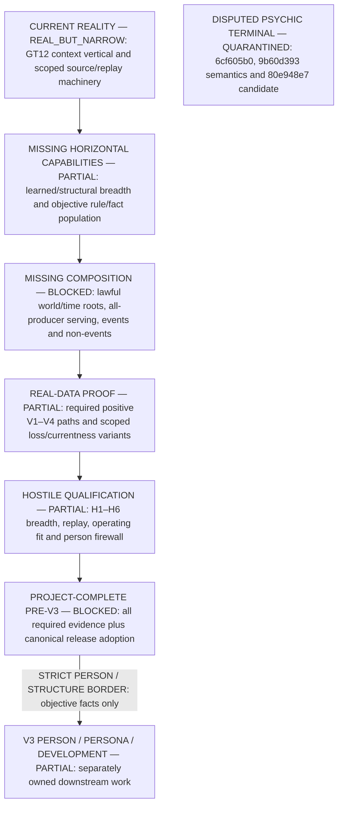

# Whole PRE-V3 completion schematic

**Packet status: independent audit evidence and proposed construction program; NOT HQ adoption.** Current accepted authority is cited at its exact scope. Machine registers mirror this Markdown packet and have no independent authority.

Present states and proposed construction order. Arrows here represent remaining work, not already-proved runtime composition. GT12 is accepted only at its exact context/zero-effect grain. The world construction program ends at the strict objective border; V3 person development remains separately owned.

