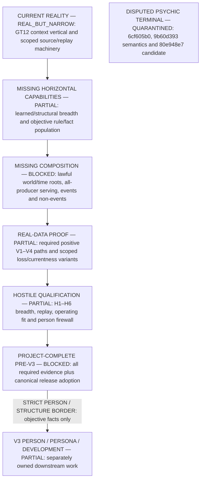

# Return to Vozhd HQ

**Packet status: independent audit evidence and proposed construction program; NOT HQ adoption.** Current accepted authority is cited at its exact scope. Machine registers mirror this Markdown packet and have no independent authority.

| Required return field | Operational return |
|---|---|
| ASTRA AUDIT | PASS_WITH_STOP_LINE |
| PRIMARY VERDICT | Substantial exact source/query/structural/serving/replay machinery and one accepted real GT12 context vertical exist. PRE-V3 is not complete: positive learned/structural/consequence world population, lawful world/time roots, general event/non-event serving and horizontal/composed qualification remain. Recommendations in this packet are not adopted project law. |
| PERSON/STRUCTURE FIREWALL | CURRENTLY_VIOLATED at local M3 enforcement scope; no clean live end-to-end person constructor proved. Quarantined psychic terminal remains excluded. |
| PRE-V3 COMPLETION STATE | NOT_PROJECT_COMPLETE; F on exact canary only, no G/H subsystem closure |
| NUMBER OF MATERIAL OPEN GAPS | 34 |
| NUMBER OF STRICT BLOCKERS | 7 |
| NUMBER OF READY-NOW PARALLEL COMMISSIONS | 8 |
| STRICT SEQUENTIAL SPINE | HQ audit/dispatch acceptance → exact input authority → implementation/population → affected route composition → independent qualification → operational/canonical release; no all-lanes barrier before per-route work. |
| READY-NOW PARALLEL LANES | C01 HQ scope/state; I: C03 learned + C04 structural; II: C02 world/time + C05 SDTF; III: C06 non-event + C07 firewall + C08 degraded policy. |
| STOP-LINE FINDINGS | Quarantined universal psychic terminal 6cf605b0 / 9b60d393 semantics / 80e948e7 candidate; clean M3 generalized positive payload promotion before result-schema enforcement. Holds are scoped and proposed; preserve GT12/unrelated lawful service. |
| QUARANTINED / SUPERSEDED ARCHITECTURE | Quarantined identities fully enumerated in 04 and machine/authority_dispositions.json. Historical seed/slot/renderer shapes and mandatory physical stage sequence are not current authority. |
| STRONGEST CURRENT PROVED VERTICAL | Afrobarometer R5 → exact Q86B/Q86A conditional (19210) → FF relation → PRE-V3 admission/V554 → V557 CONTEXT → V558 → V3 DENY_ZERO_EFFECT. |
| LARGEST UNPROVED CLAIM | A horizontally populated, current, replayable objective world that serves all required events/non-events/actor-indexed relations to V3 without upstream person construction. |
| RECOMMENDED NEXT HQ ACT | Read 00, 05, 06 and 09; issue one grounded ASTRA audit-evidence acceptance and bounded C01-C08 dispatch decision, recording exact quarantine and incorporation ceilings. Adopt future semantic candidates separately at named gates. |
| DO NOT DO YET | Do not merge this as semantic adoption, edit live OBL states from recommendations, launch waiting implementations before their gates, wake C09 without its HQ release, manufacture objective facts, adopt a psychic terminal or declare final border/project completion. |
| TERMINAL | ASTRA_PREV3_COMPLETION_AUDIT_R1__RETURN_TO_VOZHD_HQ |

## HQ decision sequence

1. Accept or reject this audit as evidence, with exact disputed findings identified. Accepting evidence does not adopt the target architecture or every proposed gap as law.
2. If accepted, release the eight bounded cards in [09](09_FIRST_WAVE_COMMISSIONS.md). Their read sets and outputs are frozen; no further whole-architecture discussion is needed to begin those grains.
3. C01 returns a concrete central-state/coverage reconciliation candidate. Each lane returns exact authority or implementation-input candidates directly to its integrator. HQ decides the named gates, then wakes only qualified successors.
4. Reuse GT12/HB01/B16/B17/HB04/SDTF evidence at its exact grain. Update central state only through competent incorporation decisions.
5. Close per-route work incrementally; reserve final completion/interface freeze for [10](10_COMPLETION_AND_FREEZE_CRITERIA.md).

## Reading order and verification

- [00 — Executive verdict](00_EXECUTIVE_VERDICT.md)
- [03 — Capability matrix](03_CAPABILITY_MATURITY_MATRIX.md)
- [05 — Gap register](05_GAP_AND_BLOCKER_REGISTER.md)
- [06 — Typed dependency DAG](06_DEPENDENCY_AND_PARALLELISM_DAG.md)
- [09 — Copyable dispatch cards](09_FIRST_WAVE_COMMISSIONS.md)
- [12 — Evidence and authority index](12_EVIDENCE_AND_AUTHORITY_INDEX.md)

Run `python3 tools/validate_packet.py` from this packet directory to verify schemas, evidence links, node/edge references, acyclicity, counts, ready/waiting partition, Markdown mirrors and manifest hashes. This validates the packet, not the Rawlsing runtime.

The packet is an additive audit branch/PR artifact. MAIN, PRE-MAIN, current authority indexes and live obligations are not changed by storing it. The earlier standalone narrative is preserved verbatim as historical audit evidence; its statement that no repository branch was moved described that earlier return, before this packaging action.

## Grounding receipt

| Receipt field | Value |
|---|---|
| grounding_receipt_id | ASTRA_PREV3_COMPLETION_PACKET_GROUNDING_R1 |
| agent_role | ASTRA |
| canonical_agent_mode | HOSTILE_INDEPENDENT_AUDIT |
| ground_version | R2 |
| canonical_project_head_observed | 9b60d3936ad7919f0b5583b4024a821e4591c9c8 |
| semantic_floor | 3468673673db2f3de804d6e825585f86ff98e870 |
| physical_branch_parent | 9b60d3936ad7919f0b5583b4024a821e4591c9c8 |
| scope | Convert completed independent audit into decision-ready repository packet; preserve source/claim typing; no semantic adoption, implementation dispatch or production-code changes. |
| relevant_state_ids | ["N004", "N006", "N008", "N009", "N010", "N011", "N012", "N015", "N016", "N017", "N018", "N024", "N025", "N028", "N030", "S040", "S041"] |
| relevant_obligations | ["OBL001", "OBL002", "OBL003", "OBL004", "OBL006", "OBL007", "OBL008", "OBL012", "OBL013", "OBL017", "OBL020", "OBL027", "OBL028", "OBL029", "OBL030", "OBL031", "OBL032", "OBL033", "OBL034", "OBL035", "OBL036", "OBL037", "OBL046", "OBL047", "OBL048", "OBL050", "OBL051", "OBL055", "OBL056", "OBL058", "OBL059", "OBL060", "OBL061", "OBL062", "OBL063"] |
| binding_authority_read | ["USER-BRIEF", "USER-RETURN", "GND", "COMP", "STATE", "ANTI"] |
| must_factor_surfaces | ["A1", "A3W", "ADAPTIVE", "ANTI", "B-INVENTORY", "B-WAIT", "B16", "B17", "B21Q", "BLOCKER1", "BLOCKER2", "BOUNDED", "CAN008", "COMP", "COMPONENT", "DISCOVERY", "DVA", "DVA-RULING", "FF", "FF-CLOSE", "FLIGHT", "GENE", "GND", "GT12", "GT12-IDENT", "INGEST", "M1-FF", "M2", "M3", "M4", "M4-BINDING", "M5", "MAINT", "MANUAL", "OBL063-GENERIC", "OLD-BRIDGE", "OLD-ROLE", "OLD-SEED", "PSEPF", "QUAR-CODE", "QUAR-MATRIX", "QUAR-OWNER", "QUAR-RETURN", "QUERY", "RECURSIVE", "RELATIONS", "SDTF-COMPANION", "SDTF-GAPS", "SDTF-R1", "SDTF-R2", "SDTF-R3", "SDTF-R4", "SDTF-RUNTIME", "SDTF-SEM", "SNATIVE", "STATE", "TRII", "VISION", "WAR", "WSC", "WSC-SEAMS", "WVS", "LOCAL-TEST", "LOCAL-M3", "USER-BRIEF", "USER-RETURN", "ORIGINAL-AUDIT"] |
| authority_ceiling | AUDIT_EVIDENCE_AND_PROPOSED_PROGRAM_ONLY |
| may_decide | Audit verdict, scoped findings, proposed dependencies and commissions; preserve evidence in isolated repository branch/PR. |
| may_not_decide | HQ adoption, canonical state closure, semantic law changes, worker dispatch, implementation or branch merge. |
| quarantine | ["6cf605b0c63f6a4ec66170bb8dc00b3060002d1a", "9b60d3936ad7919f0b5583b4024a821e4591c9c8", "80e948e7bea5ff430b40f86942459a91a590683b"] |
| anti_resurrection_constraints | No psychic terminal inheritance; no obsolete serial V550-V558 layout mandate; no historical implementation-as-current-law; retain generic incompleteness and scoped blocker evidence. |
| dependencies | Frozen completed audit, exact source/probe identities, current physical base verified; adopting HQ must re-ground if current state changes. |
| return_destination | data/ddm_build_copy/recovery_integration/semantic_relation_R1_through_Job3/R1_20260825/PRE_MAIN_RECONCILIATION_R1/WHOLE_SPINE_BUILD_CONSTITUTION_R1/RAWLSING_BUILD_WAR_PLAN_R1/CENTRAL_SYNTHESIS_R1/ASTRA_PREV3_COMPLETION_AUDIT_R1/99_RETURN_TO_VOZHD_HQ.md |
| CENTRAL_STATE_HEAD_MATCH | PASS_AT_PACKAGING_PREFLIGHT |
| GROUNDING_COMPLETE_FOR_DECLARED_SCOPE | PASS_AUDIT_PACKET_SCOPE_ONLY |
| adoption_power | NO |
| closure_power | NO |

## Final schematic

