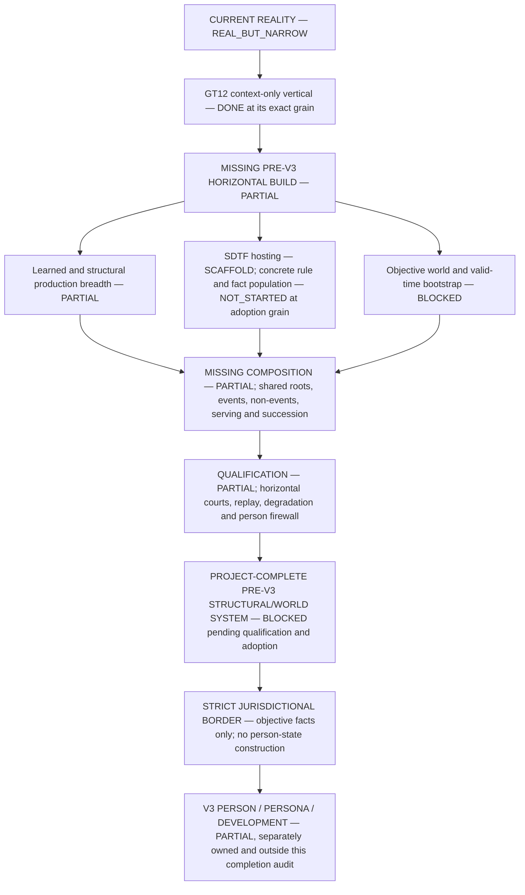

# Rawlsing PRE-V3 completion audit and construction attack plan R1

Independent whole-system audit · Repository: `maidiu/rawlsing` · Requested by Matthew · Audit date: 12 September 2026

**Disposition: PRE-V3 IS NOT PROJECT-COMPLETE.** The remaining job is materially larger than finishing GT12, selecting a carrier, unblocking one OEE, or installing a terminal driver policy. It requires a populated, current, governed objective world; broader learned and structural production; composition through shared world/release roots; and independent qualification against an explicit functional denominator.

There is substantial reusable implementation. The accepted GT1/GT2 vertical is real and valuable. WVS7 now has an accepted source-local certification floor. Chetiri has real source-backed discovery execution at its campaign grain. SDTF has adopted and qualified runtime infrastructure. None establishes horizontal completion, and several central records lag those results.

**The quarantined Enneagram constructor is an architectural violation if made the universal PRE-V3 terminal.** The clean floor does not establish a live psychometric person constructor. It does, however, contain a reproduced M3 enforcement gap: a caller-supplied psychological payload can pass its lexical boundary check under the existing synthetic test authority and be marked `actor_independent=True`. That defect must be closed before generalized higher-order production is qualified.

This report is an audit and a proposed construction program. It issues no HQ adoption, launches no workers, modifies no production code, and moves no repository branch.

## 1. Grounding receipt and evidence limits

### 1.1 Frozen authority frame

The user’s explicit ontological law governs this audit:

**PRE-V3 owns structure and the objective world. V3 owns person, persona, subjective state, uptake, response and realized development.** Objective actor-indexed relations remain lawful PRE-V3 objects. An actor identifier is not permission to create that actor’s psychology.

| Surface | Observed immutable reference | Treatment |
|---|---|---|
| MAIN | `4ba3569d2d69a89ade1ffa0b4ca8e0869654cf7e` | Current repository surface; curated older implementation transfer is not a production-completion certificate. |
| PRE-MAIN branch | `9b60d3936ad7919f0b5583b4024a821e4591c9c8` | Observed branch head; its disputed terminal-model semantics are excluded by the user. |
| Last clean PRE-MAIN semantic floor | `3468673673db2f3de804d6e825585f86ff98e870` | Baseline for central authority and the independent code/test audit. |
| Disputed model-owner disposition | `6cf605b0c63f6a4ec66170bb8dc00b3060002d1a` | Quarantined semantic authority. |
| Disputed matrix freeze | `9b60d3936ad7919f0b5583b4024a821e4591c9c8` | Quarantined semantic authority. |
| Terminal-driver candidate | `80e948e7bea5ff430b40f86942459a91a590683b` | Inspected as a candidate; not adopted as PRE-V3 architecture. |
| First consumer blocker | `468a7f81cdf522c6da418df67473354391026129` | Retained as exact missing-consumer evidence, without universal psychic-consumer inference. |
| Legacy-policy blocker | `bdd35cd611125722022d6d068c553aff8dc40b39` | Retained as legacy-policy/authority archaeology, without terminal necessity inference. |
| Whole-spine central fan-in | `dceacb137e1ab111dc4b389d9bf45bea15971d3b` | Inheritance/design evidence, read at its recorded candidate/adoption grain. |
| War-plan central synthesis | `17b9abc5c8c3038d14670c6e68136bb868f5073a` | Campaign sequencing evidence; not a substitute for completion criteria. |
| B compiler/architecture coordinator | `8676569af1e6580979a7265aeca1c499165fde24` | Newer campaign evidence, distinguished from canonical central inheritance. |
| SDTF coordinator | `43e52f12bb7e175d108446c6c852e5532d22b9ad` | Semantic companion and campaign evidence, checked against clean-floor HQ adoptions. |
| OBL061 A3W worker | `797d62d46da6ea570d56070800af19bf633e1c85` | Exact world/context blocker return, not a positive world receipt. |
| OBL061 A1 worker | `6c16e455bf3ded1c16875e173821cf65ec5bd725` | Exact prospective-generation-subject blocker; V3-side evidence only. |

The terminal-driver branch inspected was `agent/rabochii-obl063-real-terminal-driver-policy-constructor-candidate-r1`. PRE-MAIN is `integration/pre-main-reconciliation-r1`. “Observed head” and “permitted semantic baseline” are deliberately separate fields in this receipt; this report does not pretend they are the same commit.

Grounding consumed the canonical entrypoint, Ground R2, current authority/semantic indexes, anti-resurrection index, project state, open obligations, dependency/return graph, tensions, unknowns, global inheritance map and completion protocol. Relevant state families include N004/N006/N008–N012/N015–N018/N024–N025/N028/N030 and S040/S041. The audit adopts their distinction between local success, campaign acceptance, HQ banking and canonical inheritance. Findings here are proposed dispositions, not self-adopted changes to those records. [GND] [COMP] [STATE] [FLIGHT] [ANTI]

### 1.2 What was independently checked

The clean tree was enumerated completely: 5,499 tree entries, including **545 Python files**. All 545 Python files were materialized with Git blob-hash verification; the 187 Python files under `rawlsing_next` received the broad boundary search, with relevant producers, guards, tests and historical paths read in detail. The remaining Python corpus was searched for influential legacy semantics. This is a complete Python snapshot search at this commit, not a claim to have manually read every line or all repository history.

The six supplied historical PDFs/JSON/JavaScript files were read from the supplied local copies. Repository returns and adoptions were read at immutable commits. Relevant newer B, SDTF and OBL061 branch evidence was inspected separately rather than assumed to be incorporated because a branch was newer.

Independent local execution used Python 3.12.14 and pytest 9.1.1 on the exact clean snapshot. A selected, relevant 21-module regression run produced **371 tests: 368 passed, 3 failed**. Four additional M3 boundary probes were executed. Details and a reproducible probe are in §6. This is not a full repository CI run, a new SAV/DTA source execution, a production service boot, or an independent rerun of all recorded campaign workflows.

Real source execution counts below are **repository evidence**, with their adoption and claim ceilings retained. They were not all reexecuted in this audit. A negative search result is stated as “not proved in the inspected current evidence,” not as proof that no unexamined branch could contain related work.

### 1.3 Inheritance that survives

Dva contributes producer ownership, direct DAG reuse, exact-ref structural semantics, temporal/possibility/realization distinctions and the separation of architecture closure from implementation. Its original closure explicitly recorded stale seed, slot, pressure-flow and renderer implementations. Its conceptual synthetic-life court is not a current source-backed world-production run. Later disposition of 46 W3–W6 items closes the stranded-roadmap problem, not every descendant function. [DVA] [DVA-RULING] [B-INVENTORY]

Trii contributes exact respondent incidence, topology, risk set, semantic fact identity, source-universe separation, authority-before-discovery, coverage-aware search and positioned-subject possibility without psychological assignment. Historical V547 search, V548 trees, V549 clouds and permanently materialized C11 are not compulsory physical products. Chetiri preserves those information obligations while leaving carrier choice open. [TRII] [VISION] [GENE]

Source-native and manually adjudicated semantic authority must survive normalization and compilation. A decoder, association, embedding or LLM proposal does not become routing, comparability, direction, structural admission or causal authority. The old source-native constitution’s blanket staging gates are historical sequencing; current source-local admission and bounded-incompleteness decisions must be applied at their later, narrower accepted grains. [SNATIVE] [MANUAL] [WVS] [OBL063-GENERIC]

Whole-spine inheritance requires direct reuse of earlier producers, creation only of newly owned meaning, explicit handoffs, replay and no consumer starvation. The war plan’s bounded canary ladder was a useful build strategy. Its repeated deferral of general discovery, pooling and breadth until a next named claim does **not** constitute a definition of project completion. The next named claim is now whole PRE-V3 completion, so the required horizontal capability inventory must become an executable workload. [WSC] [WSC-SEAMS] [WAR]

## 2. Horizontal capability audit: all A–O, all thirteen dimensions

Maturity measures the strongest **explicitly scoped** proof, not universal readiness: A concept; B owner/contract; C local implementation; D real source-backed implementation; E adjacent composition; F real vertical canary; G sufficient horizontal production coverage; H project completion. E may be fixture composition, and D may prove a truthful unavailable result. Neither implies positive world population. No capability below reaches G or H on the available evidence.

In the tables, **Y** means present at the stated scope; **P** means partial, divided or not fully reconciled; **NP** means not proved; **N** means the required proof/instance is explicitly absent at the audited grain. An owner family is not evidence that every domain row has a competent populated owner.

### 2.1 Requirement, ownership, authority and implementation

| Capability; maturity | Semantic requirement known? | Current owner exists? | Current authority exists? | Implementation exists? | Implementation current? |
|---|---|---|---|---|---|
| A. Source/admission — **F, narrow** | Y: bytes, source semantics, use-specific admission | Y: source/native and PRE553 owners; P by source | Y: exact source-local floors; P across corpus | Y: ingestion, repositories, projection, certification | Y for adopted seams; P across corpus |
| B. Exact empirical/query/jointability — **F, narrow** | Y: exact question, predicate, risk set, topology, measure, universe | Y: PRE553 I03/I05 and relation owners | Y: exact operations; P for required multi-source positive premises | Y: query, exact/adaptive discovery, relations, recursive handoff | Y locally; P for composed contracts/tests |
| C. Learned empirical world — **D, campaign-scoped** | Y for inherited functions; P for executable coverage denominator | P: inventory names five missing-owner classes, some later addressed | P: search exists; validation/comparability/admission not broadly populated | Y for discovery; P for validated product compiler and lifecycle execution | P: real campaign floor exceeds central ledger, not automatic canonical closure |
| D. Structural relations/positions/possibilities — **F, narrow** | Y: objective relation/position/possibility, no disposition | P: FF/M1–M3 owners; objective entity/position populations incomplete | Y at exact route/conditional grains; P across domains | Y: relation ingress, atomic route, higher-order wrapper, PSEPF | P: narrow production; M3 enforcement gap; generic objective positions incomplete |
| E. Field Forge — **F, narrow** | Y at R2 plus adopted exact extensions | Y for relation and admission responsibilities | Y: active post-R2 semantic chain closed; positives remain claim-specific | Y for accepted conditional relation; P for wider products | Y for GT12; NP for broad FIELD/capital/transport production |
| F. SDTF objective consequences — **E, fixture composition** | Y: D1′, P1–P5, K1–K4 and separate proof/currentness | Y: mechanism authority, D1 host, witness/currentness, world response seams | Y: adopted R4 contract; N for concrete rule population at adoption grain | Y: qualified R1–R4 infrastructure | Y for adopted infrastructure; N for populated domain mechanism bodies in that adoption |
| G. Temporal and currentness layers — **E, scoped** | Y locally; P for unified world bootstrap/current selection | P: temporal, rule, application, fact, witness owners; initial world-time binding gap | Y for exact layers; P for a complete world authority tuple | Y: temporal admission, exact rule/currentness, re-drive | Y locally; P across one rooted objective world |
| H. Publication/serving/resolution — **F, narrow** | Y: lossless producer-preserving serving with ceilings | Y: M4 publication/repository/resolver; M5 resolved context | Y for accepted producer families and GT12 context | Y | Y for accepted family paths; P for all objective producers |
| I. World/release/context rooting and replay — **E, scoped** | Y for immutable release/replay; P for instantiated world/context root contract | P: release/repository owners exist; A3W lacks a lawful complete input owner chain | Y for component/release identity; P for objective world bootstrap | Y for release/root primitives; N for exact A3W world receipt | P; deterministic constructors do not establish authorized root inputs |
| J. Objective occurrence availability — **C** | Y: occurrence truth differs from experience/contact/acceptance | P: exact occurrence/source owners exist; generic world event production incomplete | Y for exact OBL058–060/ADP-019-related contracts; P broader domain | Y for bounded machinery; N for current first-canary positive occurrence chain | P: contracts current; current positive world instances not proved |
| K. Objective non-event context — **C** | Y upstream: positions, conditions, constitutive and durative facts | P: D1/structural owners; generic downstream ingress still open | Y for SDTF non-event semantics; P for generic consumer admission | Y for some hosting/currentness primitives; P for complete ingress/serving | P; no generic accepted non-event vertical |
| L. Permission/causal-use/calibration — **F, negative ceiling** | Y: evidence, use, causal authority and calibration are separate | Y by exact authority kind; P for positive mechanisms | Y for negative ceilings and exact contexts; P for positive causal/calibration population | Y: typed guards, bindings and bounded degradation | Y at tested scopes; P for producer schema enforcement and wider applications |
| M. Invalidation/succession/reconstruction — **E, scoped** | Y: versioned dependencies, historical preservation, governed lifecycle | Y locally; P for world-level coordination | Y: identity/currentness plus adopted declarative lifecycle; P operational closure | Y locally; P for integrated invalidation and recovery | P: no complete-world selective rebuild proof |
| N. Terminal PRE-V3 serving — **F, context-only** | Y objective duty; P for complete coverage/interface contract | P: existing producer/serving owners; missing roots and family bindings | Y for narrow structural context; N for universal psychic-vector mandate | Y: current narrow chain; P for terminal objective-world service | P: no complete populated terminal release |
| O. Source-to-terminal composition — **F, one accepted vertical** | Y whole obligation; P measurable breadth denominator | P: competent component owners; whole completion integration not closed | Y for GT12; P for broader operations | Y for GT12 and several local compositions | P: real vertical floor survives; whole-system integration absent |

### 2.2 Execution, replay, qualification, composition and completion

“Canary only” concerns the demonstrated vertical depth, not an assertion that the code contains only a canary.

| Capability | Real source-backed execution proved? | Replay proved? | Hostile/independent qualification? | Composes with predecessor? | Composes with successor? | Horizontal breadth sufficient? | Vertical canary only? | Project-completion grade? |
|---|---|---|---|---|---|---|---|---|
| A | Y: GT12; WVS source-local | Y at exact releases | Y at bounded adopted scopes | Y: exact bytes/authority | Y to empirical, narrow to structural | NP | Yes for end-to-end claim | N |
| B | Y: exact conditional; B16 campaign discovery | Y at frozen workloads | Y locally and recorded courts; 2 local exception mismatches | Y | Y narrow; broader positive jointability P | NP | Yes for end-to-end claim | N |
| C | Y: B16 evaluates all 82 candidates, all coverage-limited | Y: two runs/reconstruction at campaign grain | Y recorded bounded campaign courts | Y | P: no positive validated learned-world vertical shown | NP | No positive vertical proved | N |
| D | Y for one admitted relation/affordance path | Y narrow | Y narrow; M3 payload court fails broader boundary | Y narrow | Y narrow | NP | Yes | N |
| E | Y: GT12 conditional relation | Y exact | Y adopted canary | Y | Y exact admission/context | NP | Yes | N |
| F | N for concrete rules/world facts in runtime adoption | Y fixtures | Y: adopted integration qualification | Y fixture rule binding | Y fixture hosting/re-drive; N complete serving path | N at rule-population grain | No real positive vertical proved | N |
| G | P: source time/admission exists; no full current world | Y local, NP whole world | Y local currentness courts | P | P | NP | Fragment proofs | N |
| H | Y GT12 | Y exact repository/query | Y adopted vertical | Y for allowed families | Y context to V3 deny guard | NP | Yes | N |
| I | P: source/release roots real; A3W positive root absent | Y components, N A3W | Y component courts; exact blocker for A3W | P | P | N for required rooted world | Fragment proofs | N |
| J | N at current first-canary occurrence chain | Y local machinery only | Y contracts, N real-world chain | P | N positive first-canary chain | NP | No real positive vertical proved | N |
| K | N generic real non-event route | Y local host/currentness only | Y upstream fixtures, N generic ingress | P | N generic ingress | NP | No real positive vertical proved | N |
| L | Y context-only/zero-effect ceiling | Y narrow | Y narrow; M3 gap remains | Y scoped | Y scoped; no general causal promotion | NP | Yes for full path | N |
| M | P: exact empirical reconstruction real; world evolution NP | Y selected components | Y local/campaign; whole-world NP | P | P | NP | Fragment proofs | N |
| N | Y narrow structural context only | Y narrow | Y narrow | Y GT12, P all families | Y deny/zero-effect consumer; P complete objective API | N | Yes | N |
| O | Y accepted GT12 | Y accepted GT12 | Y exact independent adoption court | Y exact source chain | Y exact zero-effect boundary | N | Yes | N |

Evidence supporting and limiting these classifications follows. The table does not transform campaign acceptance into canonical project closure. [STATE] [GT12] [WVS] [B16] [SDTF-RUNTIME] [A3W]

### 2.3 What the implemented machinery actually buys

**A–B: strong exactness, uneven positive authority.** PRE553 implements ingestion/repository objects, exact empirical queries, source relations, exact/adaptive discovery, component authority, recursive handoff and authority maintenance. The information model preserves respondent binding, empirical coordinates, response states, predicate/risk-set distinction and source identity. That is useful infrastructure for a rich learned world, not proof that such a world has been compiled. [INGEST] [QUERY] [RELATIONS] [DISCOVERY] [ADAPTIVE] [COMPONENT] [RECURSIVE] [MAINT]

J01-A’s frozen inventory covers 1,879 source structures, 1,411 candidates, nine families and 35 scopes. The C06 Contract@2 snapshot has 18,276 rows: 1,025 general, 1,574 positive executable routing, 17 nonapplicable, 1,274 administrative and 14,386 typed unresolved. These are inventory/routing counts at their recorded grain, not current universal source or operation admission. P3 jurisdiction/API availability does not load every positive premise for every operation. Relation authority, respondent jointability, pooling, measurement comparability and structural admission remain separate. [STATE] [GENE]

**C: real autonomous evaluation is not a positive learned world.** B16’s real LiTS I workload evaluated 82/82 candidates in two fresh runs. Every candidate ended `EVALUATED_MISSING_OR_CONFLICTING_AUTHORITY / COVERAGE_LIMITED`. Each run records 140 I05 empirical queries/fact references and eight I03 executions, with exact replay and delete/reconstruct evidence. This is real production feasibility and honest authority-limited search, not 82 validated structural relations and not a complete-negative discovery finding. [B16]

The B2 inventory’s 24 responsibilities divide into 12 owned-current, seven successor-current, zero retired-with-proof and five missing-owner classes. Later lifecycle adoption addresses part of that frontier. Validation, required comparability, general composition and claim-specific ownership still require exact work; retirement is conditional on actually discarding information. The required learned-world compiler must populate accepted products, uncertainty and explanation lineage, not merely preserve search APIs. [B-INVENTORY] [STATE]

**D–E: the structural path is real but narrower than the ontology.** The GT12 producer creates a specific actor-independent conditional relation. M1 admits its exact structural use; M2 implements an exact atomic route rule; M3 validates higher-order participants, authority and permissions around a caller-supplied result. M3 is not a general semantic rule engine. Its positive payload needs a separately competent producer and an enforceable objective schema. The route-born predicate registry can lawfully be valid-empty; a higher-order object is not required when direct publication suffices. [GT12] [M1-FF] [M2] [M3]

Field Forge R2 and OBL040/041/042/005/043 close the active bounded semantic chain: geometry/routing, geometry-family distinctions, weight/estimand/homology refusals, position-role meaning and capital/conversion distinctions. OBL020 closes that synthesis. It does not populate all structural fields, transport maps, institutional mechanisms, capital conversions or higher-order interactions. A geometric noun, an association or an appealing theory does not confer those claims. OBL006 stays dormant unless a required exact external political-group transport claim activates it. [FF] [FF-CLOSE]

PSEPF’s implementation explicitly distinguishes proxy, exact fact and actor belief. Exact conditional computation and authorized specificity-loss walkback are lawful evidence services. A queried population possibility field does not initialize a person. A general objective actor-position resolver is still not proved merely because a clinic-specific V3 comparator contract exists. [PSEPF] [STATE]

**F: SDTF has runtime infrastructure, not a populated consequence world.** The adopted R4 semantics preserve one D1′ objective consequence family, five classes—P1 material access/dependency; P2 authority/obligation/sanction; P3 organized activity/time; P4 gate/treatment; P5 counterpart/channel—and four kinds: K1 constitutive positional, K2 qualified possibility, K3 realized occurrence, K4 durative. There is no authority here for D2/D3/D4 or a sixth class. Class membership is not a mechanism rule; a rule is not an application; an application is not a current fact. [SDTF-SEM] [SDTF-COMPANION]

The adopted R1–R4 machinery binds mechanism authority, hosts/replays D1, checks witnesses/currentness, and re-drives world response. The repaired R1→R2 current-rule seam is significant. The recorded integration court passed 99 qualification tests per run, plus protocol tests. Its explicit creation ceiling is **zero concrete rules, zero actors and zero objective world facts**. The D1 host consumes an external evaluator; the authoritative bodies of actual domain mechanisms and their evidence/calibration do not appear by hashing a rule reference. [SDTF-RUNTIME] [SDTF-GAPS] [SDTF-R1] [SDTF-R2] [SDTF-R3] [SDTF-R4]

**G, I and M: local currentness is not a current world.** Distinguish source observation time, rule validity, application validity, fact validity, witness validity, resolver selection time and V3 runtime time. A complete release needs explicit temporal relations among them; it cannot treat a recent run as current truth. K4 needs either a current interval witness or a continuing-state basis whose validity overlaps the query and whose termination coverage is complete, with no defeating termination. An old event plus silence is insufficient. [SDTF-COMPANION] [SDTF-R3]

A3W’s exact blocker is `NO_LAWFUL_PROJECT_CURRENT_A3W_GENERATED_WORLD_OR_CONTEXT_RECEIPT_MATERIALIZATION_PATH`. A designator such as `V3_SIM_WORLD_R1`, a context label and a deterministic hash do not supply a lawfully authorized world/repository/query/context/temporal tuple. The current A3W/A3T sequencing exposes a bootstrap cycle: A3W needs temporal input, while downstream A3T cannot retroactively supply an upstream world-time authority it is not commissioned to own. Resolve this by distinguishing **PRE-V3 objective world valid-time anchoring** from **V3 runtime temporal binding**. This is an ownership/input correction, not permission to manufacture timestamps. [A3W]

Local replay, current-rule invalidation and component authority maintenance exist. The adopted learned-product lifecycle/economics contract is declarative. A composed objective-world update still needs proof that the correct dependency closure changes, unaffected facts keep their identities, old releases remain reproducible, and no current query silently mixes incompatible roots. [MAINT] [B-INVENTORY] [STATE]

**H and N: serving exists, but its accepted universe is restricted.** M4 accepts V553–V556 producer root families and returns an exact resolution result; M5 builds resolved structural context after explicit currentness/eligibility decisions. That proves neither an all-producer world repository nor D1′ publication. New objective producers must use a lawful direct reference or a lossless adapter, with producer ownership intact. They must not masquerade as a legacy family merely to fit the current allowlist. [M4] [M5]

**J–K: occurrence contracts and non-event semantics have not populated availability.** OBL058/059/060 close exact authority machinery, not current positive source facts. The current A1 return separately proves that the required prospective actor-generation request is missing. That V3 blocker does not mean PRE-V3 needs optional psyche facts or cannot build an actor-independent objective world. CAN-008 R2 owns person×event receivability, uptake/appraisal and response semantics; it is semantic adoption, not generic non-event runtime closure. A standing objective condition must not be dressed up as a fictitious encounter to enter that lane. [A1] [CAN008] [STATE]

## 3. The terminal PRE-V3 product

### 3.1 Semantic answer

The terminal requirement is a **governed, replayable objective-world resolution capability over producer-owned objects with shared immutable world/release roots**. A manifest without resolvable content is insufficient. A query service without fixed authority and historical replay roots is insufficient. A giant serialized payload is unnecessary unless workload evidence justifies it.

The most defensible logical form is a producer-owned DAG plus a world/release/context manifest and governed resolution services. This combines semantic responsibilities; it does **not** select a persistent, virtual or hybrid physical winner. Existing components should be reused or extended according to exact responsibility. No new mandatory V550–V558 serial traversal is implied. [WSC] [GENE] [VISION]

| Required terminal duty | What must be resolvable | Ownership/negative condition |
|---|---|---|
| World identity | World or governed scenario identity; release; source, rule and object roots; validity basis; historical lineage | Authoritative producer refs, not a display label or mutable `latest` |
| Empirical evidence | Exact source-indexed facts, conditional/joint support, topology, risk set, coverage and uncertainty | Observed responses remain evidence about their respondent/source scope; never generated personal belief |
| Learned products | Validated empirical relations and their explanation/validation lineage, or exact candidate/partial/unavailable state | Discovery and structural admission remain distinct |
| Objective structural state | Institutions, relations, positions, material conditions, channels, rules, constraints and opportunities | An objective actor or entity reference may index a relation; no disposition follows |
| Objective consequences | Admitted P1–P5/K1–K4 applications and current facts | Rule/source/calibration authority and witness basis remain independently inspectable |
| Occurrences and non-events | Current/historical occurrences; standing conditions; constitutive and durative state; justified absence where coverage permits | World occurrence is not actor experience; non-event context needs no fabricated event |
| Currentness and succession | Exact as-of query basis, conflicting/withdrawn/superseded states, dependency invalidation and reconstruction | No unrecorded wall-clock or newest-file selection |
| Permission and degradation | Use-specific authority, source-local/population ceilings, proxy/fallback/omission provenance | Missing is not zero, unsupported is not false, no implicit renormalization or inferred causal permission |
| Downstream contract | Typed objective results, producer refs, query/selection receipts and reasons for refusal | V3 alone determines uptake, interpretation, response and durable person change |

The minimal logical request identifies the world/release, as-of basis, target objective entities/relations, requested operation/use and consumer authorization. Its result identifies the selected producer objects, exact authorities/dependencies, validity and coverage, permission ceiling and replay receipt. Concrete type and field names should be finalized by the competent seam owners; this report does not declare a new adopted wire protocol.

An objective scenario may be governed rather than a literal historical census. It must be labeled as such and derive its objective facts under an explicit world-construction rule. Neither a fixture nor an invented context becomes historical evidence. Source observations, governed models and generated objective world facts need distinct epistemic types.

### 3.2 What must remain outside

No PRE-V3 output may contain a generated person’s persona, belief, ideological stance, affect, appraisal, preference, motive, trait, type, interpretation, uptake, response, developmental history or durable subjective state. This restriction applies to latent vectors and convenient “initialization” fields as much as to prose.

PRE-V3 can answer that an actor holds a tenancy, has a legal eligibility, is located within an institutional jurisdiction or faces a material constraint when those are objective facts under competent authority. It cannot answer that the actor therefore feels insecure, prefers hierarchy, identifies with a group, experiences an encounter or has a personality type.

### 3.3 Physical choices remain open

Persistent products, exact source-backed evaluation and a hybrid can all implement the same semantic duties. Chetiri has demonstrated source-backed feasibility and a common harness; it has not selected a production winner. Workload semantics, source retention, admitted authorities and negative behavior must be equal before comparing cost, latency, memory, reconstruction and operational behavior. A winner may legitimately differ by product class; no evidence requires one storage strategy for the entire system. [B16] [B17] [B21Q] [B-WAIT]

## 4. Strongest real verticals and where they stop

| Proof path | Genuinely demonstrated chain | Exact ceiling / stopping point |
|---|---|---|
| **Accepted GT1/GT2 / GT12** | Afrobarometer R5 source-backed exact conditional Q86B→Q86A; 19,210 denominator; FF relation; PRE-V3 admission; M1 V554 F1; direct V557 context publication; V558 resolution; V3 guard | `CONTEXT` only; `DENY_ZERO_EFFECT`; unchanged person-state fingerprint. No positive causal use, person generation, general learned world, SDTF population, world event/non-event system or horizontal completeness. |
| **WVS7 HB01 source-local floor** | Exact SAV; 97,220 rows; 613 logical variables; 612 projected with PWGHT excluded; 66/66 source-local universes; multi-owner projection; certification and reconstruction; exact I03 parity | The inspected I03 result is `UNAVAILABLE / RISK_SET_UNAVAILABLE`. All 222 documentary residuals and nine D03 determinants remain `ROUTING_UNKNOWN`. No population, design, weighted, pooling or measurement authority follows. |
| **LiTS I C05R2B/B16** | Genuine DTA source; governed projection and discovery frontier; all 82 candidates evaluated in two runs; query/fact references; replay and reconstruction | All 82 are coverage-limited due to missing/conflicting authority. No positive validated learned or structural-world vertical. Campaign acceptance is not silent central-ledger closure. |
| **SDTF R1–R4 integrated runtime** | Bound mechanism authority → D1 host/replay → witness/currentness → world-response re-drive, including repaired current-rule seam | Qualified infrastructure/fixtures; zero concrete rule, actor or world-fact population at adoption scope. Not a real source-to-terminal consequence vertical. |
| **OBL061 A3W/A1** | Exact independent producer returns identify missing world/context input and prospective actor-generation request respectively | Blockers are proved. No positive current world receipt or actor activation follows. Only A3W’s objective-world dependency is a PRE-V3 construction obligation. |

[GT12] [WVS] [B16] [SDTF-RUNTIME] [A3W] [A1]

GT12’s final HQ adoption supersedes the earlier failed/incomplete identity stage. Its adopted empirical fact is `540236d533e9123f6d7b4d1edd4cf0951277154e72c7667deb09fb6550f11f46`; query `e4ec3998664975c6a5f9e020b7815cfe6d39a212e264963d8037e6f0db87d0d0`; replay `c0c23ca2bb439364756503722b60d047139d42a6128411cc19bfbd87d33c884f`. The authority-complete identity changed lawfully when exact target-use authority entered identity closure; empirical result semantics did not change. [GT12-IDENT] [GT12]

The final GT12 adoption records real E2B terminal `688dca436f0c3d9ad49805c87caa9ee43cfac103`, final independent audit `27405d83cd83906f5a625b53f828d830b57f0902`, exact determinism, 221 regression/hostile tests and 20 protocol tests. These are accepted repository evidence, not this audit’s local 371-test run. Reuse that accepted floor; reopen it only on a concrete contradictory dependency or integration change. [GT12]

WVS7’s source-local release is `a7053b1169dc42d3af348eb96771fe89476ca30b13dccafb982ea39d7f67ee8d`, with source SHA-256 `2bd2a20fc565e7e7b4b2030fd8457db4d0d88160c5ee5186e9ea6c267209af7d`. The 42 dual-owner physical slots produce separately authorized respondent-event and empirical-coordinate objects; the generic implementation must preserve this without WVS/question-name special cases. This is stronger than the stale “HB01 pending” ledger entry and narrower than population certification. [WVS]

## 5. Person-creation hostile court

The classifications concern semantic ownership and actual reachability. A suspicious filename alone is not a corruption finding. Observed survey responses about attitudes may remain lawful empirical evidence; assigning them as a generated individual’s attitude is a different operation.

| Case | Classification | Evidence and disposition |
|---|---|---|
| Quarantined `EMPIRICAL_TO_DRIVER_VECTOR_PRE_V3` constructor producing driver→Enneagram distributions as the terminal | **ARCHITECTURAL_VIOLATION** if installed at that PRE-V3 terminal grain | The 22×9 psychometric type output crosses the user’s boundary before V3, even if it never mutates an actor object. Quarantine stands; no universal terminal dependency follows. [QUAR-CODE] [QUAR-OWNER] [QUAR-MATRIX] |
| Generic bounded empirical runtime and component-authority vector | **CURRENT_LAWFUL** | Evidence tier, missingness, claim ceilings and authority vectors are infrastructure, not personality semantics. Bind lawful objective consumers at their own grains; do not delete the generic mechanism because legacy terminology says “driver.” [BOUNDED] [COMPONENT] |
| Legacy cross-cultural Enneagram PDF and full vector pipeline | **HISTORICAL_ONLY** | They describe country/cultural aggregates feeding type/health/persona priors. They are evidence of the historical psychological proposal, not current PRE-V3 law. Importing that operation into PRE-V3 would be a violation. |
| Historical v3.4 generator framework | **HISTORICAL_ONLY** | Person/driver/developmental proposals and numeric thresholds are not an adopted objective-world rule corpus or calibrated terminal policy. Preserve provenance; do not manufacture current authority from it. |
| Supplied `driverSchema.json`, `driverTypeWeights.js`, `enneagramBatch.js` | **HISTORICAL_ONLY** | 40 schema tokens/103 proxy entries versus 22 matrix drivers leaves 18 unmatched. The JavaScript uses missing-as-zero and min–max normalization, while the prose pipeline describes softmax. Those are distinct semantics, not a recoverable exact current policy. |
| Aggregate descriptive model over governed source populations, with no generated-person inference | **OPTIONAL_NONPERSON_MODEL** | A possible separately governed analytical product, if its outputs truly describe the source/model population and its validation/use limits are explicit. The supplied psychic terminal is not automatically rescued into this class; it would need a different exact claim and owner disposition. |
| M3 higher-order `governed_result.semantic_payload` | **ARCHITECTURAL_VIOLATION — local enforcement gap** | Reproduced on the clean snapshot under synthetic test authority: psychometric/personal-trait payloads become `SUPPORTED` and `actor_independent=True`. No live positive production authority or actual actor is established by this probe. Require typed producer-result/schema enforcement before broader qualification. [M3] |
| Old `allowed_as_runtime_persona_evidence` / persona-packet eligibility flags | **AMBIGUOUS_REQUIRES_DISPOSITION** | These are live legacy code surfaces, not proof of persona synthesis. They may only describe downstream evidence eligibility under a competent V3 gate. Inventory exact reachable consumers; prohibit their use as PRE-V3 psychological admission or direct personal priors. Preserve manually adjudicated source meaning. [OLD-ROLE] [OLD-BRIDGE] [MANUAL] |
| Dva/war-plan shorthand “PRE-V3 actor-independent; V3 first actor-indexed owner” | **AMBIGUOUS_REQUIRES_DISPOSITION** | It is too broad under the explicit current task law if it excludes objective actor-indexed position, tenancy, eligibility or consequence facts from the world. Reconcile exact owner statements with SDTF; keep uptake/experience/development in V3. Do not silently harmonize a jurisdiction conflict. [DVA] [WAR] [SDTF-SEM] |
| Old V554 seed/readiness/interpolation surfaces | **HISTORICAL_ONLY** at superseded semantic grain | Dva explicitly marks stale seed/score shapes as migration debt. The word “seed” alone is not proof of person creation; exact-ref structural affordance is lawful. Do not revive score-based semantics as current authority. [DVA-RULING] [OLD-SEED] |
| Positioned-subject empirical possibility field | **CURRENT_LAWFUL** at inspected producer scope | Population evidence selected by exact comparability criteria, with explicit proxy authority and specificity loss. It does not generate actor belief, propensity, preference or personality. V3-owned consumption is separate. [PSEPF] |
| M4 repository / M5 context and structural-peer eligibility | **CURRENT_LAWFUL** at accepted scope | Current guards reject person/V3/V2/render objects; M5 does not synthesize empirical priors or mutate actor state. This does not prove all untyped upstream payloads are semantically safe. [M4] [M5] |
| SDTF objective consequences, including actor-indexed consequences | **CURRENT_LAWFUL** at R4 semantic scope | Objective material/institutional facts are not psychic transmission. P1–P5 do not authorize appraisals, need states, motives or actor uptake; rule and witness authority remain mandatory. [SDTF-SEM] [SDTF-COMPANION] |
| World event/contact/availability promoted into encounter, uptake or durable state | **ARCHITECTURAL_VIOLATION** as a proposed shortcut; **not observed as an accepted clean positive vertical** | CAN-008 and exact OBL061 blockers prevent the inspected first-canary shortcut. Generic non-event ingress must preserve the same separation without pretending every condition is an event. [CAN008] [A3W] [A1] |

The clean repository therefore does **not** earn an unconditional “firewall proved” verdict. Its principal semantic contracts preserve the distinction, the quarantined terminal contradicts it, ambiguous inherited owner/permission names need exact disposition, and M3’s local enforcement is demonstrably insufficient.

### 5.1 What the OBL063 blockers actually prove

The generic law preserves population-certified, source-local-certified, partial and unavailable tiers, explicit fallback provenance and no invented values, missing-as-zero or implicit renormalization. It is useful for every objective consumer whose evidence can be incomplete. [BOUNDED] [OBL063-GENERIC]

The first blocker proves the nominated real consumer/policy was not available at its exact commission grain. The second proves legacy files did not furnish a coherent, adopted current policy. Neither proves that Rawlsing’s terminal must be a 40-driver registry, 22-slot vector, six scalar mappings, 22×9 matrix or type softmax. [BLOCKER1] [BLOCKER2]

The quarantined candidate implements 22 active/18 pending classification, six selected mappings from five unique source channels, 16 missing active slots, an exact 22×9 matrix and softmax at temperature one. Guarding missingness does not cure the upstream psychometric ownership conflict. Conversely, rejecting its universal PRE-V3 role does not require destroying the artifact or prohibiting separately governed research. [QUAR-RETURN] [QUAR-CODE]

The replacement dependency is **per-objective-consumer evidence policy**, not a universal person vector. For example, a tenancy relation may remain unavailable without source authority, a supported institutional rule may still be served when an unrelated survey is unavailable, and a missing calibration may block a numeric causal claim while preserving a permitted descriptive fact. Exact fallback alternatives require their own authority; the runtime must never improvise them.

## 6. Independent execution findings and reproducibility

### 6.1 Selected regression run

The 21 selected test modules cover empirical query/source relations/discovery/component authority/recursive handoff/maintenance/PSEPF; M1–M5; bounded empirical runtime and hostile cases; and the five SDTF runtime/integration surfaces. **368 passed; three failed in 2.67 seconds.**

| Failure | Observed behavior | Meaning for construction |
|---|---|---|
| `test_sample_pooling_requires_semantic_equivalence_nonduplication_and_own_authority` | Missing exact semantic relation raises `SourceRelationIntegrityError`; test expects `SourceRelationAuthorizationError` | Fails closed. Reconcile documented error taxonomy and callers/tests; no positive unauthorized pooling demonstrated. |
| `test_estimand_composition_requires_its_own_exact_relation_even_when_pooling_exists` | Same integrity-versus-authorization mismatch for missing exact relation | Fails closed. Preserve the independent estimand-composition authority requirement. |
| `test_m4_binding_accepts_exact_relation_contract_and_keeps_v554_producer_family` | Older test supplies caller-selected `REVIEW`/`CONTEXT`; current shared binding rejects that shortcut and requires the validated relation binding | Contract/test drift after stronger permission binding. Do not loosen the production guard merely to restore green tests. |

This is a current verification debt, not a claim that GT12’s accepted original proof is retroactively false. The correct repair is an exact contract/caller/test reconciliation followed by the affected regression and composed seam court. Repeating every expensive source execution is unnecessary unless the repair changes its identity, semantics or dependency closure. [RELATIONS] [M4-BINDING]

### 6.2 M3 hostile payload probe

| Synthetic payload | Local result | Positive object? |
|---|---|---|
| `{"actor_state":"x"}` | `DENIED` | No |
| `{"psychometric_type":4,"motivation":"approval"}` | `SUPPORTED` | Yes; labeled actor-independent |
| `{"subject_ref":"urn:audit:subject:1","preference":"deference","psychological_trait":"submissive"}` | `SUPPORTED` | Yes; labeled actor-independent |
| `{"relation_kind":"TEST_HIGHER_ORDER"}` | `SUPPORTED` | Yes; expected structural control |

The probe uses the existing M3 test fixtures to supply two exact synthetic M2 routes and an active synthetic rule. It does not bypass a real production registry, create a real actor, or prove publication through the whole machine. It proves the narrower defect that the purported semantic boundary checks substrings of mapping keys, not the semantic result’s conformance to a competent objective producer schema. [M3]

Reproduce at the frozen clean snapshot, with pytest available:

```python
from rawlsing_next.tests import test_m3_v556_higher_order_structural as t

a, b = t._m2("audit:a"), t._m2("audit:b")
rule = t._rule()
request = t._request(
    rule,
    [t._bind(a, "CAUSE", 1), t._bind(b, "EFFECT", 2)],
    payload={"psychometric_type": 4, "motivation": "approval"},
)
result = t._eval([a, b], request)
print(result.decision_state, result.v556_object["actor_independent"])
# Audited result: M3DecisionState.SUPPORTED True
```

Proposed repair scope: bind rule identity to a competent executable result/schema, validate permitted objective content recursively, preserve lawful objective actor references, and reject personal-state semantics regardless of convenient field names. A longer blacklist alone does not establish the required boundary. The independent court must include legitimate actor-indexed world facts as positive controls, so a repair does not incorrectly ban the user’s lawful ontology.

## 7. Obligation dispositions: preserve the work, correct its grain

These are proposed HQ dispositions. They do not silently edit the central register. The minimum governance repair is one reconciliation packet that distinguishes existing accepted evidence, incorporation state, remaining functional debt and exact successor ownership. [COMP] [STATE]

| Existing obligation / cluster | Audit disposition and priority | Dependency / completion consequence |
|---|---|---|
| OBL002 PRE553 seam versus continuous DAG | **Still return-required at physical topology grain; not a reason to postpone semantic composition.** Preserve publication/replay responsibilities and direct producer reuse. | Define required objects/operations first. Prototype lossless composition on existing implementations; choose physical placement only with workload evidence. Do not force eight stages. |
| OBL003 learned-world inventory | **Keep CLOSED at inventory grain. Open/populate exact functional successors required by completion.** | Missing-owner rows do not disappear behind the closed inventory. Reconcile later lifecycle adoption; require competent validation/comparability/composition owners for the chosen workload. |
| OBL030 production discovery; OBL035 C05R2B | **Do not reissue the already completed B16 execution.** Recognize real campaign evidence and identify remaining canonical adoption and positive learned-product work. | All 82 coverage-limited outcomes prove evaluation, not validated relations. A new positive learned-world workload must trigger exact missing authority and validation work. |
| OBL036 C08/G1 | **The pending central entry is stale relative to B17 campaign evidence.** | B17 disposes 54 C08 rows: 49 unchanged, four closed via C04, one via B16, zero new/blocking, with 76 unresolved preserved. Reconcile acceptance/inheritance; do not erase the residuals or rerun historical reconciliation by default. [B17] |
| OBL001/024/037 physical persistent/virtual/hybrid discriminator | **Open; prerequisites have advanced.** Source-backed feasibility and HB04 harness qualification are real; no winner or benchmark follows. | Preserve the no-retirement-credit baseline. After competent gate reassessment, HB05 workload and HB06 oracle may run in parallel; HB07 completes the launch packet; separate C09 parity/economics court precedes selection. [B21Q] [B-WAIT] |
| OBL004 source→PRE-V3 compiler | **Partially closed; central whole-system construction obligation.** | Keep GT12. Add required learned, objective position/non-event, occurrence, temporal and multi-producer paths. “One composed proof” is no longer an adequate closure condition for project-wide completion. |
| OBL008 WVS certification | **HB01 source-local closure is already accepted in newer clean-floor evidence.** The ledger’s full-source pending statement needs reconciliation. | Preserve 66/66 source-local availability, 222 routing unknowns, nine D03 unknowns, and separate population/design permissions. Remaining documentary recovery runs alongside useful source-local serving. [WVS] |
| OBL013/017 N025 current admission | **Retain the exact negative ceiling; no generic D successor is needed.** | Each production operation enumerates its required positive P3 premises and binds them. J01-A candidacy and C06 routing are not blanket composability. |
| OBL007 Job3 blockers; OBL011 fracture readmission; OBL046/047 orphan/remainder debt | **Targeted prerequisites when the completion workload uses those meanings.** | Preserve frozen verdicts and exact missing identities. Run the requisite readmission when the chosen producer depends on it. Do not excavate every branch as a global completion prerequisite or call unexplored debt closed. |
| OBL012/033 comparability, composition, linkage/backfill | **Separate operations, not one universal join gate.** | Same-source Q69B↔Q86A closure survives. Required cross-source or cross-release operations need their own equivalence/linkage/pooling/measure authority. Unsupported transfers may remain explicit refusals; required positive capabilities cannot all be declared unavailable to earn completion. |
| OBL020, OBL040/041/042/005/043 Field Forge | **Keep exact semantic closures. Commission production breadth, not another generic constitution.** | Build only domain/claim rows in the completion workload. Existing R2 relations and negative transport law are reusable. |
| OBL006 external political-group crosswalk | **Dormant, claim-conditional.** | Activate only for a required exact endpoint/context/time transport claim. No speculative universal crosswalk project. |
| SDTF R1–R4 / G1–G6 runtime | **Keep adopted infrastructure closure. Concrete rule/evidence/world population remains a separate priority.** | Populate competent mechanism bodies, applications, witness coverage and actual current facts. Reuse current-rule repair; do not repeat it as the new rule-population job. |
| OBL061 world/context | **Split objective world bootstrap from V3 actor/OEE construction.** | PRE-V3 must supply lawful objective world/release/time/context inputs. V3 must supply its generation request, activation, phase and runtime binding. Neither owner may manufacture the other’s prerequisites. [A3W] [A1] |
| OBL062 | **Reconcile an identifier/meaning collision before assigning work.** | The central row still describes V3/PFF two-ended psychic reconciliation; newer SDTF/CAN-008 boundary material leaves generic non-event ingress open. Preserve both provenances with distinct exact subgrains or successor IDs. Do not overwrite one with the other or make all PFF development a PRE-V3 gate. [STATE] [SDTF-COMPANION] [CAN008] |
| OBL031/048 comparator/classification; OBL032 PSEPF metabolism | **Keep exact adopted authorities; preserve their zero-positive/current-input limits.** | The clinic/Q69B comparator does not prove general objective actor-position resolution. Real V3 metabolism remains V3 work; PRE-V3 can qualify its objective query contract independently. |
| OBL063 | **Retain generic bounded incompleteness; reject the universal psychic-terminal assumption.** | Replace the scope with evidence policies for named objective consumers. HQ must explicitly reassess the HB05/HB06/C09 hold; this audit does not authorize a wake itself. An Enneagram policy is not an intrinsic empirical-workload prerequisite. |
| OBL027/028 old Dva roadmap | **Keep disposition CLOSED. No wholesale W3–W6 replay.** | Carry only triggered descendant functionality into the completion workload, with current owners and implementation evidence. |
| OBL034 lifecycle/economics | **Keep contract closure; distinguish operational implementation.** | Use its lifecycle determinants in world/product invalidation and economics. The adopted contract does not execute every lifecycle operation. |
| OBL029 source/carrier retirement; OBL051 branch deletion | **Not baseline completion gates while authoritative evidence is retained.** | Equivalence/retirement becomes strict if discarding source/carrier information is proposed. Branch hygiene is separate from world-serving functionality. No deletion is proposed here. |
| OBL050 legacy positive V558 caller debt | **Keep current-reachability closure.** | Reopen only on an actual new positive edge bypassing authenticated dependency roles; do not generically rewrite historical identities. |

The corrected critical path is not “finish all archaeology, then finish all authority, then build each legacy stage, then produce a psychic vector.” It is an explicit objective completion workload, competent populated producers, shared world/time roots, incremental composition and qualification. Documentary recovery, lawful degraded serving, rule population and physical workload preparation can advance together.

## 8. Target completion state and acceptance denominator

**Completion means the agreed PRE-V3 objective-world workload is implemented, populated, composed, replayable, independently qualified and centrally adopted, with a stable objective interface that a V3 consumer can use without inventing missing upstream truth.** It does not require V3 itself to be a finished person engine.

The first executable governance output is a finite **completion coverage register**, derived from the inherited functional inventory and terminal demand. Each row must specify:

1. Required objective capability and concrete operation, with a producer/consumer pair.
2. Domain, entity/relation kind, source family/release and temporal scope.
3. Applicable source semantics, evidence tier, measure and permission premises.
4. Required positive behavior, required negative/partial behavior and whether unsupported status is an acceptable product limit.
5. Competent semantic owner, exact current authority and implementation.
6. Actual population/source execution, predecessor/successor composition, replay and independent qualification evidence.
7. Release/adoption status and exact remaining blocker/return path.

HQ must adopt that denominator before anyone can claim G or H. It cannot define the denominator as whatever the current canary happens to do, delete inherited requirements because they lack an owner, or require universal knowledge about every historical source. It must identify the intended supported world domains and preserve a visible backlog outside them. A narrower initial product may be released honestly as a **bounded PRE-V3 release**; it cannot be renamed whole-project completion while required inherited capabilities remain deferred.

The register must cover ordinary functioning as well as constraint, scarcity and sanction: access, maintenance, institutional participation, reciprocal material support, organized activity, available channels and lawful possibilities. P1–P5 cannot become merely five labels for one deprivation example. This is a structural coverage requirement, not a request to infer optimism, suffering or any other person-state.

### 8.1 Minimum positive vertical floor

Four distinct **semantic route classes** are the smallest credible positive floor proposed here. They can share sources, objects and infrastructure; they are not four independent stage stacks. Four passes alone do not establish horizontal completion.

| Route | Required positive demonstration | Required stopping discipline |
|---|---|---|
| V1. Exact empirical structural context | Reuse accepted GT12; consume it through the new shared objective release/root without changing its exact claim or permissions | Context remains context; no positive person effect is required or authorized. |
| V2. Learned-to-structural production | Real authorized discovery finds at least one non-preselected lawful relation; competent validation/admission produces a positive learned/structural product; serve it with lineage. Include a genuinely required higher-order/joint case beyond one unary or pairwise shortcut | Association is not causal law; higher-order wrapper success is not mechanism-body execution; typed incomplete search is not complete negative. |
| V3. Objective position and non-event consequence | Real source-backed or explicitly governed objective institution/position/rule yields a lawful actor-indexed objective fact and a standing/durative consequence; resolve it as-of without an encounter | No actor psychology, uptake or biography. Include valid K4 support and a termination-defeat variant. |
| V4. Objective occurrence and world succession | A competent objective occurrence/world response changes the appropriate rule application/fact/root; current queries see the successor, historical queries reproduce the predecessor, unaffected facts retain identity | An occurrence is not an experience. A fabricated person action cannot bootstrap world truth; a real V3 action, if used, must arrive as a separately admitted external input. |

Every route must also undergo the relevant loss/denial/currentness variants. Across the four routes, require at least two genuinely different source/format situations and multiple institution/position domains, with same-source and required cross-source/release operations distinguished. An existing failure-to-authorize case is an essential control, not a substitute for the positive V2/V3/V4 duties.

### 8.2 Minimum horizontal breadth courts

These six courts cover different failure surfaces. Each must enumerate the actual applicable rows; passing six demonstrations is not the denominator.

| Court | Required coverage and hostile cases | Evidence needed to close |
|---|---|---|
| H1. Source/empirical information | Every in-scope source family/topology class; SAV/DTA where used; scalar, repeated/multiple/ranked/matrix forms; physical versus semantic missingness; exact respondent identity; risk set versus condition; weights/design; multi-owner projection | Real current execution at each materially different supported class; exact source/projection/admission identities; preserved unknowns and withheld permissions. |
| H2. Learned-world reach | All required discovery/validation/product functions; higher-order signal, minority/multimodal/contradictory cases; recursive predicate ancestry; positive, complete-negative, partial and budget-exhausted results | Frozen authorized frontier, coverage accounting, competent validation and real positive products. Cheap known-query parity cannot substitute for discovery-program proof. |
| H3. Objective structural domain breadth | Required institutions, positions, material/access/dependency relations, channels and rules; each required Field Forge operation; applicable P1–P5 and K1–K4 combinations | Multiple non-equivalent domains with actual rules/facts; falsifiers and permission limits. Mark impossible class×kind combinations nonapplicable with reasons rather than forcing a Cartesian product. |
| H4. Time/world evolution | Rule versus application versus fact versus witness currentness; overlapping/conflicting rules; direct versus proxy time; K4 interval/continuing basis; termination, withdrawal, correction, gaps and historical queries | Rooted current and historical runs; selective invalidation; unaffected identity conservation; complete termination-coverage evidence where asserted. |
| H5. Serving and person boundary | All required objective producer families; direct DAG reuse; actor-indexed objective queries; events/non-events; access permissions; psychometric aliases, nested latent payloads and data→person shortcuts | Independent consumer exercises supported positive objectives and refuses person-state construction. M3 defect repaired; no D1′→legacy-family laundering. |
| H6. Composition, degradation and operation | Required cross-source/release relationships; missing authority/source/component; one-family deletion; no weight redistribution; cold/warm runs; delete/regenerate; authority withdrawal; boot and restart | The same semantics survive physical/replay paths; an unavailable component does not kill unrelated permitted service; no all-unavailable release masquerades as substantive completion. |

## 9. Dependency-aware construction phases

Phases are integration milestones, not instructions to serialize every worker. Independent production lanes start as soon as their exact input authorities are frozen. A change in one producer requalifies its dependency closure, not every unrelated campaign.

| Phase | Parallel work and exact dependencies | Gate / what it proves | What it does not prove |
|---|---|---|---|
| **0. Reconcile scope and authority** | HQ consumes this audit; reconcile HB01/B16/B17/HB04/SDTF evidence and ledger drift; preserve OBL063 quarantine; separate OBL062 grains; allocate missing objective owners and completion rows. Inventories and commission preparation may run concurrently. | **G0:** competent adoption of a finite objective coverage register, corrected return paths and explicit first-wave scope | No runtime/world population, physical winner or automatic acceptance of this audit. |
| **1. Close exact missing contracts and bootstrap inputs** | In parallel: objective world/release/valid-time ownership; missing source/learned/FF production authority dockets; concrete SDTF rule bodies/evidence dockets; non-event ingress boundary; M3/result-schema and regression contract repair; named objective degraded-consumer policies. Reuse adopted contracts. | **G1:** each lane has exact producer-owned inputs, typed outputs, authority and tests. World bootstrap has no A3W↔A3T cycle. A rule is not accepted solely because it has a hash. | Contract closure does not count as positive production or horizontal coverage. |
| **2. Populate and execute objective producers** | Source/admission improvements, learned discovery/validation, FF structural production, SDTF rules/applications/witnesses and objective event/non-event producers run in parallel after their own G1. Build the smallest necessary serving adapters/root materializer. | **G2 per row:** genuine governed data execution produces required positive or justified typed negative results with provenance/replay | A pile of local products is not a composed world. Full population certification is not required for lawful source-local duties. |
| **3. Compose incrementally through shared roots** | Start V1 as soon as the root seam exists; start V2–V4 independently as their producer inputs qualify. Join direct producer references, temporal authority, serving, invalidation and degraded behavior. Repair only demonstrated missing seams. | **G3:** four semantic route classes work with exact current/historical roots; a consumer needs no private stage archaeology or invented input | Four verticals do not prove all horizontal rows, production economics or whole-project adoption. |
| **4. Qualify breadth and operational fit** | Independent H1–H6 courts; replay/reconstruction/currentness/boundary attacks. In parallel, B completes its lawful workload/oracle/launch prerequisites and parity-first A/B/C economics for the same required workload. | **G4:** every mandatory coverage row has accepted execution/composition/qualification evidence; material boundary defects are closed. Physical selection is lawful only after semantic parity and comparable measurements. | Benchmark speed cannot override missing semantics, source retention or permission. A two-source benchmark is not universal performance proof. |
| **5. Adopt release and freeze the V3 interface** | Integrator builds one release manifest and operating path from accepted inputs. Independent consumer runs the objective API; verify cold reconstruction/restart and historical access on the chosen implementation(s). HQ reconciles all touched obligations and successors. | **G5:** canonically adopted, populated, reproducible PRE-V3 release; supported scope/limits explicit; stable objective V3 interface | Does not complete V3 psychology, actor uptake/response, PFF person transition machinery or V2 expression. |

Strict sequential gates are semantic authority before positive production; qualified dependencies before an integrated claim; equal semantic workload before physical comparison; independent qualification before adoption; and canonical release/consumer-contract evidence before a completion/interface-freeze declaration. Work that merely shares a campaign name need not wait for unrelated work.

The likely substantive critical path is **objective world/time bootstrap plus real domain rule/product population → shared-root composition → horizontal qualification**. B’s carrier comparison is a separate operational path until a concrete performance requirement makes its result necessary. V3 actor creation and subjective development are downstream work, not prerequisites for producing an objective world.

### 9.1 When physical discrimination becomes legitimate

Existing B16/B17/HB04 evidence should be consumed, not repeated. The B coordinator’s wait state predates the accepted HB01 source-local closure; HQ’s later generic OBL063 gate also needs a scope-correct disposition. The audit recommends reopening **gate assessment**, not silently bypassing it. [B16] [B17] [B21Q] [B-WAIT] [WVS]

After HQ confirms the retained exact dependencies, HB05 final workload and HB06 oracle can proceed independently, then HB07 can assemble the launch packet. C09 must first establish semantic parity, including typed negative results, then measure identical work. Every route retains identical source/authority obligations and zero retirement credit unless a separate retirement ruling exists.

A bounded physical choice becomes legitimate for a bounded demonstrated workload at that point. A project-wide choice requires the completion register’s discovery, historical/current queries, non-event/event serving, invalidation, degraded operation and recovery requirements to be represented or conservatively preserved. Do not let a two-source empirical benchmark decide the physical needs of an unbuilt objective world.

### 9.2 When interface freeze becomes legitimate

Early semantic seam contracts and provisional schemas are necessary for parallel work. **Final PRE-V3/V3 interface freeze** is justified only after:

- Every required objective family and operation has a competent producer and tested consumer path, including objective actor-indexed facts and non-event context.
- Shared world/release/context and valid-time identities are real, not sentinels; current and historical queries are reproducible.
- Permission, coverage, refusal, proxy and degraded-result semantics are stable and exercised.
- Producer-result typing closes the M3 class of leakage without excluding lawful objective actor references.
- All mandatory horizontal rows and V1–V4 compositions pass independent qualification on the release implementation.
- HQ adopts the release, reconciles obligations and records any deliberately unsupported scope without silently deleting inherited requirements.

A V3 contract consumer may be used to prove this boundary before the whole person engine exists. Its positive duty is to receive and resolve objective inputs lawfully; the test need not create a person or claim an actual encounter. A fixture consumer is qualification machinery, not evidence of V3 runtime completion.

## 10. First executable wave: exact proposed commission grains

No commissions below have been launched. These are concrete scopes for HQ to adopt. Use existing branches/owners where a matching live commission exists; create successors only after exact reconciliation, never duplicate an active worker. Each return carries input commit/blob identities, output hashes, authority status, executable evidence or exact blocker, and a named return path.

**Coordination:** one VOZHD owns scope, cross-lane decisions and final adoption. Three SUB-VOZHD lanes own (I) source/learned/FF production, (II) objective world/SDTF/time, and (III) serving/composition/boundary. Rabochii return directly to their lane integrator; integrators exchange frozen producer receipts through the coordinator. A separate independent qualifier attacks frozen candidates. Matthew is not the synchronization bus.

| Commission grain | Owner and frozen inputs | Exact output / PASS condition | Exclusions and return gate |
|---|---|---|---|
| **PREV3_COMPLETION_SCOPE_AND_OBLIGATION_RECONCILIATION_R1_ONLY** | VOZHD with one bounded state/inventory worker; clean floor, current accepted receipts, 24-function inventory, this audit | Adoptable coverage register; row-by-row current/implemented/populated/composed/qualified status; HB01/B evidence incorporation disposition; OBL062 alias split; OBL063 gate assessment; owner/return map | No code, new ontology or branch cleanup. Returns to HQ for G0; other workers may prepare from frozen existing authority while this reconciles. |
| **PREV3_OBJECTIVE_WORLD_RELEASE_AND_VALID_TIME_BOOTSTRAP_R1_ONLY** | SUB-VOZHD II; A3W blocker, M4/M5 roots, SDTF currentness, objective source/context authorities | Exact missing-input/owner contract; lawful objective world/release/context/valid-time tuple and constructor plan, reusing existing objects where possible; explicit break in the A3W/A3T cycle | No actor generation request, phase, psyche, uptake or fabricated time. Returns to HQ and serving lane; implementation follows only the adopted missing grain. |
| **PREV3_SOURCE_AND_LEARNED_WORLD_POSITIVE_WORKLOAD_R1_ONLY** | SUB-VOZHD I; B16 frontier, PRE553 query/discovery, source-local admissions and function inventory | Concrete V2 source/operation workload with at least one defensible positive target class beyond GT12; exact discovery, validation, comparability/admission premises and source/document locations; reuse/missing-owner ledger | No statistical association promoted by convenience, no all-source certification campaign, no replay of B16. PASS means execution-ready governed workload or exact named authority blockers, not positive production itself. |
| **PREV3_FIELD_FORGE_STRUCTURAL_PRODUCTION_COVERAGE_R1_ONLY** | SUB-VOZHD I; adopted R2/post-R2 law and structural rows of coverage register | Concrete required relation/position/channel/transport or no-transport operations mapped to accepted law, existing producers and exact missing evidence; V2/V3 structural handoffs | No new generic FIELD/HOMOLOGY/capital theory. OBL006 only if a specific required transport row triggers it. Returns to producer lanes and HQ for population release. |
| **SDTF_OBJECTIVE_RULE_BODY_AND_WORLD_POPULATION_R1_ONLY** | SUB-VOZHD II; adopted R4 and R1–R4 infrastructure, exact source evidence and P1–P5/K1–K4 requirements | First finite set of actual objective mechanism-rule bodies with inputs, applicability, temporal scope, falsifiers, witness requirements and separate causal/calibration premises; runnable producer/evaluator bindings proposed for V3/V4 | No D2/D3/D4/P6 or psychological transmission. A literature citation alone cannot satisfy a rule or coefficient. Returns to competent rule owners/HQ before positive fact execution. |
| **PREV3_OBJECTIVE_NON_EVENT_SERVING_AND_V3_INGRESS_R1_ONLY** | SUB-VOZHD III plus the existing V3 semantic owner; SDTF D1′, CAN-008 R2, clarified OBL062 subgrain | Lossless objective standing/durative/context receipt and consumer admission contract; direct producer references; explicit objective availability versus subjective uptake ownership | No generic person engine, event laundering or forced V558 legacy-family substitution. HQ resolves only exact cross-jurisdiction deltas; V3 owns downstream personal meaning. |
| **PREV3_PRODUCER_RESULT_FIREWALL_AND_CONTRACT_DRIFT_REPAIR_R1_ONLY** | SUB-VOZHD III; frozen clean M3/M4/source-relation implementations, §6 reproductions and exact owner contracts | Smallest competent result-schema/producer-binding repair and error/caller/test reconciliation; positive objective actor-indexed controls; psychological alias/nested-payload rejection; affected regression and independent seam qualification | Do not loosen guards to green tests, add an unbounded blacklist as the whole proof, or rewrite accepted historical identities. Independent reviewer, not producer self-PASS, closes the defect. |
| **PREV3_OBJECTIVE_CONSUMER_BOUNDED_EVIDENCE_POLICY_R1_ONLY** | SUB-VOZHD III with I/II; adopted generic bounded runtime, named objective consumers and required source tiers | Finite per-consumer policy table: required evidence, lawful partial result, authorized alternatives, omission/refusal, no-renormalization and provenance; deletion/loss court specification; exact HB05/HB06 dependency recommendation | No driver→type terminal, implicit broad priors, source authority weakening or unilateral B wake. Return policy and gate recommendation to HQ; execute only after adopted scope. |

These eight grains are not eight new architectural campaigns. The first is central reconciliation; the others are narrow production/contract work packages within three existing responsibility lanes. Once a lane has a lawful executable input, proceed to implementation and real population rather than opening another generic audit. If a worker returns a blocker, the integrator assigns the exact missing owner/input; it does not return the whole problem to Matthew or restart the constitution.

## 11. Release court and stop conditions

The release can be declared project-completion-grade only if all of the following are true:

1. **Coverage:** all mandatory rows in the adopted objective completion register have substantive positive support where required, with complete and truthful limits elsewhere. No inherited functional requirement is hidden by relabeling it optional after a failed implementation.
2. **Population:** learned, structural and objective consequence products are actual current governed products; source dictionaries, empty registries and rule-reference hashes do not stand in for them.
3. **Composition:** V1–V4 and all required producer/consumer family paths resolve through coherent world/release roots. No hidden raw-stage rematching or fabricated intermediate fact is required.
4. **Time and replay:** current selection, historical queries, rule/application/fact/witness validity, invalidation and reconstruction are demonstrated on composed world state.
5. **Boundary:** no PRE-V3 person-state construction; objective actor-indexed facts remain supported; event/non-event availability never silently becomes personal experience.
6. **Authority:** evidence, validation, structural admission, causal use, calibration and source composition have their own required positive premises. Currentness is not permission; identity hashing is not authorization.
7. **Degradation:** named missing sources or authorities yield typed, attributable loss while unrelated supported service remains usable. Missing-as-zero and automatic renormalization remain prohibited.
8. **Operation:** the selected implementation(s) meet the declared workload’s operational requirements, reconstruct from retained authorities and restart without invented `latest` state. Source retirement is separately governed if proposed.
9. **Independent qualification:** hostile courts run against frozen integrated candidates and exact dependencies. Known M3 boundary and contract/test discrepancies have competent dispositions and verification.
10. **Adoption:** every touched obligation and successor has a central disposition; accepted results are canonically inherited or explicitly preserved/non-adopted. A campaign PASS or this audit is not the final authority. [COMP]

Stop a positive claim at the smallest missing premise: unknown routing, missing source relation, absent competent rule body, unsupported calibration, invalid witness interval, unresolved root, forbidden use, or personal-state leakage. Do not stop unrelated lawful production. Do not certify completion merely because every requested result can truthfully say unavailable.

The work to completion is finite once the workload is explicit. It is not yet small enough to describe as cleanup: the missing objective-world population and composition are substantive construction. The existing source, authority, serving and replay machinery substantially reduces that work, provided its bounded achievements are neither discarded nor exaggerated.

## 12. Evidence index and artifact provenance

The links below pin the inspected repository evidence to immutable commits. “Clean” means the user-authorized semantic floor, not the observed quarantined PRE-MAIN head. Newer campaign receipts retain their limited adoption/inheritance status. Supplied historical artifacts remain historical evidence.

| Reference | Inspected artifact | Snapshot / Git blob |
|---|---|---|
| [A1] | `00_RETURN.md` | a1; commit `6c16e455bf3d`; blob `509b8ce7e23dacba187b29921fcd96e48ccdf95e` |
| [A3W] | `00_RETURN.md` | a3w; commit `797d62d46da6`; blob `4febce8923d30d35bd0c564f9eb596a92f0434b7` |
| [ADAPTIVE] | `pre553_discovery_adaptive.py` | clean; commit `3468673673db`; blob `58e32770381fa8d901701d6a2c676f28261aa3e3` |
| [ANTI] | `ANTI_RESURRECTION_INDEX.tsv` | clean; commit `3468673673db`; blob `e5d68e2ccaa3ccd104233b65309478618b64d6f4` |
| [B-INVENTORY] | `00_VOZHD_DISPOSITION.md` | clean; commit `3468673673db`; blob `eef6f15565efb41b31a3861d8252e71a85925f3e` |
| [B-WAIT] | `54_POST_HB04_C09_RESIDUAL_WAIT_STATE_R1.md` | b; commit `8676569af1e6`; blob `fc4b1bdd7025afef5afed036d7a3062319f1d18f` |
| [B16] | `30_B16_C05R2B_PRODUCTION_ADJUDICATION_AND_C08_G1_AUTHORIZATION_R1.md` | b; commit `8676569af1e6`; blob `12f4986b36eb497bc2b856579d271ead21906466` |
| [B17] | `32_B17_C08_G1_ADJUDICATION_AND_C09_PREREQUISITE_REASSESSMENT_AUTHORIZATION_R1.md` | b; commit `8676569af1e6`; blob `d6878a5b24b0ab9d3ab8243f977b52254ca4ffbe` |
| [B21Q] | `53_B21Q_ACCEPTANCE_HB04_CLOSURE_AND_C09_RESIDUAL_REASSESSMENT_R1.md` | b; commit `8676569af1e6`; blob `3d57d2ccc5b09b637c7d4c7a717589aeef7b2625` |
| [BLOCKER1] | `RESULT.md` | blocker1; commit `468a7f81cdf5`; blob `22fa1a028bed9fcf8b5b051210ce7b53dda5669f` |
| [BLOCKER2] | `00_RETURN.md` | blocker2; commit `bdd35cd61112`; blob `d274366eb6427fab21c2a1dbd797e706b8eddcaf` |
| [BOUNDED] | `bounded_empirical_runtime.py` | clean; commit `3468673673db`; blob `5677751c36a8cd15daa7679232126a4ab69bdd89` |
| [CAN008] | `02_HQ_CAN008_R2_ADOPTION_R1.md` | clean; commit `3468673673db`; blob `a6bc1555489271e1adb2271ed02d46bb7f888170` |
| [COMP] | `PROJECT_COMPLETION_PROTOCOL.md` | clean; commit `3468673673db`; blob `01236d2dd7e366448c9f76a923557033556c0a01` |
| [COMPONENT] | `pre553_component_authority_vector.py` | clean; commit `3468673673db`; blob `7c5993540e3dcfde5110f882fd1e26a298f47ac6` |
| [DISCOVERY] | `pre553_discovery_exact.py` | clean; commit `3468673673db`; blob `b2b99460cc5991bc26aa2ffe5bda129b408fc197` |
| [DVA] | `00_WORKER_RETURN.md` | clean; commit `3468673673db`; blob `5dd4d2c929f9b0449c83883ec6fc0591f3a72e4b` |
| [DVA-RULING] | `WHOLE_MACHINE_ARCHITECTURE_CLOSURE_RULING.md` | clean; commit `3468673673db`; blob `81fa4881fcdd683e79a781cc23cc44670bf4b0a1` |
| [FF] | `01_ADOPTED_AUTHORITY_CAPSULE.md` | clean; commit `3468673673db`; blob `da5b89605e1aaacb965f32ed0e8babcd08c8db86` |
| [FF-CLOSE] | `00_VOZHD_SYNTHESIS_AND_DISPOSITION.md` | clean; commit `3468673673db`; blob `0a89fa3480fac97264d3f0d3606ae5cfc1c9cf40` |
| [FLIGHT] | `05_HQ_CURRENT_FLIGHT_STATE_20260910_R2.md` | clean; commit `3468673673db`; blob `7e736719258e54c5bad4f959184fa2214e1e1ab9` |
| [GENE] | `31_PREV3_ARCHITECTURE_GENEALOGY_R1_HQ_JOIN_AND_DISCRIMINATOR_AUTHORITY.md` | clean; commit `3468673673db`; blob `2688e9ad370d0db284f165ec55ff1d84e4a17a8a` |
| [GND] | `DECISION_AGENT_GROUNDING_PROTOCOL.md` | clean; commit `3468673673db`; blob `5b1c02b42e70cdf4fcb0ae41cae7a66f6a2bcc78` |
| [GT12] | `00_VOZHD_ADOPTION.md` | clean; commit `3468673673db`; blob `65af1ea77f2fb1e1d00059d353dbae1072fce847` |
| [GT12-IDENT] | `00_DISPOSITION.md` | clean; commit `3468673673db`; blob `2a6e12177b4d09ddf3fe91fc0819076d9c02778e` |
| [INGEST] | `pre553_c11_ingest.py` | clean; commit `3468673673db`; blob `37cd35fa2e3420a3eea272a2902e96ab9ba38aba` |
| [M1-FF] | `m1_admitted_field_forge_relation_v554_ingress.py` | clean; commit `3468673673db`; blob `0aeacd9e66c7e4340b36e1b622bb5c9bf2865fd5` |
| [M2] | `m2_v555_atomic_route.py` | clean; commit `3468673673db`; blob `deef8a60613635a10faf7d89cd8cdf0c3b8a0710` |
| [M3] | `m3_v556_higher_order_structural.py` | clean; commit `3468673673db`; blob `a4749541273c921ebe4ff7a0b91460bb1e016b87` |
| [M4] | `m4_v557_v558_publication_repository.py` | clean; commit `3468673673db`; blob `8ec5c8e1c1a3cb7e998bb6cf0972ac87f396e360` |
| [M4-BINDING] | `m4_m1_evaluation_binding.py` | clean; commit `3468673673db`; blob `dfc91d93d7d23d9d6cfe6d601d7d5734e7d5042f` |
| [M5] | `m5_runtime_rsc_peer_prior.py` | clean; commit `3468673673db`; blob `18735bdb31a220aed032aa722574d685e2bdddf5` |
| [MAINT] | `pre553_authority_maintenance.py` | clean; commit `3468673673db`; blob `ac7f3a013129bc148debf8f011597971a2c99442` |
| [MANUAL] | `38_DVA_TRII_CHETIRI_MANUAL_SEMANTIC_AUTHORITY_PRESERVATION_AND_NON_AUTOMATION_LAW.md` | clean; commit `3468673673db`; blob `2bb465343b0bca4c11867a7bc253ad039db09271` |
| [OBL063-GENERIC] | `01_HQ_GENERIC_CONTRACT_ADOPTION_R1.md` | clean; commit `3468673673db`; blob `489cb6d6169bdbf56e1e789318c6b42c351ebe9a` |
| [OLD-BRIDGE] | `ddm_v550_bridge.py` | clean; commit `3468673673db`; blob `29edd5e24f095334683035f2ce1ec95674fe274b` |
| [OLD-ROLE] | `ddm_v550_authority_contract.py` | clean; commit `3468673673db`; blob `0d02f2876f84b8c4081177b75e8df9d7c15cfd05` |
| [OLD-SEED] | `ddm_v554_seed_contract.py` | clean; commit `3468673673db`; blob `b11b73fc171f6b37976fa579d54700505a69f84c` |
| [PSEPF] | `source_backed_positioned_subject_possibility.py` | clean; commit `3468673673db`; blob `62e5eced47b64512f47b004e3e13a6ef3fe21de7` |
| [QUAR-CODE] | `obl063_terminal_driver_constructor.py` | quarantine-candidate; commit `80e948e7bea5`; blob `1592f1712f5d8aef797bc28f3f5f2080f99b42e5` |
| [QUAR-MATRIX] | `01_DRIVER_TYPE_WEIGHT_MATRIX_R1.json` | quarantine; commit `9b60d3936ad7`; blob `b399ab6c0fcf19351b63c35fb99aabc582ddbbd9` |
| [QUAR-OWNER] | `00_HQ_MODEL_OWNER_DISPOSITION.json` | quarantine; commit `9b60d3936ad7`; blob `6fcb0959fa22c554a9772e7014030dd1f2a84f92` |
| [QUAR-RETURN] | `01_RABOCHII_RETURN.md` | quarantine-candidate; commit `80e948e7bea5`; blob `3e08a854fa5c9d46738d596aedacadd751636268` |
| [QUERY] | `pre553_empirical_query.py` | clean; commit `3468673673db`; blob `fbcd93b5b5336848744cfbb77e1d50a5d3ac6af7` |
| [RECURSIVE] | `pre553_recursive_handoff.py` | clean; commit `3468673673db`; blob `868f43bf9869af5501fd67c3de7a2703ba4cb1b4` |
| [RELATIONS] | `pre553_source_relations.py` | clean; commit `3468673673db`; blob `5b67e3f98a5faf95a6c82700af2346fef6e306a5` |
| [SDTF-COMPANION] | `48_R4_SEAM_COMPANION_SPECIFICATION_FINAL_R2.md` | sdtf; commit `43e52f12bb7e`; blob `4e77479afa3cce4cce7e38168f7ee9c6bf021cd0` |
| [SDTF-GAPS] | `06_HQ_G1_G6_GAP_AUDIT_ADOPTION_AND_PARALLEL_RELEASE_R1.md` | clean; commit `3468673673db`; blob `d7abc1946b89735138c2b1ae479404a94890bdce` |
| [SDTF-R1] | `sdtf_r4_mechanism_rule_authority_binding.py` | clean; commit `3468673673db`; blob `c94997f5c7f2bbee9cd99c570554fd48c0f47556` |
| [SDTF-R2] | `sdtf_r4_d1_hosting_replay.py` | clean; commit `3468673673db`; blob `7f5a2f677e60cd4d218737faa61140dddc55cc28` |
| [SDTF-R3] | `sdtf_r4_witness_currentness.py` | clean; commit `3468673673db`; blob `06c8a2259436e7209bad4e4b3f8c314b18446fe6` |
| [SDTF-R4] | `sdtf_r4_world_response_redrive.py` | clean; commit `3468673673db`; blob `9964a24e25467fa53cc9f5529b6f40be9f11f53a` |
| [SDTF-RUNTIME] | `00_HQ_RUNTIME_ADOPTION.md` | clean; commit `3468673673db`; blob `74bfcd61cb139ccd426a28e5be4d6128e9359956` |
| [SDTF-SEM] | `00_HQ_ADOPTION.md` | clean; commit `3468673673db`; blob `6193367a97f99a2eb231497a50d7662e31bb6ba7` |
| [SNATIVE] | `09_SOURCE_NATIVE_CONSTITUTION.md` | clean; commit `3468673673db`; blob `d7d6a4c283238a42edc6a3c271f31ba6081c9792` |
| [STATE] | `OPEN_OBLIGATIONS.tsv` | clean; commit `3468673673db`; blob `85de538b3fa3b719abdf0a2118d86f3f84b98035` |
| [TRII] | `00_WORKER_RETURN.md` | clean; commit `3468673673db`; blob `60febd3bf64fa5395145114a1561fc097acacc76` |
| [VISION] | `11_ABSOLUTE_GOVERNING_VISION_CONSTITUTION.md` | clean; commit `3468673673db`; blob `61061359c6c28f607b8bd9c185dbd0d5cddf0eec` |
| [WAR] | `01_WAR_PLAN.md` | war; commit `17b9abc5c8c3`; blob `b3e64006e6533a71cdb1f03b10144246f4e446cf` |
| [WSC] | `01_WHOLE_SPINE_BUILD_CONSTITUTION_CANDIDATE_R1.md` | wsc; commit `dceacb137e1a`; blob `483c323e9999c72b3763976bfe5a48ef5ced037c` |
| [WSC-SEAMS] | `02_SEAM_COMPATIBILITY_MATRIX.tsv` | wsc; commit `dceacb137e1a`; blob `95f1ec85c73e8322b7abf89f89482070c50beceb` |
| [WVS] | `08_HQ_HB01_CLOSURE_R1.md` | clean; commit `3468673673db`; blob `fd7c0b364a59d78454a510abacd4a5d0b6d4ce55` |

**Supplied source fingerprints (SHA-256)**

| Supplied file | SHA-256 |
|---|---|
| `01-Cross-Cultural-Enneagram-Model.pdf` | `0f63d78d05a65b99754e4e6ed43a620766267971bda46181ad810d5f986a21ee` |
| `02-Full-Rawlsing-Vector-Pipeline.pdf` | `6e182e0815886d755608ae99e7b736b32e6573a103a63bdae925ab8eba96090a` |
| `03-Rawlsing-3.4-Personality-Generator-Framework-v3.4-Google-Docs.pdf` | `8dd618619dabac17db29f7654bc8b2045859bf682bbd182090dbd1d76512b6b1` |
| `04-driverSchema.json` | `859d16ce2f490dcd6cdf73b80db9580ff2b03c21168bcafaf5d5284db89cb5dc` |
| `05-driverTypeWeights.js` | `7d1eb56b4dc50f037c01976fe9eaace6e43130da3bdf7ea02591d02fe04d90cc` |
| `06-enneagramBatch.js` | `52e849e3e36d2708c13c8214fce2dfd606156292636d695412dc25451c4d1751` |

**Independent local verification fingerprints (SHA-256)**

| Evidence | SHA-256 |
|---|---|
| `regression.xml` | `3f02b6f2257f56fe10a8c3d8b5819481bba919fd7e6b04042a3375a3e4212a07` |
| `m3-hostile-probe.json` | `7f181b5a81e49f3603a5fd9def9eaa9cdbb2344966107b2edf27f1cbb2befc1b` |

MAIN and PRE-MAIN references were rechecked before finalization and were unchanged from §1.1. The report is the reviewable audit return; the local verification files are intermediate evidence, with the substantive failures and exact M3 reproduction preserved above.

[A1]: https://github.com/maidiu/rawlsing/blob/6c16e455bf3ded1c16875e173821cf65ec5bd725/data/ddm_build_copy/recovery_integration/semantic_relation_R1_through_Job3/R1_20260825/PRE_MAIN_RECONCILIATION_R1/WHOLE_SPINE_BUILD_CONSTITUTION_R1/RAWLSING_BUILD_WAR_PLAN_R1/CENTRAL_SYNTHESIS_R1/E_V3_OBL059_HQ_ADOPTION_R1/OBL061_RUNTIME_CONSTRUCTION_R1/A1_CURRENT_ACTOR_ACTIVATION_R1/00_RETURN.md
[A3W]: https://github.com/maidiu/rawlsing/blob/797d62d46da6ea570d56070800af19bf633e1c85/data/ddm_build_copy/recovery_integration/semantic_relation_R1_through_Job3/R1_20260825/PRE_MAIN_RECONCILIATION_R1/WHOLE_SPINE_BUILD_CONSTITUTION_R1/RAWLSING_BUILD_WAR_PLAN_R1/CENTRAL_SYNTHESIS_R1/E_V3_OBL059_HQ_ADOPTION_R1/OBL061_RUNTIME_CONSTRUCTION_R1/A3W_FIRST_CANARY_WORLD_CONTEXT_RECEIPT_R1/00_RETURN.md
[ADAPTIVE]: https://github.com/maidiu/rawlsing/blob/3468673673db2f3de804d6e825585f86ff98e870/rawlsing_next/pre553_discovery_adaptive.py
[ANTI]: https://github.com/maidiu/rawlsing/blob/3468673673db2f3de804d6e825585f86ff98e870/data/ddm_build_copy/recovery_integration/semantic_relation_R1_through_Job3/R1_20260825/PRE_MAIN_RECONCILIATION_R1/CANONICAL_GOVERNANCE_R1/ANTI_RESURRECTION_INDEX.tsv
[B-INVENTORY]: https://github.com/maidiu/rawlsing/blob/3468673673db2f3de804d6e825585f86ff98e870/data/ddm_build_copy/recovery_integration/semantic_relation_R1_through_Job3/R1_20260825/PRE_MAIN_RECONCILIATION_R1/WHOLE_SPINE_BUILD_CONSTITUTION_R1/RAWLSING_BUILD_WAR_PLAN_R1/CENTRAL_SYNTHESIS_R1/SUB_VOZHD_B_HQ_FANIN_DISPOSITION_R1/00_VOZHD_DISPOSITION.md
[B-WAIT]: https://github.com/maidiu/rawlsing/blob/8676569af1e6580979a7265aeca1c499165fde24/data/ddm_build_copy/recovery_integration/semantic_relation_R1_through_Job3/R1_20260825/PRE_MAIN_RECONCILIATION_R1/WHOLE_SPINE_BUILD_CONSTITUTION_R1/RAWLSING_BUILD_WAR_PLAN_R1/CENTRAL_SYNTHESIS_R1/SUB_VOZHD_CAMPAIGN_INTEGRATION_R1/B_ARCHITECTURE_COMPILER_DVA_CHETIRI_R1/54_POST_HB04_C09_RESIDUAL_WAIT_STATE_R1.md
[B16]: https://github.com/maidiu/rawlsing/blob/8676569af1e6580979a7265aeca1c499165fde24/data/ddm_build_copy/recovery_integration/semantic_relation_R1_through_Job3/R1_20260825/PRE_MAIN_RECONCILIATION_R1/WHOLE_SPINE_BUILD_CONSTITUTION_R1/RAWLSING_BUILD_WAR_PLAN_R1/CENTRAL_SYNTHESIS_R1/SUB_VOZHD_CAMPAIGN_INTEGRATION_R1/B_ARCHITECTURE_COMPILER_DVA_CHETIRI_R1/30_B16_C05R2B_PRODUCTION_ADJUDICATION_AND_C08_G1_AUTHORIZATION_R1.md
[B17]: https://github.com/maidiu/rawlsing/blob/8676569af1e6580979a7265aeca1c499165fde24/data/ddm_build_copy/recovery_integration/semantic_relation_R1_through_Job3/R1_20260825/PRE_MAIN_RECONCILIATION_R1/WHOLE_SPINE_BUILD_CONSTITUTION_R1/RAWLSING_BUILD_WAR_PLAN_R1/CENTRAL_SYNTHESIS_R1/SUB_VOZHD_CAMPAIGN_INTEGRATION_R1/B_ARCHITECTURE_COMPILER_DVA_CHETIRI_R1/32_B17_C08_G1_ADJUDICATION_AND_C09_PREREQUISITE_REASSESSMENT_AUTHORIZATION_R1.md
[B21Q]: https://github.com/maidiu/rawlsing/blob/8676569af1e6580979a7265aeca1c499165fde24/data/ddm_build_copy/recovery_integration/semantic_relation_R1_through_Job3/R1_20260825/PRE_MAIN_RECONCILIATION_R1/WHOLE_SPINE_BUILD_CONSTITUTION_R1/RAWLSING_BUILD_WAR_PLAN_R1/CENTRAL_SYNTHESIS_R1/SUB_VOZHD_CAMPAIGN_INTEGRATION_R1/B_ARCHITECTURE_COMPILER_DVA_CHETIRI_R1/53_B21Q_ACCEPTANCE_HB04_CLOSURE_AND_C09_RESIDUAL_REASSESSMENT_R1.md
[BLOCKER1]: https://github.com/maidiu/rawlsing/blob/468a7f81cdf522c6da418df67473354391026129/data/ddm_build_copy/recovery_integration/semantic_relation_R1_through_Job3/R1_20260825/PRE_MAIN_RECONCILIATION_R1/WHOLE_SPINE_BUILD_CONSTITUTION_R1/RAWLSING_BUILD_WAR_PLAN_R1/CENTRAL_SYNTHESIS_R1/BOUNDED_EMPIRICAL_INCOMPLETENESS_RUNTIME_R1/WORKER_RETURNS/OBL063_REAL_CONSUMER_BINDING_R1/RESULT.md
[BLOCKER2]: https://github.com/maidiu/rawlsing/blob/bdd35cd611125722022d6d068c553aff8dc40b39/data/ddm_build_copy/recovery_integration/semantic_relation_R1_through_Job3/R1_20260825/PRE_MAIN_RECONCILIATION_R1/WHOLE_SPINE_BUILD_CONSTITUTION_R1/RAWLSING_BUILD_WAR_PLAN_R1/CENTRAL_SYNTHESIS_R1/BOUNDED_EMPIRICAL_INCOMPLETENESS_RUNTIME_R1/WORKER_RETURNS/OBL063_REAL_DRIVER_VECTOR_POLICY_AUTHORITY_R1/00_RETURN.md
[BOUNDED]: https://github.com/maidiu/rawlsing/blob/3468673673db2f3de804d6e825585f86ff98e870/rawlsing_next/bounded_empirical_runtime.py
[CAN008]: https://github.com/maidiu/rawlsing/blob/3468673673db2f3de804d6e825585f86ff98e870/data/ddm_build_copy/recovery_integration/semantic_relation_R1_through_Job3/R1_20260825/PRE_MAIN_RECONCILIATION_R1/WHOLE_SPINE_BUILD_CONSTITUTION_R1/RAWLSING_BUILD_WAR_PLAN_R1/CENTRAL_SYNTHESIS_R1/PFF_U1_SHARED_PERSON_TRANSITION_GATE_R1/CAN008_R2_AUTHORITY_CANDIDATE_R1/02_HQ_CAN008_R2_ADOPTION_R1.md
[COMP]: https://github.com/maidiu/rawlsing/blob/3468673673db2f3de804d6e825585f86ff98e870/data/ddm_build_copy/recovery_integration/semantic_relation_R1_through_Job3/R1_20260825/PRE_MAIN_RECONCILIATION_R1/GOVERNANCE_PROTOCOLS_R1/PROJECT_COMPLETION_PROTOCOL.md
[COMPONENT]: https://github.com/maidiu/rawlsing/blob/3468673673db2f3de804d6e825585f86ff98e870/rawlsing_next/pre553_component_authority_vector.py
[DISCOVERY]: https://github.com/maidiu/rawlsing/blob/3468673673db2f3de804d6e825585f86ff98e870/rawlsing_next/pre553_discovery_exact.py
[DVA]: https://github.com/maidiu/rawlsing/blob/3468673673db2f3de804d6e825585f86ff98e870/data/ddm_build_copy/recovery_integration/semantic_relation_R1_through_Job3/R1_20260825/PRE_MAIN_RECONCILIATION_R1/PROJECT_INHERITANCE_R1/SOURCE_CORPORA/W42_DVA_INHERITANCE/00_WORKER_RETURN.md
[DVA-RULING]: https://github.com/maidiu/rawlsing/blob/3468673673db2f3de804d6e825585f86ff98e870/data/ddm_build_copy/vozhd_dva/20260817_downstream_completion/integration/WHOLE_MACHINE_ARCHITECTURE_CLOSURE_RULING.md
[FF]: https://github.com/maidiu/rawlsing/blob/3468673673db2f3de804d6e825585f86ff98e870/data/ddm_build_copy/recovery_integration/semantic_relation_R1_through_Job3/R1_20260825/PRE_MAIN_RECONCILIATION_R1/PROJECT_INHERITANCE_R1/FIELD_FORGE_R2_ADOPTED_AUTHORITY_R1/01_ADOPTED_AUTHORITY_CAPSULE.md
[FF-CLOSE]: https://github.com/maidiu/rawlsing/blob/3468673673db2f3de804d6e825585f86ff98e870/data/ddm_build_copy/recovery_integration/semantic_relation_R1_through_Job3/R1_20260825/PRE_MAIN_RECONCILIATION_R1/WHOLE_SPINE_BUILD_CONSTITUTION_R1/RAWLSING_BUILD_WAR_PLAN_R1/CENTRAL_SYNTHESIS_R1/FIELD_FORGE_OBL020_POST_R2_TERMINAL_SYNTHESIS_R1/00_VOZHD_SYNTHESIS_AND_DISPOSITION.md
[FLIGHT]: https://github.com/maidiu/rawlsing/blob/3468673673db2f3de804d6e825585f86ff98e870/data/ddm_build_copy/recovery_integration/semantic_relation_R1_through_Job3/R1_20260825/PRE_MAIN_RECONCILIATION_R1/WHOLE_SPINE_BUILD_CONSTITUTION_R1/RAWLSING_BUILD_WAR_PLAN_R1/CENTRAL_SYNTHESIS_R1/05_HQ_CURRENT_FLIGHT_STATE_20260910_R2.md
[GENE]: https://github.com/maidiu/rawlsing/blob/3468673673db2f3de804d6e825585f86ff98e870/data/ddm_build_copy/recovery_integration/semantic_relation_R1_through_Job3/R1_20260825/31_PREV3_ARCHITECTURE_GENEALOGY_R1_HQ_JOIN_AND_DISCRIMINATOR_AUTHORITY.md
[GND]: https://github.com/maidiu/rawlsing/blob/3468673673db2f3de804d6e825585f86ff98e870/data/ddm_build_copy/recovery_integration/semantic_relation_R1_through_Job3/R1_20260825/PRE_MAIN_RECONCILIATION_R1/GOVERNANCE_PROTOCOLS_R1/DECISION_AGENT_GROUNDING_PROTOCOL.md
[GT12]: https://github.com/maidiu/rawlsing/blob/3468673673db2f3de804d6e825585f86ff98e870/data/ddm_build_copy/recovery_integration/semantic_relation_R1_through_Job3/R1_20260825/PRE_MAIN_RECONCILIATION_R1/WHOLE_SPINE_BUILD_CONSTITUTION_R1/RAWLSING_BUILD_WAR_PLAN_R1/CENTRAL_SYNTHESIS_R1/GT1_GT2_BOUNDED_CLOSURE_FANOUT_R1/GT1_GT2_FINAL_HQ_ADOPTION_R1/00_VOZHD_ADOPTION.md
[GT12-IDENT]: https://github.com/maidiu/rawlsing/blob/3468673673db2f3de804d6e825585f86ff98e870/data/ddm_build_copy/recovery_integration/semantic_relation_R1_through_Job3/R1_20260825/PRE_MAIN_RECONCILIATION_R1/WHOLE_SPINE_BUILD_CONSTITUTION_R1/RAWLSING_BUILD_WAR_PLAN_R1/CENTRAL_SYNTHESIS_R1/GT12_R1C_INTEGRATED_GT2_IDENTITY_AUTHORITY_DISPOSITION_R1/00_DISPOSITION.md
[INGEST]: https://github.com/maidiu/rawlsing/blob/3468673673db2f3de804d6e825585f86ff98e870/rawlsing_next/pre553_c11_ingest.py
[M1-FF]: https://github.com/maidiu/rawlsing/blob/3468673673db2f3de804d6e825585f86ff98e870/rawlsing_next/m1_admitted_field_forge_relation_v554_ingress.py
[M2]: https://github.com/maidiu/rawlsing/blob/3468673673db2f3de804d6e825585f86ff98e870/rawlsing_next/m2_v555_atomic_route.py
[M3]: https://github.com/maidiu/rawlsing/blob/3468673673db2f3de804d6e825585f86ff98e870/rawlsing_next/m3_v556_higher_order_structural.py
[M4]: https://github.com/maidiu/rawlsing/blob/3468673673db2f3de804d6e825585f86ff98e870/rawlsing_next/m4_v557_v558_publication_repository.py
[M4-BINDING]: https://github.com/maidiu/rawlsing/blob/3468673673db2f3de804d6e825585f86ff98e870/rawlsing_next/m4_m1_evaluation_binding.py
[M5]: https://github.com/maidiu/rawlsing/blob/3468673673db2f3de804d6e825585f86ff98e870/rawlsing_next/m5_runtime_rsc_peer_prior.py
[MAINT]: https://github.com/maidiu/rawlsing/blob/3468673673db2f3de804d6e825585f86ff98e870/rawlsing_next/pre553_authority_maintenance.py
[MANUAL]: https://github.com/maidiu/rawlsing/blob/3468673673db2f3de804d6e825585f86ff98e870/data/ddm_build_copy/vozhd_trii/20260820_pre553_empirical_compiler_activation/SUBSTRATE_RECONSTRUCTION/VOZHD_CHETIRI_COMPILER_PERSISTENCE/38_DVA_TRII_CHETIRI_MANUAL_SEMANTIC_AUTHORITY_PRESERVATION_AND_NON_AUTOMATION_LAW.md
[OBL063-GENERIC]: https://github.com/maidiu/rawlsing/blob/3468673673db2f3de804d6e825585f86ff98e870/data/ddm_build_copy/recovery_integration/semantic_relation_R1_through_Job3/R1_20260825/PRE_MAIN_RECONCILIATION_R1/WHOLE_SPINE_BUILD_CONSTITUTION_R1/RAWLSING_BUILD_WAR_PLAN_R1/CENTRAL_SYNTHESIS_R1/BOUNDED_EMPIRICAL_INCOMPLETENESS_RUNTIME_R1/01_HQ_GENERIC_CONTRACT_ADOPTION_R1.md
[OLD-BRIDGE]: https://github.com/maidiu/rawlsing/blob/3468673673db2f3de804d6e825585f86ff98e870/data/ddm_build_copy/ddm_v550_bridge.py
[OLD-ROLE]: https://github.com/maidiu/rawlsing/blob/3468673673db2f3de804d6e825585f86ff98e870/data/ddm_build_copy/ddm_v550_authority_contract.py
[OLD-SEED]: https://github.com/maidiu/rawlsing/blob/3468673673db2f3de804d6e825585f86ff98e870/data/ddm_build_copy/ddm_v554_seed_contract.py
[PSEPF]: https://github.com/maidiu/rawlsing/blob/3468673673db2f3de804d6e825585f86ff98e870/rawlsing_next/source_backed_positioned_subject_possibility.py
[QUAR-CODE]: https://github.com/maidiu/rawlsing/blob/80e948e7bea5ff430b40f86942459a91a590683b/rawlsing_next/obl063_terminal_driver_constructor.py
[QUAR-MATRIX]: https://github.com/maidiu/rawlsing/blob/9b60d3936ad7919f0b5583b4024a821e4591c9c8/data/ddm_build_copy/recovery_integration/semantic_relation_R1_through_Job3/R1_20260825/PRE_MAIN_RECONCILIATION_R1/WHOLE_SPINE_BUILD_CONSTITUTION_R1/RAWLSING_BUILD_WAR_PLAN_R1/CENTRAL_SYNTHESIS_R1/BOUNDED_EMPIRICAL_INCOMPLETENESS_RUNTIME_R1/MODEL_SEMANTIC_OWNER_DISPOSITION_R1/01_DRIVER_TYPE_WEIGHT_MATRIX_R1.json
[QUAR-OWNER]: https://github.com/maidiu/rawlsing/blob/9b60d3936ad7919f0b5583b4024a821e4591c9c8/data/ddm_build_copy/recovery_integration/semantic_relation_R1_through_Job3/R1_20260825/PRE_MAIN_RECONCILIATION_R1/WHOLE_SPINE_BUILD_CONSTITUTION_R1/RAWLSING_BUILD_WAR_PLAN_R1/CENTRAL_SYNTHESIS_R1/BOUNDED_EMPIRICAL_INCOMPLETENESS_RUNTIME_R1/MODEL_SEMANTIC_OWNER_DISPOSITION_R1/00_HQ_MODEL_OWNER_DISPOSITION.json
[QUAR-RETURN]: https://github.com/maidiu/rawlsing/blob/80e948e7bea5ff430b40f86942459a91a590683b/data/ddm_build_copy/recovery_integration/semantic_relation_R1_through_Job3/R1_20260825/PRE_MAIN_RECONCILIATION_R1/WHOLE_SPINE_BUILD_CONSTITUTION_R1/RAWLSING_BUILD_WAR_PLAN_R1/CENTRAL_SYNTHESIS_R1/BOUNDED_EMPIRICAL_INCOMPLETENESS_RUNTIME_R1/REAL_TERMINAL_DRIVER_POLICY_CONSTRUCTOR_CANDIDATE_R1/01_RABOCHII_RETURN.md
[QUERY]: https://github.com/maidiu/rawlsing/blob/3468673673db2f3de804d6e825585f86ff98e870/rawlsing_next/pre553_empirical_query.py
[RECURSIVE]: https://github.com/maidiu/rawlsing/blob/3468673673db2f3de804d6e825585f86ff98e870/rawlsing_next/pre553_recursive_handoff.py
[RELATIONS]: https://github.com/maidiu/rawlsing/blob/3468673673db2f3de804d6e825585f86ff98e870/rawlsing_next/pre553_source_relations.py
[SDTF-COMPANION]: https://github.com/maidiu/rawlsing/blob/43e52f12bb7e175d108446c6c852e5532d22b9ad/data/ddm_build_copy/recovery_integration/semantic_relation_R1_through_Job3/R1_20260825/PRE_MAIN_RECONCILIATION_R1/WHOLE_SPINE_BUILD_CONSTITUTION_R1/RAWLSING_BUILD_WAR_PLAN_R1/CENTRAL_SYNTHESIS_R1/STRUCTURAL_DEVELOPMENTAL_TRANSDUCTION_FORGE_R1/48_R4_SEAM_COMPANION_SPECIFICATION_FINAL_R2.md
[SDTF-GAPS]: https://github.com/maidiu/rawlsing/blob/3468673673db2f3de804d6e825585f86ff98e870/data/ddm_build_copy/recovery_integration/semantic_relation_R1_through_Job3/R1_20260825/PRE_MAIN_RECONCILIATION_R1/WHOLE_SPINE_BUILD_CONSTITUTION_R1/RAWLSING_BUILD_WAR_PLAN_R1/CENTRAL_SYNTHESIS_R1/STRUCTURAL_DEVELOPMENTAL_TRANSDUCTION_FORGE_R1/HQ_POST_ADOPTION_G1_G6_IMPLEMENTATION_GAP_AUDIT_R1/06_HQ_G1_G6_GAP_AUDIT_ADOPTION_AND_PARALLEL_RELEASE_R1.md
[SDTF-R1]: https://github.com/maidiu/rawlsing/blob/3468673673db2f3de804d6e825585f86ff98e870/rawlsing_next/sdtf_r4_mechanism_rule_authority_binding.py
[SDTF-R2]: https://github.com/maidiu/rawlsing/blob/3468673673db2f3de804d6e825585f86ff98e870/rawlsing_next/sdtf_r4_d1_hosting_replay.py
[SDTF-R3]: https://github.com/maidiu/rawlsing/blob/3468673673db2f3de804d6e825585f86ff98e870/rawlsing_next/sdtf_r4_witness_currentness.py
[SDTF-R4]: https://github.com/maidiu/rawlsing/blob/3468673673db2f3de804d6e825585f86ff98e870/rawlsing_next/sdtf_r4_world_response_redrive.py
[SDTF-RUNTIME]: https://github.com/maidiu/rawlsing/blob/3468673673db2f3de804d6e825585f86ff98e870/data/ddm_build_copy/recovery_integration/semantic_relation_R1_through_Job3/R1_20260825/PRE_MAIN_RECONCILIATION_R1/WHOLE_SPINE_BUILD_CONSTITUTION_R1/RAWLSING_BUILD_WAR_PLAN_R1/CENTRAL_SYNTHESIS_R1/STRUCTURAL_DEVELOPMENTAL_TRANSDUCTION_FORGE_R1/HQ_RUNTIME_ADOPTION_R1/00_HQ_RUNTIME_ADOPTION.md
[SDTF-SEM]: https://github.com/maidiu/rawlsing/blob/3468673673db2f3de804d6e825585f86ff98e870/data/ddm_build_copy/recovery_integration/semantic_relation_R1_through_Job3/R1_20260825/PRE_MAIN_RECONCILIATION_R1/WHOLE_SPINE_BUILD_CONSTITUTION_R1/RAWLSING_BUILD_WAR_PLAN_R1/CENTRAL_SYNTHESIS_R1/STRUCTURAL_DEVELOPMENTAL_TRANSDUCTION_FORGE_R1/HQ_ADOPTION_R1/00_HQ_ADOPTION.md
[SNATIVE]: https://github.com/maidiu/rawlsing/blob/3468673673db2f3de804d6e825585f86ff98e870/data/ddm_build_copy/vozhd_trii/20260820_pre553_empirical_compiler_activation/SUBSTRATE_RECONSTRUCTION/09_SOURCE_NATIVE_CONSTITUTION.md
[STATE]: https://github.com/maidiu/rawlsing/blob/3468673673db2f3de804d6e825585f86ff98e870/data/ddm_build_copy/recovery_integration/semantic_relation_R1_through_Job3/R1_20260825/PRE_MAIN_RECONCILIATION_R1/CENTRAL_PROJECT_STATE_R1/OPEN_OBLIGATIONS.tsv
[TRII]: https://github.com/maidiu/rawlsing/blob/3468673673db2f3de804d6e825585f86ff98e870/data/ddm_build_copy/recovery_integration/semantic_relation_R1_through_Job3/R1_20260825/PRE_MAIN_RECONCILIATION_R1/PROJECT_INHERITANCE_R1/SOURCE_CORPORA/W43_TRII_INHERITANCE/00_WORKER_RETURN.md
[VISION]: https://github.com/maidiu/rawlsing/blob/3468673673db2f3de804d6e825585f86ff98e870/data/ddm_build_copy/vozhd_trii/20260820_pre553_empirical_compiler_activation/SUBSTRATE_RECONSTRUCTION/VOZHD_CHETIRI_COMPILER_PERSISTENCE/11_ABSOLUTE_GOVERNING_VISION_CONSTITUTION.md
[WAR]: https://github.com/maidiu/rawlsing/blob/17b9abc5c8c3038d14670c6e68136bb868f5073a/data/ddm_build_copy/recovery_integration/semantic_relation_R1_through_Job3/R1_20260825/PRE_MAIN_RECONCILIATION_R1/WHOLE_SPINE_BUILD_CONSTITUTION_R1/RAWLSING_BUILD_WAR_PLAN_R1/CENTRAL_SYNTHESIS_R1/01_WAR_PLAN.md
[WSC]: https://github.com/maidiu/rawlsing/blob/dceacb137e1ab111dc4b389d9bf45bea15971d3b/data/ddm_build_copy/recovery_integration/semantic_relation_R1_through_Job3/R1_20260825/PRE_MAIN_RECONCILIATION_R1/WHOLE_SPINE_BUILD_CONSTITUTION_R1/WSC001_SEAM_CONSTITUTION_WAVE_R1/CENTRAL_FANIN_R1/01_WHOLE_SPINE_BUILD_CONSTITUTION_CANDIDATE_R1.md
[WSC-SEAMS]: https://github.com/maidiu/rawlsing/blob/dceacb137e1ab111dc4b389d9bf45bea15971d3b/data/ddm_build_copy/recovery_integration/semantic_relation_R1_through_Job3/R1_20260825/PRE_MAIN_RECONCILIATION_R1/WHOLE_SPINE_BUILD_CONSTITUTION_R1/WSC001_SEAM_CONSTITUTION_WAVE_R1/CENTRAL_FANIN_R1/02_SEAM_COMPATIBILITY_MATRIX.tsv
[WVS]: https://github.com/maidiu/rawlsing/blob/3468673673db2f3de804d6e825585f86ff98e870/data/ddm_build_copy/recovery_integration/semantic_relation_R1_through_Job3/R1_20260825/PRE_MAIN_RECONCILIATION_R1/WHOLE_SPINE_BUILD_CONSTITUTION_R1/RAWLSING_BUILD_WAR_PLAN_R1/CENTRAL_SYNTHESIS_R1/WVS7_HB01_SOURCE_LOCAL_HQ_ADOPTION_R2/08_HQ_HB01_CLOSURE_R1.md

## 13. Final schematic

Statuses describe the audited present condition. Arrows show the remaining construction and proof order; the final target is blocked until the gates above close. `DONE` applies only to the exact accepted floor, never to all PRE-V3.


