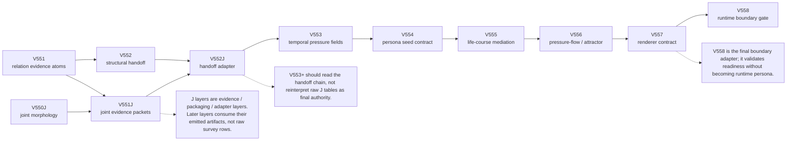

# V552 to V558 Layer Guide

Status: binding synthesis for current layered implementation

This guide is a compact operating reference for the V552 through V558 path.
It does not replace the authoritative contracts, roadmaps, or stop-gates.
It exists to keep the implementation aligned with the current understanding of
what the later layers are for, what they may consume, and what they must not
invent.

## Core principle

Build structural priors, not premature personhood.

The later layers should preserve how survey-derived evidence behaves across
nested social strata, how those strata condition one another, and how the
resulting pressure field can later support runtime persona generation without
forcing every possible ideological or theological detail into the evidence
pipeline.

For the time-comparison side of that work, see
[V553_WAVE_HARMONIZATION_AND_TEMPORAL_VALIDATION_GUIDE.md](/Users/matthewsmith/Desktop/Rawlsing/docs/architecture_control/V553_WAVE_HARMONIZATION_AND_TEMPORAL_VALIDATION_GUIDE.md).

## Dependency chain

## What the nine strata mean

The strata are relational pressure layers, not demographic buckets.
They are stable as a scaffold, but their activation, weight, and relevance are
conditional on respondent position, region, wave, and evidence context.

The nine strata are:

1. Planetary
   - Global capitalism, climate vulnerability, colonial residue, commodity
     dependency, migration regimes, sanctions, development hierarchy, world
     system position.
2. Imperial block
   - US/EU/NATO/Russia/China/Gulf alignment, occupation, proxy war, aid and
     military dependency, geopolitical patronage.
3. Nation state
   - Regime legitimacy, policing, courts, corruption, welfare state, elections,
     citizenship, national identity.
4. Sub-national region
   - Rural/urban split, borderland, capital dominance, regional deprivation,
     internal coloniality, conflict zone, infrastructure unevenness.
5. Sect-ethno-class
   - Class fraction, caste/ethnic/religious minoritization, sectarian position,
     language group, education access, labor-market position.
6. Party/movement
   - Party attachment, union or movement affiliation, militia or religious
     movement proximity, protest orientation, ideological belonging.
7. Neighborhood/household
   - Local security, kin density, neighborhood trust, domestic economy,
     work/school exposure, immediate social surveillance.
8. Family
   - Parent warmth, discipline, gender order, obligation, spouse relation,
     child relation, intergenerational authority, domestic violence where
     available, affective economy.
9. Self
   - Agency, shame, fear, aspiration, faith or meaning posture, defense style,
     attention, psychic residue of structure.

## Absolute horizon

Absolute horizon is an internal moral and meaning pressure layer, not a
demographic label.

It may involve:
- God-talk
- justice
- death
- mercy
- judgment
- vocation
- despair
- hope
- ultimate accountability

It must not be reduced to religion affiliation, religiosity scale, or theology
as a flavor label.

## How the strata are supposed to behave

The correct model is not one fixed strata assignment for every person.
The correct model is:

- the same question can pressure multiple strata
- the same stratum can matter more or less depending on respondent position
- the same demographic slice can sit differently inside different waves and
  regions
- strata can align, conflict, or remain weakly present
- horizon can only be synthesized after lower strata evidence is materially
  present

The implementation should preserve:

- person-to-stratum orientation
- stratum-to-person pressure as a later runtime concern
- conditional strata weights
- strata path
- aggregate projection surfaces
- explicit absences and uncertainties

## What V552 should do

V552 is the structural handoff layer.

It should:
- consume certified and reviewable evidence from upstream
- turn that evidence into structural priors, not a finished persona
- preserve question/facet/driver/stratum/horizon hierarchy
- preserve position conditioning and conditional strata routing
- preserve contradiction summaries and directional evidence where the authority
  supports them
- preserve aggregate pressure backdrops without collapsing them into lived
  person-level pressure

It should not:
- search for explicit ideology as if the evidence were already a worldview
- infer personality from demographics alone
- collapse person-to-stratum and stratum-to-person into one score
- invent horizon from a single item
- treat aggregate projections as lived interiority

## What V553 should do

V553 turns structural priors into time-indexed pressure fields.

It should:
- express how pressures accumulate over time
- preserve contradiction across years or wave intervals
- show what persists, what intensifies, and what remains unresolved
- support recursive developmental modeling without generating biography

It should not:
- invent events that are not supported by the structural field
- erase rupture into smooth continuity
- turn temporal pressure into a life story

## What V554 should do

V554 turns temporal pressure into bounded seed affordances.

It should:
- specify what downstream runtime may seed
- define what is blocked
- carry known absences forward
- keep the person still undefined as a runtime persona

It should not:
- emit a full persona
- infer name, voice, biography, or psychology as a finished object
- treat the seed contract as the person itself

## What V555 should do

V555 models life-course mediation.

It should:
- represent how pressures may be mediated through family, household,
  co-parenting, institutions, church, school, work, and locality
- carry generated mediation as generated, not as survey fact
- preserve the route by which structural priors become more legible in a
  developmental setting

It should not:
- invent actual parent beliefs
- invent actual household history
- convert mediation traces into asserted biography

## What V556 should do

V556 turns mediated pressures into pressure-flow and attractor candidates.

It should:
- model latent dynamics under structural pressure
- allow attractor families to emerge as candidates
- preserve generated psyche provenance
- support the possibility of defiance, collapse, compassion, domination,
  withdrawal, or transformation as dynamically shaped outcomes

It should not:
- assign a survey-derived Enneagram type
- treat a candidate attractor as a fixed person label
- collapse the generated dynamic into a direct evidence claim

## What V557 should do

V557 is the renderer contract.

It should:
- make the output safe for runtime consumption
- preserve traceability and provenance
- separate evidence-constrained material from generated material
- keep raw evidence inaccessible to the renderer

It should not:
- expose raw survey rows as memories
- erase uncertainty
- let runtime exceed the upstream authority chain

## What V558 should do

V558 is the runtime boundary gate.

It should:
- validate the final readiness line before any runtime graft
- confirm governance/authority documents are present
- preserve the distinction between review-ready and runtime-ready
- remain non-persona and non-dialogue

It should not:
- generate runtime persona material
- collapse readiness into narrative
- replace the renderer contract

## The dynamic strata rule

The strata are not all equally present in every case.

For a given person, region, and wave, the system may dynamically emphasize:
- nation state over imperial block
- region over nation state
- sect-ethno-class over party/movement
- family over neighborhood
- self over all other layers when the evidence is chiefly interior

That is the right behavior.
The point is not to fill all boxes.
The point is to generate the correct structural priors for the demographic slice
in question.

## The model of incoherence

The system should be able to preserve real human incoherence:

- partial ideological alignment
- partial alienation
- aspirational identification
- local pragmatism
- contradictory attachments
- uneven education or criticality
- intuitive or unconscious patterning
- time-dependent development under pressure

The goal is not to make people perfectly coherent.
The goal is to make the incoherence structurally intelligible.

## What this guide binds

This guide binds the V552 through V557 implementation to the following
operating commitments:

- preserve structural priors, not premature personhood
- keep strata relational and conditional
- keep horizon downstream and earned
- keep aggregate proxies separate from lived pressure
- keep runtime synthesis distinct from DDM evidence export
- keep uncertainty visible instead of laundering it away
- keep the implementation responsive to wave, region, and demographic slice

## Implementation reminder

If a later layer starts looking for explicit ideological or theological labels
before the relevant structural priors are in place, it is probably drifting.

If a later layer starts behaving like a person generator before the handoff is
complete, it is also drifting.

If a later layer cannot explain which strata it is modeling, what it receives,
what it refuses, and what it emits, it is not ready.
